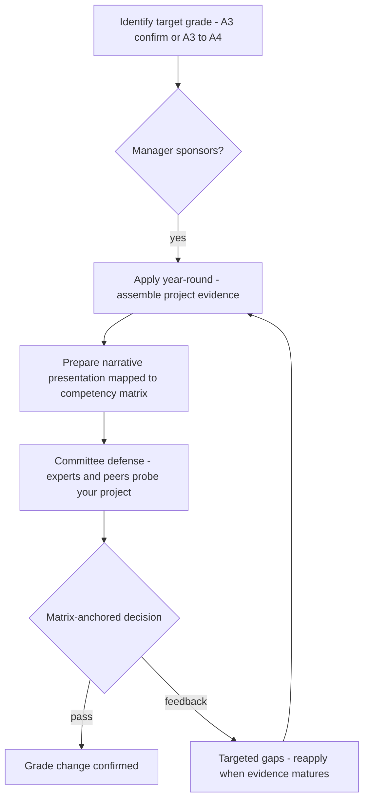

## The EPAM A3 Senior Data Engineer Assessment

You are already inside EPAM. "Assessment" here is not a hiring loop — it is EPAM's formal internal process for evaluating whether an existing employee's demonstrated work justifies a title/grade change (e.g., A3 confirmation or A3→A4 promotion). The currency is not quiz answers: it is a **narrative presentation of your progression**, delivered to a peer/expert committee and scored against the competency matrix ([EPAM careers blog](https://www.epam.com/careers/blog/assessment-at-epam-what-it-means-for-your-career-growth)). Employees still billable on client engagements (~56,600 of ~62,850 staff; [FY2025 results](https://investors.epam.com/news/news-details/2026/EPAM-Reports-Results-for-Fourth-Quarter-and-Full-Year-2025/default.aspx)) — the bar is "your delivered project proves the next grade," not "did you pass a test."

:::glide Glide — From Nomination to Matrix Verdict
1) Pick the target grade :: **A3 confirmation** (defend with ~1 year of delivery evidence) vs **A3→A4** (leadership delta: mentoring, review leadership, workstream direction) — different evidence, same process.
2) Secure manager sponsorship :: Advocacy is a **stated gate** — assessments stall regardless of skill; start the conversation quarters before applying.
3) Apply year-round :: Applications accepted **any time**; many roles add an **annual promotion-eligibility review** on top.
4) Assemble one real project :: Progression narrative anchored to **real delivered work** — decisions owned, not tasks done; resume adjectives read junior.
5) Map to the competency matrix :: Cover every dimension: **engineering depth, architecture (≥2 options per decision), delivery impact, mentoring, English B2+**.
6) Build the defense deck :: Context → Architecture → Impact → Growth → Mentoring; each bullet = one dimension, **one artifact, one number**.
7) Face the committee :: Peer/expert panel probes **one level deeper than your deck** — Spark execution model, Delta MERGE, window functions from your own war stories.
8) Matrix-anchored verdict :: Pass confirms the grade; gaps (e.g. mentoring below the A4 line) loop you back to reapply when evidence matures.
? Why does sponsorship matter when skill already clears the bar? :: Skill clears the bar; **sponsorship and project visibility open the door** — if your manager cannot narrate your impact, the committee never sees your best evidence.
? What is the classic A3→A4 failure mode? :: **A3-grade evidence with an A4 label** — the promotion needs a leadership delta (formal mentoring, review leadership, workstream direction), not more of the same component-level evidence.
? There is no Codility in an internal Assessment — what is judged instead? :: **Actual delivered work**: impact metrics, owned decisions with trade-offs and alternatives, mentored people, progression over time — scored against the matrix from real project examples.
? Why rehearse the deck spoken and timed? :: English **B2+ is scored and gates client staffing**; the defense itself is an English delivery test, so rehearse the hardest follow-ups aloud, not just the slides.
:::

::::diagram assessment-loop.png
:::

### How Internal Assessment Works

Synthesized from the [EPAM careers blog on Assessment](https://www.epam.com/careers/blog/assessment-at-epam-what-it-means-for-your-career-growth), [Built In's EPAM career-growth FAQ](https://builtin.com/company/epam-systems/faq/career-growth-development) (AI-generated summary of employee reviews — directional, not EPAM-approved wording), and a consultant case study confirming matrix-based scoring ([Gyfted/EPAM](https://www.blazejmrozinski.com/projects/epam)):

- **Nomination:** you pick a target title/grade and apply — typically via your line manager, who sponsors the case. Manager advocacy is a stated gate; without it, assessments stall regardless of skill.
- **Evidence assembly:** you compile results and experience into a progression narrative anchored to **real delivered project work** — impact over time, decisions you owned, not resume adjectives.
- **Committee defense:** you present to a peer-review committee of experts; practice/discipline heads run assessments inside their competency area (confirmed for Agile coaching roles; ⚠ DE assessments run by the Data/Engineering practice is inferred by analogy). Committee size, exact rubric values, and retry rules are **not publicly documented** — treat any specifics you hear as local practice, not policy.
- **Decision:** matrix-anchored verdict on the target grade; promotion follows, or structured feedback loops you back to prep. EPAM employees publicly attribute A1→A2→A3 progression to "performance, technical skills and EPAM Assessment" ([example attestation](https://linkedin.com/in/aniket-kumar-singh-3628681a1) — ⚠ individual claim).
- **Cadence:** applications are accepted **year-round**; many roles also have an **annual promotion-eligibility review** on top.



### The EPAM Job Ladder: Where A3 Sits

| Grade | Title | Scope |
|---|---|---|
| A1–A2 | Junior / Engineer | Executes well-defined tasks; needs design review |
| **A3** | **Senior Software Engineer** | **Owns components end-to-end; designs in-system; mentors juniors; client-facing daily** |
| A4 | Lead Engineer | Owns workstream/team; sets technical direction in one project |
| B1 | Solution Architect | Cross-system design; proposals and pre-sales |
| B2–B3 | Senior / Distinguished Architect | Enterprise- and company-level authority |

- Levels.fyi maps A3 to its L3 Senior band ([Levels.fyi — EPAM](https://www.levels.fyi/companies/epam-systems/salaries/software-engineer)); postings bucket as Junior/Middle/Senior/Lead, Senior the largest population ([EPAM Anywhere](https://anywhere.epam.com/)).
- Spec: "design and implement robust, scalable data-driven solutions" across Spark/Databricks/Snowflake, Airflow/ADF, one cloud ([posting](https://careers.epam.com/en/vacancy/senior-data-engineer-blta8a7d487d522334f_en)).

:::tip What A3 means in the room
Highest hands-on grade: you still live-code (that's the A4/B1 premium) but you lose the right to code silently. A brute-force answer narrated well outscores an optimal answer in silence — in committee defense too.
:::

**Use cases:** which assessment is yours

- **A3 confirmation:** you were hired or leveled at A2/A3-pending and must defend the grade with ~1 year of EPAM delivery evidence. Emphasis: consistent end-to-end ownership of components, reliable client-facing delivery, first mentoring traces. Failure mode: presenting tasks done, not decisions owned.
- **A3→A4 promotion:** you hold A3 and target Lead. Emphasis shifts to leadership evidence: formally mentoring, code/design review leadership, setting direction for a workstream ([A4 expectations per senior DE postings](https://careers.epam.com/en/vacancy/senior-data-engineer-with-python-blta05341dab4156e91_en) — mentorship and review leadership are named). Failure mode: A3-grade evidence with an A4 label.

### What Assessors Score: The Competency Matrix

The committee sits on EPAM's **competency matrix**; scoring is matrix-based, not gut-feel ([Gyfted case study](https://www.blazejmrozinski.com/projects/epam)). You are judged on how well your project examples **cover the matrix dimensions for the target grade** — "reflect on their growth… based on real-life examples from their current projects" ([EPAM blog](https://www.epam.com/careers/blog/assessment-at-epam-what-it-means-for-your-career-growth)).

| Matrix dimension | What the committee looks for in your evidence | A3 depth | A4 depth |
|---|---|---|---|
| Engineering depth | Hard technical calls you made and can defend under probing | Owns pipeline/component internals | Sets standards others follow |
| Architecture | Design horizon and trade-off reasoning | In-system pipeline design, ≥2 options per decision | Project/workstream direction |
| Delivery impact | Measurable outcomes: SLA met, cost cut, incident reduced | Component-level, quantified | Team/workstream-level |
| Soft skills & mentoring | Client communication, juniors grown, reviews led | Reviews code, 1–3 juniors | Formally leads, sets standards |
| English | B2+ baseline everywhere — gates client staffing ([posting requirement](https://careers.epam.com/en/vacancy/python-developer-blt8s1jmp09xy42op3x_en); EPAM runs in-house AI English assessment for staff) | Fluent defense of own design | Runs client technical discussions |

⚠ Exact dimension names and rubric weights are internal; the axes above are triangulated from postings, the Gyfted case, and interview-surface reports. Internal DE topic lists are not publicly reported — expect the same technology surface as external loops, focused on *your* project: Spark architecture/optimization, Delta Lake, SQL window functions, cloud services ([aggregated external-loop reports](https://www.reddit.com/r/dataengineersindia/comments/1to1mrw/epam_interview_experience_58_yoe_senior_data)).

```text
Committee scoring sketch (one candidate, target A3->A4)

                 Engineering  Architecture  Delivery  Mentoring  English
Project evidence   ######       #####        ######     ###        #####
Grade line A3      ------       ------       ------     ------     ------
Grade line A4      ########     ########     ########   ########   ########
                              ^ gap: mentoring + project-level direction
Verdict: matrix coverage below A4 line on 2 dimensions -> feedback loop
```

### Internal vs External: What Changes

| Dimension | External hiring loop | Internal Assessment |
|---|---|---|
| Purpose | Grade + project placement at hire | Title/grade change (e.g., A3→A4) of an existing employee |
| Entry test | English MCQs + proctored Codility-style OA ([source](https://www.hackingthecaseinterview.com/pages/epam-interview)) | No OA; evidence-based — narrative presentation of real project work |
| Rounds | Recruiter screen → OA → live tech interviews → managerial round; ~21 days avg | Application via manager → presentation/defense to expert+peer panel; year-round eligibility |
| Evidence judged | Resume line-items, live coding, system design | **Actual delivered work**: project impact, progression over time, matrix coverage |
| Soft skills | ~20-min situational block ([campus blog](https://campus.epam.com/en/blog/528)) | Ongoing visibility, mentorship/leadership on real projects weighed ([Built In FAQ](https://builtin.com/company/epam-systems/faq/career-growth-development)) |
| Gate beyond skill | Offer | Project availability, business demand, manager advocacy — "growth is real but not automatic" |

:::warning The gate nobody codes for
Skill clears the bar; **sponsorship and project visibility** open the door. If your manager cannot narrate your impact or your project has no measurable outcome, the committee never sees your best evidence. Start the advocacy conversation quarters before you intend to apply.
:::

### Building Your Defense

The committee format rewards narrative evidence, not LeetCode. Build everything around **one real project**:

```text
Defense deck skeleton — one project mapped to matrix dimensions

1. Context (2 min)   pipeline scale, SLA, team, your exact role
2. Architecture (5)  end-to-end diagram + the decision you owned
                     "chose Delta over raw Parquet because replay
                      semantics beat 20% storage savings" — trade-off,
                      numbers, alternatives named
3. Impact (3)        delivery metric: freshness 24h -> 5 min,
                     -38% warehouse spend, zero Sev-1 in 2 quarters
4. Growth (3)        A2->A3 delta: what you own now vs then
5. Mentoring (2)     onboarded 2 juniors; review checklist now team norm
6. Probe buffer      appendix: Spark UI screenshots, DAG, cost tables
```

:::info Worked Example
**Project:** CDC ingestion Postgres → Snowflake, ~2k txn/s, 5-min freshness SLA — mapped to matrix dimensions:

- **Architecture decision:** chose Debezium + Kafka + idempotent `MERGE` on PK over nightly batch: consistent initial snapshot + recorded WAL position gives gapless replay; batch files ≥1 min to contain Snowpipe per-file cost (0.5 MB/s ≈ 43 GB/day — sizing math stated unprompted).
- **Impact metric:** freshness SLA 24h→5min sustained 2 quarters; replay-from-checkpoint verified in a game-day exercise; alert on consumer lag > 5 min before the client noticed.
- **Mentoring example:** walked a junior through diagnosing a skew-forced shuffle via `explain()`; their fix shipped; the diagnosis checklist became the team's review item.

Each bullet = one matrix dimension, one artifact, one number. That is what "evidence-based" means to a committee.
:::

Prep plan, ~3–4 weeks part-time:

| Week | Focus | Deliverables |
|---|---|---|
| 1 | Evidence gathering | Pull artifacts from your project: DAGs, metrics dashboards, review threads, incident postmortems; pick the one project with the richest story |
| 2 | Sponsor & matrix mapping | Draft deck per skeleton above; map each slide to a matrix dimension; align narrative with your manager — their summary and yours must match |
| 3 | Fundamentals refresh | Spark execution model, Delta log/MERGE, SQL window functions, cloud service trade-offs — committee probes go one level deeper than your deck ([surface per EPAM reports](https://www.reddit.com/r/dataengineersindia/comments/1oi4yhy/epam_senior_data_engineertechnical_lead_interview)) |
| 4 | English rehearsal | Deliver the deck aloud, recorded, timed; B2+ fluency is scored and gates staffing; rehearse the 5 hardest follow-up questions in English, not just the slides |

### Key Takeaways

- Internal "Assessment" = manager-sponsored, year-round application → narrative presentation of real project work → committee defense scored against the competency matrix; pass confirms the grade, feedback loops you back.
- No Codility, no recruiter loop: the evidence is what you already shipped — impact metrics, owned decisions, mentored people, progression over time.
- Committee mechanics (size, rubric weights, retry rules) are not public; matrix-anchored scoring and manager sponsorship are the confirmed anchors.
- A3 confirmation proves ownership and delivery; A3→A4 needs leadership delta — mentoring, review leadership, workstream direction — not more of the same evidence.
- English B2+ is a standing gate; the defense itself is an English delivery test — rehearse spoken, not written.

### Interview Lens

- Every design answer needs decision drivers with numbers — latency, cost, team skill, lock-in — and ≥2 options per choice; tool loyalty reads junior to a committee the same as to an interviewer.
- Senior tell is breadth plus narration: cover ingestion→storage→modeling→orchestration→governance→cost unprompted, from *your* project's war stories, not hypotheticals.
- Practice the spoken walkthrough of one project until any matrix dimension can be answered with a specific artifact and a number — that single skill is the assessment.
