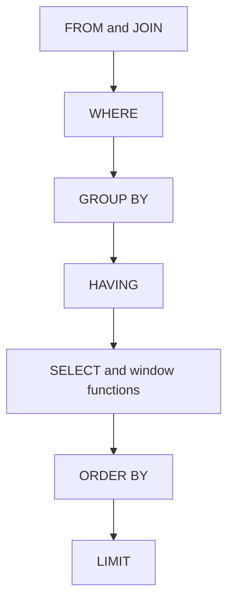

## SQL Deep Dive: The Problems EPAM Actually Asks

EPAM senior DE screens live in SQL mechanics — windows, dedup, grouping traps — and in whether you know how the engine logically executes a query.

:::glide Glide — SQL Execution & Window Playbook
1) FROM and JOIN :: base rows enter; duplicate join keys fan out and silently double sums
2) WHERE :: filters **rows only** — keep it SARGable so partition pruning works
3) GROUP BY and HAVING :: groups form; WHERE can't hold aggregates, HAVING filters groups
4) SELECT + window functions :: one window pass — every row survives, unlike GROUP BY
5) Dedup with ROW_NUMBER :: `PARTITION BY customer_id ORDER BY order_ts DESC, id DESC`, keep `rn = 1` — one scan, deterministic ties, no duplicates
6) QUALIFY variant :: Snowflake and Databricks SQL filter windows natively; OSS Spark needs the subquery
7) Sessionize with LAG :: flag rows where the gap exceeds 30 minutes, running SUM becomes the session id
8) ORDER BY and LIMIT :: aliases and windows finally visible; windows ran *before* this
? Why pick the windowed dedup over the correlated-subquery self-join? :: The self-join re-scans the table per row and returns duplicates on ties; the window does a single scan plus one sort, breaks ties deterministically with `id DESC`, and yields exactly one row per key.
? On scores 100, 100, 90 — what do RANK and DENSE_RANK return? :: RANK gives `1,1,3` (gaps after ties); DENSE_RANK gives `1,1,2` (no gaps) — pick per whether ties should consume ranks.
? A LEFT JOIN plus WHERE on the right table's column returns more rows than the left table — what happened? :: The WHERE silently converted it to an INNER JOIN, and duplicate join keys caused row fan-out; move the condition into ON.
? Why does `WHERE CAST(dt AS STRING) = '2024-01-01'` full-scan? :: Wrapping the filtered column in a function breaks SARGability, so the engine can't prune partitions — compare `dt = DATE '2024-01-01'`.
:::
::::diagram sql-pipeline.png
:::

### Window Functions

Window functions compute a value per row over a related set of rows **without collapsing them** — the core difference from GROUP BY. `PARTITION BY` defines the group, `ORDER BY` defines the frame; windows run *after* GROUP BY/HAVING, *before* ORDER BY ([Postgres tutorial](https://www.postgresql.org/docs/current/tutorial-window.html)).

- Running total: `SUM(amount) OVER (ORDER BY dt ROWS UNBOUNDED PRECEDING)` — every row survives, unlike GROUP BY.
- RANK vs DENSE_RANK on scores `100,100,90`: RANK → `1,1,3`; DENSE_RANK → `1,1,2`.

| Function | Returns | Typical use |
|---|---|---|
| `ROW_NUMBER()` | 1,2,3 — unique per partition | dedup, latest record per key |
| `RANK()` / `DENSE_RANK()` | ties share rank; gaps vs no gaps: 1,1,3 vs 1,1,2 | rankings, tiers, percentiles |
| `LAG(col)` / `LEAD(col)` | previous / next row value | deltas, session starts |

### The Classic Problems

:::info Worked Example
Dedup — latest order per customer. Naive self-join: the correlated subquery re-scans the table per row, and ties return duplicates.

```sql
SELECT o.* FROM orders o WHERE o.order_ts =
  (SELECT MAX(order_ts) FROM orders i WHERE i.customer_id = o.customer_id);
```

Windowed: one scan plus one sort, deterministic tie-break, exactly one row per key even on ties.

```sql
SELECT * FROM (SELECT *, ROW_NUMBER() OVER (PARTITION BY customer_id
         ORDER BY order_ts DESC, id DESC) AS rn FROM orders) t
WHERE rn = 1;
```

The window wins because it does a single pass instead of a correlated re-scan per row, makes ties deterministic, and never duplicates rows. Snowflake and Databricks SQL collapse it further with QUALIFY (OSS Spark has no QUALIFY):

```sql
SELECT * FROM orders QUALIFY ROW_NUMBER() OVER (PARTITION BY customer_id
     ORDER BY order_ts DESC, id DESC) = 1;
```
:::

**Use cases:**

- Dedup: latest record per key from append-only sources.
- Sessionization: gap-based sessions from clickstream timestamps.
- Cumulative KPIs: running totals, month-over-month deltas via LAG.
- Top-N dashboards: top 3 products per region (`ROW_NUMBER ... WHERE rn <= N`).

```sql
-- increment a counter at every >30min gap; running sum = session id
SELECT user_id, ts,
       SUM(CASE WHEN ts - LAG(ts) OVER (PARTITION BY user_id ORDER BY ts) > INTERVAL 30 MINUTE THEN 1 ELSE 0 END)
         OVER (PARTITION BY user_id ORDER BY ts) AS session_id
FROM clicks;
```

GROUP BY traps:

- `WHERE` filters rows **before** grouping; `HAVING` filters groups after — aggregates are illegal in WHERE.
- `COUNT(col)` skips NULLs, `COUNT(*)` counts rows, NULL is its own group; every SELECT column must be grouped or aggregated (Spark enforces strictly; Snowflake offers `ANY_VALUE`).

Join anti-patterns:

- LEFT JOIN plus WHERE on the right table's column silently becomes an INNER JOIN — move the condition into ON.
- Duplicate join keys cause row fan-out (a 1.1x key duplication silently doubles revenue sums); non-equi and comma joins degrade to nested loops or cross joins.

CTE vs subquery vs temp table:

| Option | Materialized | Reuse scope | Use when |
|---|---|---|---|
| CTE | No — inlined | one query | readability, recursion |
| Derived table | No | one query | single-use filter or agg |
| Temp table | Yes — written to storage | session or job | heavy multi-step pipelines |

Snowflake CTEs recompute per reference unless declared `AS MATERIALIZED`; Spark inlines them and may recompute — pin big intermediates with `CACHE TABLE` ([Spark CTE docs](https://spark.apache.org/docs/latest/sql-ref-syntax-qry-select-cte.html)).

### Query Optimization



```text
Stage                  Sees
FROM / JOIN            base rows
WHERE                  rows only
GROUP BY / HAVING      groups only
SELECT + window fns    aliases + one window pass
ORDER BY / LIMIT       aliases and windows visible
```

- SARGable predicates — never wrap the filtered column in a function:

```sql
WHERE dt = DATE '2024-01-01'              -- prunes partitions
WHERE CAST(dt AS STRING) = '2024-01-01'   -- full scan
```

- Partition pruning: filter the partition column (`dt`, `event_date`) early — Snowflake micro-partitions prune on min/max metadata ([docs](https://docs.snowflake.com/en/user-guide/tables-clustering-micropartitions)).
- Pre-aggregation and join order: aggregate before the join (shuffle 1M grouped rows, not 100M facts), small side on the build side, broadcast under `spark.sql.autoBroadcastJoinThreshold` ([tuning guide](https://spark.apache.org/docs/latest/sql-performance-tuning.html)).
- Statistics: stale stats mean wrong join strategy — `ANALYZE TABLE t COMPUTE STATISTICS` in Spark ([docs](https://spark.apache.org/docs/latest/sql-ref-syntax-aux-analyze-table.html)).
- `SELECT *` hurts columnar warehouses: reads every column, defeats column pruning, and breaks when schemas evolve.

### Dialect Differences

| Feature | Snowflake | Spark SQL / Databricks |
|---|---|---|
| Filter rows by window | `QUALIFY` native ([docs](https://docs.snowflake.com/en/sql-reference/constructs/qualify)) | OSS: absent — subquery; Databricks SQL has QUALIFY |
| CTE materialization | `WITH t AS MATERIALIZED` opt-in | inlined; `CACHE TABLE` to pin |
| Temp storage | `CREATE TEMPORARY TABLE` — session data | `CREATE TEMP VIEW` — metadata only, no data |

**Practice questions (reported style):**

1. Find duplicate rows and keep only the latest per customer_id.
2. Return the top 3 products by revenue for every region.
3. Sessionize a clickstream with a 30-minute inactivity cutoff; count sessions per user per day.
4. Compute cumulative revenue by month and the change vs the prior month (LAG).
5. Why does this LEFT JOIN return more rows than the left table?

### Key Takeaways

- Window functions solve dedup, top-N, running totals, and sessionization in one scan — prefer them over self-joins.
- `ROW_NUMBER` for exact dedup; `RANK`/`DENSE_RANK` when ties matter; LAG/LEAD for gaps-and-islands.
- WHERE filters rows, HAVING filters groups, windows filter via QUALIFY or a subquery — know which stage each lives in.
- SARGable predicates, early partition filters, and pre-aggregation are the levers to name when asked "why is this slow"; `SELECT *` on columnar stores is a cost, pruning, and schema-evolution smell.

### Interview Lens

- Expect a live "latest record per key" — answer with ROW_NUMBER and volunteer the QUALIFY variant unprompted.
- Tie-breaks are the trap: mention `ORDER BY ..., id DESC` before the interviewer does.
- Walk the logical execution order — pushdown, pruning, shuffle size — instead of reaching for "add an index".
