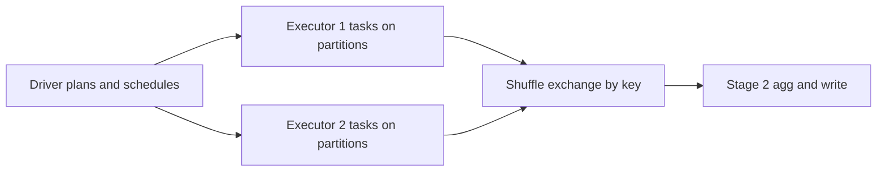

## Python & PySpark: Coding Patterns

The live-coding round tests whether you can write **correct data transformations fast** — first in plain Python (logic), then in PySpark (scale). Interviewers care about memory discipline, join/groupBy fluency, and knowing *where your data lives*.
:::scenario Scenario — Where the Spark Job Dies
@start Driver plans, executors run :: pandas is one eager process; Spark builds a **lazy DAG** and runs tasks on partitions across executor JVMs.
? Driver OOM => @driveroom |success
? Executor OOM => @executoroom |fail
@driveroom Driver OOM :: `collect()`, `toPandas()`, oversized `take()` land the full result in driver RAM — nothing big crosses to the driver.
-> aggregate on executors instead => @udf
@executoroom Executor OOM is data shape :: one giant partition (**skew**), `repartition(1)` before a heavy stage, or `cache()` without MEMORY_AND_DISK.
? UI shows one straggler task => @skew |success
? Memory pressure everywhere => @knobs |fail
@skew Diagnose before fixing :: `groupBy(col).count().orderBy(desc("count"))` or the Spark UI — 199 tasks in 2 min, one straggler in 38 min = hot key.
? Hot key confirmed => @salt |success
? No single hot key => @knobs |fail
@salt Salt the hot key, re-aggregate :: a random salt splits 400 M rows into 16 sub-groups; stage 2 sums only 16 partials per key — tasks finish together.
-> balanced stages => @knobs
@udf Climb the UDF ladder last :: native functions ride Tungsten at 1×; pandas UDFs amortize per **Arrow batch** (~2–5×); row-wise Python UDFs pay ~10×+.
? Results wrong, not just slow => @order |success
? Correct but slow => @knobs |fail
@order Wrong results = row order :: partitions guarantee no order — window frames need explicit `orderBy`, nondeterministic UDFs break re-execution.
-> deterministic rewrite => @knobs
@knobs Cheap knobs first :: `repartition(n, col)` shuffles and balances; `coalesce(n)` skips shuffle but can leave skew; cache only when reused ≥2×.
:::

::::diagram spark-runtime.png
:::

### Python Patterns for Data Work


```python
from collections import Counter, defaultdict

# 1. Grouping: defaultdict | 2. Counting: Counter
by_user = defaultdict(list)
for ev in events: by_user[ev["uid"]].append(ev["ts"])
Counter(ev["code"] for ev in events).most_common(3)

sorted(rows, key=lambda r: (-r["score"], r["ts"]))   # 3. multi-field key

def read_large(path):   # 4. generator: streams file at O(1) RAM
    with open(path) as f:
        for line in f: yield parse(line)
```

**Memory rule:** dicts/sets are O(n) in RAM; a generator is O(1). If the interviewer says "file won't fit in memory," the expected answer is **yield, don't return**.

**Use cases:**
- Plain Python suffices → files < ~1 GB, one-off scripts, unit-test fixtures, interview warm-ups.
- Need Spark → >10 GB, multi-file/Parquet input, joins across datasets, cluster-era SLAs, or the question mentions "distributed".

### PySpark: Driver vs Executors


| Dimension | pandas | PySpark |
|---|---|---|
| Where data sits | One process, driver RAM | Partitions across executor JVMs |
| Execution | Eager, row-by-row | Lazy plan → optimized → distributed stages |
| Order of rows | Stable | **Not guaranteed** across partitions |
| Scaling lever | Bigger machine | More executors/partitions |



```text
        DRIVER (1 JVM process)
        - builds DAG, schedules tasks
        - collect()/toPandas() RESULTS land HERE   <-- OOM source
        +---------------------------+
EXEC 1  | partition rows (columnar) |  shuffle write/read
EXEC 2  | partition rows            |  agg state, sort buffers
EXEC N  | partition rows            |  <-- groupBy/join OOM source
        +---------------------------+
```

**OOM causes, by where it hurts:**
- **Driver OOM** → `collect()`, `toPandas()`, broadcasting a huge table, `df.count()` is fine but `df.take(10**9)` is not.
- **Executor OOM** → one giant partition (skew!), `repartition(1)` before a heavy stage, cache without `MEMORY_AND_DISK`, wide shuffle on a hot key.

### The 10 Patterns That Cover Most Screens

1. **Dedupe** — `dropDuplicates(["uid", "event_id"])` or row-number for "latest wins".
2. **Latest record per key** — window `row_number().over(W.orderBy(desc("ts")))` then `filter("rn == 1")`.
3. **Top-k per group** — `dense_rank()`/`row_number()` over `partitionBy(g)`, filter `<= k`.
4. **Sessionize** — lag the previous event, diff > 30 min → new session flag, cumulative `sum(flag)` → session id.
5. **Explode nested data** — `F.explode("events")` → one row per element; inverse is `collect_list`.
6. **Joins** — small×large → `broadcast(small)`; large×large → equi-join and let AQE skew-handle.
7. **Agg dictionary** — `groupBy("k").agg(count, sum, approx_count_distinct, F.collect_set(...))`.
8. **Conditional logic** — `F.when(...).otherwise(...)` chains; never Python UDF for this.
9. **Schema hygiene** — read Parquet/Delta with explicit schema; parse timestamps via `to_timestamp`.
10. **Write idempotently** — `mode("overwrite").partitionBy("dt")` or Delta `MERGE` for upserts.


1. **Dedupe events:** keep the latest of duplicate `(user_id, event_id)` pairs — window or `dropDuplicates` trade-off?
2. **Sessionize logs:** gap-of-30-min sessions per user → session id + event count + duration.
3. **Top-3 products per category** by revenue, ties allowed (`dense_rank` vs `row_number`).
4. **Clickstream funnels:** join impressions↔clicks with time bounds (`between`) without exploding duplicates.

### PySpark Performance


| Function type | Data path | Relative cost | Use when |
|---|---|---|---|
| Native (`F.sum`, `F.when`) | Columnar, Tungsten codegen | 1× (baseline) | Always first choice |
| pandas UDF (`@pandas_udf`) | Arrow batches, vectorized | ~2–5× slower | Custom logic, NumPy/scikit ops |
| Python UDF (`@udf`) | Row-wise, pickle ↔ CPython | ~10×+ slower, single-threaded | Last resort only |

Every Python UDF row pays: JVM → serialized bytes → Python process → back. Pandas UDFs amortize it per **Arrow batch** ([docs](https://spark.apache.org/docs/latest/api/python/user_guide/arrow_pandas_udfs.html)).

**Partitioning knobs:**
- `repartition(n, col)` full shuffle, balances sizes; `coalesce(n)` no shuffle, merges — cheap but can leave skew.
- Check skew via `df.groupBy(col).count().orderBy(desc("count"))` or the Spark UI (one long task).

**Caching:** `persist(StorageLevel.MEMORY_AND_DISK)` only when a DF is reused ≥2×; then `unpersist()`. Blind `.cache()` is a memory leak with extra steps.

**Delta/Parquet I/O** — columnar + predicate pushdown means read only needed columns ([Parquet](https://spark.apache.org/docs/latest/sql-data-sources-parquet.html)); Delta adds ACID + `MERGE` ([Delta](https://docs.delta.io/latest/delta-intro.html)):

```python
(df.write.mode("overwrite").option("mergeSchema", "true")
   .partitionBy("dt").format("delta").save(path))
```

:::info Worked Example — Fixing a Skewed groupBy
Stats: 1 B click rows, `groupBy("user_id")` on 200 executors. One bot account owns 400 M rows (40%). Spark UI: 199 tasks finish in ~2 min, task 137 runs **38 min**, then executor OOM — the hot key's partition must hold 400 M partial aggregates in one task's memory.

```python
from pyspark.sql import functions as F

N = 16  # salt buckets
salted = (df.withColumn("salt", (F.rand() * N).cast("int")))
stage1 = (salted.groupBy("user_id", "salt")
          .agg(F.count("*").alias("c"), F.sum("amt").alias("amt")))
result = (stage1.groupBy("user_id")
          .agg(F.sum("c").alias("clicks"), F.sum("amt").alias("revenue")))
```

Why it works: adding `salt` splits the hot key into 16 sub-groups, so the 400 M-row partition becomes 16 × 25 M — now ~20× under the pressure point, all tasks finish together. Stage 2 aggregates only 16 partial rows per key: trivially cheap. Same trick for skew **joins**: salt the big side, replicate the small side across salt values. For skewed joins specifically, also know `df.hint("skew", "user_id")` (Databricks) and AQE's automatic skew join split (`spark.sql.adaptive.skewJoin.enabled`, [tuning guide](https://spark.apache.org/docs/latest/sql-performance-tuning.html)).
:::

**Use cases:**
- AQE on (default 3.2+) handles most skew/join surprises; hand-salt when AQE is off or skew is known at design time.

### Key Takeaways

- Plain Python questions probe **memory discipline** (generators, `Counter`, `sorted(key=)`) — Spark questions probe **data locality** (nothing big crosses to the driver).
- `collect()`/`toPandas()` = driver OOM; skew + `repartition(1)` + careless `cache()` = executor OOM — name all three when asked "why did the job die?"
- Native functions > pandas UDFs > Python UDFs; the Python-UDF tax is per-row serialization into CPython ([UDF guide](https://spark.apache.org/docs/latest/api/python/user_guide/python_udf.html)).
- Windows solve "latest per key / top-k per group / sessionize" — three of the most common screens in one API.
- Skewed aggregation: split the hot key with a salt (two-stage agg), or let AQE split skewed partitions; verify with the Spark UI, not vibes.

### Interview Lens

- "Job is slow with one straggler task" → skew: show the `groupBy().count().orderBy(desc)` diagnostic, then salt or enable AQE skew join.
- "pandas code works but Spark gives wrong results" → row order isn't guaranteed; window frames need explicit `orderBy`, and nondeterministic UDFs break re-execution.
- "When would you not use Spark?" → under ~10 GB, single machine: Python/pandas is faster to write and run; Spark's cost model starts at distributed shuffle.
