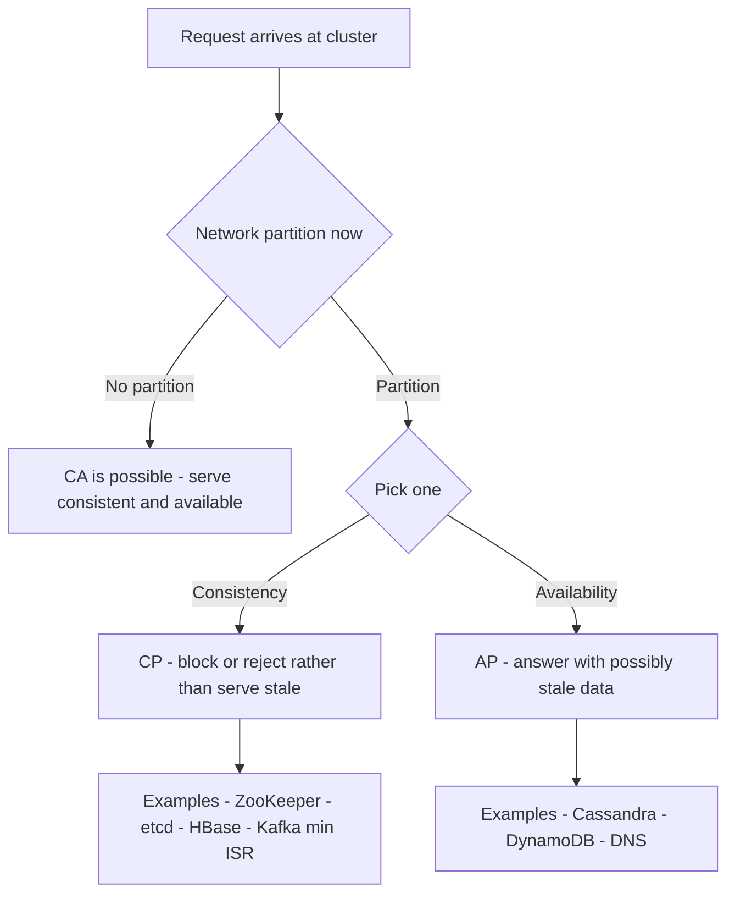

## Distributed Systems Fundamentals


:::tldr
- CAP forces the C-vs-A choice only under a network partition: CP refuses stale answers (ZooKeeper, etcd), AP serves possibly stale (Cassandra, DynamoDB).
- Quorum rule: `R + W > N` forces read/write overlap; `W > N/2` prevents split-brain.
- N=5 math: W=3/R=3 → 99.1% both paths; W=1/R=5 → ~99.999% writes but 59.0% reads.
- Retries are mandatory → at-least-once delivery → duplicates guaranteed; idempotency keys, dedup tables, upserts make replays no-ops.
- "Exactly-once" is effectively-once end-to-end: idempotent producer + transactional offsets + a sink that participates in commit.
- Wall clocks lie across machines — order with event time + watermarks; LWW silently discards concurrent updates.
- 2PC is atomic but blocking (crashed coordinator holds locks); sagas chain local transactions with compensations.
:::

Interviewers rarely say "CAP theorem" — they test it by asking why your Kafka topic has 3 replicas with `min.insync.replicas=2`, whether a retried Spark job double-counts, or why Snowflake loads can safely re-run.

:::scenario Scenario — The Quorum Decision
@start A partition occurs :: CAP only forces a choice **under partition** — before that, CA is coherent and you get both C and A.
? CP — refuse stale answers => @cp |success
? AP — serve possibly stale => @ap |fail
@cp CP: consistency over availability :: CP blocks or rejects rather than serve stale — ZooKeeper, etcd, HBase; Kafka `min.insync.replicas=2` leans here.
-> enforce the write quorum => @quorum
@ap AP: availability over consistency :: AP answers with possibly stale data — Cassandra, DynamoDB, DNS; staleness is handled at the app level.
-> still size the overlap => @quorum
@quorum Apply the quorum rule :: `R + W > N` forces read/write overlap so reads see the newest value; `W > N/2` prevents split-brain.
? Size for writes => @w1 |success
? Balanced quorum => @w3 |fail
@w1 W=1/R=5 on N=5 :: any node accepts writes (~99.999% availability, lowest latency) but reads need all 5 — only ~59.0% read availability.
-> rarely-read telemetry only => @retries
@w3 W=3/R=3 on N=5 :: 99.1% availability on both paths; `acks=all` + `min.insync.replicas=2` is this posture, CP-leaning over the ISR.
-> duplicates still coming => @retries
@retries Accept retries :: retries are mandatory, so delivery is **at-least-once** and duplicates are guaranteed, not exceptional.
-> make replays no-ops => @idempotent
@idempotent Make replays harmless :: idempotency keys, dedup tables, upserts and transactional offsets turn duplicate delivery into no-ops.
? Concurrent updates in flight => @lww |success
-> otherwise => @eventtime
@lww Quorums don't stop LWW loss :: last-write-wins silently discards concurrent updates — causal ordering (vector clocks) and event time matter too.
-> keep causal order => @eventtime
@eventtime Order with event time :: wall clocks lie across machines — windows close deterministically only via **event time + watermarks**.
-> next partition hits => @start
:::

::::diagram quorum-replication.png
:::
### CAP & the Consistency Spectrum

- **CAP, read correctly:** only when a network *partition* occurs must you choose — **CP** (refuse stale answers, sacrifice availability) or **AP** (serve possibly stale data, sacrifice consistency). "CA" is only coherent for non-distributed systems with no partitions ([CAP theorem](https://en.wikipedia.org/wiki/CAP_theorem)).
- "C" here means linearizability ([Gilbert–Lynch proof](https://en.wikipedia.org/wiki/CAP_theorem)); the practical spectrum from [Jepsen](https://jepsen.io/consistency) is: strong → sequential → causal → eventual.
- **Read-your-writes** is the pragmatic middle users actually need: a session sees its own writes without global coordination.
- ACID vs BASE ([Vogels, Eventually-Consistent](https://www.allthingsdistributed.com/2008/12/eventually_consistent.html)):

| Model | Core promise | Cost |
|---|---|---|
| **ACID** | Atomic, Consistent, Isolated, Durable per transaction | Locks + coordination + latency |
| **BASE** | Basically Available, Soft state, Eventually consistent | Stale reads, app-level conflict handling |

| Consistency level | Guarantee | Tools that offer it |
|---|---|---|
| Linearizable | Every read sees latest committed write | ZooKeeper, etcd, Spanner |
| Sequential | Per-partition/client order kept, no cross-client causality | Kafka per-partition ordering |
| Causal / read-your-writes | See effects of causes you observed | DynamoDB strongly consistent reads, MongoDB causal sessions |
| Eventual | Replicas converge when writes stop | Cassandra ONE (tunable), Redis replicas, DynamoDB default reads |



### Replication & Partitioning

- **Leader–follower replication:** *sync* (follower acks before commit — no loss, higher latency) vs *async* (fast, but failover loses recent writes and lagging followers serve stale reads). Semi-sync is the middle ground.
- **Quorum rule:** `R + W > N` forces read and write sets to overlap; `W > N/2` prevents two write quorums (split-brain).

```text
Quorum: N=5 replicas, W=3 writers, R=3 readers  ->  R+W=6 > 5

  write W=3              read R=3            forced overlap
 +----+----+----+       +----+----+----+
 | R1 | R2 | R3 |       | R1 | R4 | R5 |     R1 sits in both sets,
 +----+----+----+       +----+----+----+     so the reader always
                                              sees the newest value
```

:::info Worked Example
Quorum sizing on N=5 replicas at 90% node uptime:

- **W=3, R=3:** write availability = P(≥3 of 5 up) = 10·0.9³·0.1² + 5·0.9⁴·0.1 + 0.9⁵ = **99.1%**; read availability identical. R+W=6>5 → every read sees the latest acknowledged write. Tolerates 2 failures on both paths.
- **W=1, R=5:** write availability = 1 − 0.1⁵ ≈ **99.999%** (any single node accepts, lowest latency); read availability = 0.9⁵ = **59.0%** — reads need all 5 nodes, but each read is maximally fresh.
- **Decision:** W=3/R=3 for balanced OLTP; W=1/R=5 only for write-heavy, rarely-read telemetry where a failed read can simply be retried.
:::

- **Hash vs range partitioning:** hash spreads load uniformly but kills range scans; range is scan-friendly but hot-spots on monotonically increasing keys (timestamps, IDs). Fix hot keys by salting or shard splitting.
- **Rebalancing:** `hash(key) mod N` moves nearly everything when N changes; consistent hashing or many-fixed-partitions → few assignments move (Kafka's model).
- **Consensus in one breath:** Raft/Paxos make a cluster agree on one ordered log despite crashes — the engine behind leader election and metadata ([Raft](https://raft.github.io/)): Kafka KRaft controllers, Flink HA via ZooKeeper, etcd, HDFS QJM.

### Idempotency & Exactly-Once Myths

- Retries are mandatory in distributed systems → delivery is **at-least-once** → duplicates are guaranteed, not exceptional.
- **Idempotency** makes replays harmless: same operation applied twice = same result. Mechanisms: idempotency keys, dedup tables, MERGE/upsert keyed on a natural ID, storing offsets in the same transaction as results.
- "Exactly-once" is **effectively-once end-to-end**: Kafka EOS = idempotent producer (PID + per-partition sequence numbers) + transactional offsets ([Kafka semantics](https://kafka.apache.org/documentation/#semantics)); the sink must participate — e.g., an Iceberg sink committing on Spark checkpoints.
- No system executes a side effect literally once; it guarantees the *observable effect* happens once via dedup + atomic commit.

### Time, Clocks & Event Ordering

- Wall clocks drift (NTP skew, leap seconds) — never order business events with `now()` across machines.
- **LWW dangers:** last-write-wins silently discards concurrent updates — data loss disguised as conflict resolution.
- **Vector clocks in one line:** per-node counters that detect causality and concurrency without a global clock (Dynamo, Riak).
- Hence stream processing runs on **event time** (record timestamp) + **watermarks** ("no earlier events expected") so windows close deterministically despite disorder ([Flink event time](https://nightlies.apache.org/flink/flink-docs-stable/docs/concepts/stateful-stream-processing/)).

### Transactions, Backpressure & the Fallacies

- **2PC:** coordinator prepares, then commits all participants — atomic but **blocking**: a coordinator crash leaves locks held. Fine inside one cluster (Flink two-phase-commit sinks), poor across services.
- **Saga:** chain of local transactions, each with a compensating transaction on failure — trades atomicity for availability; the microservices default over cross-service 2PC.
- **Backpressure:** consumers slower than producers fill unbounded buffers until OOM. Flow control = bounded queues, credit-based transfer (Flink), pull-based consumption (Kafka), rate limits (Spark `maxOffsetsPerTrigger`).
- **Fallacies of distributed computing:** the network is reliable, latency is zero, bandwidth is infinite, the network is secure, topology doesn't change, there is one admin, transport cost is zero, the network is homogeneous. Every timeout, retry policy, and buffer bound exists because these are false.

### Where This Shows Up

**Use cases:**
- **CAP:** Kafka's `unclean.leader.election.enable` is an explicit CP-vs-AP switch; Iceberg commits use optimistic concurrency on the metadata pointer, serialized by catalog CAS ([Iceberg spec](https://iceberg.apache.org/spec/)).
- **Replication/quorum:** `acks=all` + `min.insync.replicas` ≈ write quorum over the ISR; read from followers trades freshness for locality.
- **Partitioning:** Kafka partition keys, Spark hash-shuffle skew, Iceberg bucket transforms + partition evolution, Snowflake clustering keys (range-style micro-partitions).
- **Idempotency:** Kafka idempotent producer; Spark `foreachBatch` + MERGE; Snowflake COPY skips already-loaded files for 64 days ([docs](https://docs.snowflake.com/en/user-guide/data-load-considerations-load)); Iceberg MERGE makes replays no-ops.
- **Event time:** Spark Structured Streaming / Flink watermarks; Kafka record timestamps (`CreateTime` vs `LogAppendTime`).
- **Consensus:** Kafka KRaft replaced ZooKeeper with a Raft quorum of controllers; Flink HA elects the JobManager via ZooKeeper.

:::tip Go Deeper — DDIA 2nd Edition (Mar 2026)
This section maps almost 1:1 to [DDIA 2e](https://martin.kleppmann.com/2026/03/24/designing-data-intensive-applications-2e.html) (Kleppmann & Riccomini): ch6 Replication, ch7 Sharding, ch8 Transactions, ch9 The Trouble with Distributed Systems, ch10 Consistency & Consensus. 2e adds cloud/object-store-native framing and renames Partitioning→Sharding. Per-chapter further-reading lists: [ept/ddia2-references](https://github.com/ept/ddia2-references). Free ch1+2+9 excerpt via [ScyllaDB](https://lp.scylladb.com/designing-data-intensive-apps-book-offer).
:::

:::cards
Q: When does CAP actually force a choice? :: Only during a network partition — before that you get both consistency and availability.
Q: State the quorum rule and what it guarantees. :: R + W > N forces read/write overlap so reads see the newest write; W > N/2 prevents split-brain.
Q: Availability of W=3/R=3 vs W=1/R=5 on N=5? :: 99.1% on both paths vs ~99.999% writes and 59.0% reads.
Q: Why are duplicate deliveries guaranteed? :: Retries are mandatory, so delivery is at-least-once — duplicates are normal, not exceptional.
Q: What does "exactly-once" actually mean? :: Effectively-once end-to-end: idempotent producer, transactional offsets, and a sink participating in commit.
Q: Why do windows close on event time + watermarks? :: Wall clocks lie across machines; event time plus watermarks make closes deterministic despite disorder.
Q: Why is 2PC a poor fit across services? :: It blocks — a crashed coordinator leaves locks held; use sagas with compensating transactions.
:::

### Key Takeaways

- Under partition you pick C or A explicitly — every distributed store answers this whether you choose or not.
- `R + W > N` is the dial trading read/write availability and latency against freshness.
- Design every consumer and sink to be safe when it runs twice — because retries guarantee it will.
- Event time + watermarks exist because wall clocks lie across machines.
- "Exactly-once" = at-least-once delivery + idempotent, transactional sinks — never a transport guarantee alone.

### Interview Lens

- Asked "is Kafka CP or AP?": answer it's tunable per topic — quote `min.insync.replicas` and unclean leader election as the two knobs.
- Volunteer the quorum math (W=3/R=3 vs W=1/R=5) when replication factor comes up — it shows reasoning, not recitation.
- Map any "what if the job crashes mid-run?" question to idempotency + checkpointing, never to "it probably won't happen".
