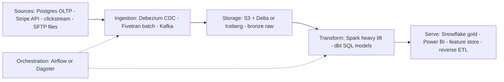

## Data Platform Architecture

A data platform moves data from operational systems to analytical consumers reliably and on time; interviews ask you to draw it, defend each layer boundary, and match modeling to workload.

:::glide Glide — Source to Gold
1) Sources → ingestion :: Move data with **no business logic** — batch extract, CDC stream, or queue; first decisions are pull vs push, full vs incremental.
2) Bronze lands raw :: Immutable append-only copy plus ingest metadata is your **replay insurance** — never edited downstream.
3) Silver validates :: Deduplicated, typed, conformed; the quality gate sends failures to **quarantine** so bad data never poisons gold.
4) Gold serves :: Dimensional models and aggregates for BI/ML — warehouse tables, dashboards, features, reverse-ETL.
5) Declare the grain :: "One row per order line" — model the *business process*, not the source system; grain is the #1 modeling question.
6) Pin facts with SCD2 :: The surrogate FK pins each fact to the dimension version true at event time — without it there is **no as-of join**.
7) Contract the interface :: Versioned, machine-enforceable producer→consumer agreements catch renames at **producer build time**, not as NULLs in gold weeks later.
8) Run the spine :: Orchestration, catalog, observability, security cut across every layer — mention them **unprompted**.
? Why log-based CDC over polling `updated_at`? :: Polling misses hard deletes and untouched rows; log-based (binlog/WAL → Debezium → Kafka) has minimal source overhead, captures deletes, seconds latency. Triggers slow every write inline — legacy-only red flag.
? When do you skip a medallion layer? :: Where no trust boundary exists — teams making all three copies of every dataset get blank tables and tripled storage.
? Why does SCD2 need a surrogate key, not just valid dates? :: The fact's FK pins the row to the version true at event time; re-keying facts later is a full rewrite — the MERGE must run in one transaction or a crash leaves no current row.
? Star, Data Vault, or OBT? :: Star for BI aggregations by conformed dimensions; Data Vault for regulated multi-source integration with full attribute history; OBT for one consumer scanning whole rows where joins dominate latency.
:::

::::diagram platform-layers.png
:::

### Layered Reference Architecture



- **Sources + ingestion** — OLTP DBs, SaaS APIs, events, files; moved with no business logic via batch extract (Fivetran), CDC stream (Debezium), or queue. First choices: pull vs push, full vs incremental.
- **Storage** — immutable append-only raw copy (bronze); your replay insurance, never edited downstream.
- **Transform + serve** — clean/conform/aggregate SQL-first (dbt, Spark SQL); then warehouse tables, BI, ML features, reverse-ETL.
- **Cross-cutting spine** — orchestration, catalog, observability, security. Mention unprompted.

**OLTP vs OLAP** — incompatible workloads force two systems; CDC is the bridge between them.

| Dimension | OLTP | OLAP |
|---|---|---|
| Layout | Row-oriented, 3NF, ACID, point CRUD | Columnar, denormalized, big scans |
| Examples | PostgreSQL, MySQL, Oracle | Snowflake, BigQuery, Databricks, ClickHouse |

**CDC** ([Debezium](https://debezium.io/blog/2018/07/19/advantages-of-log-based-change-data-capture)) — log-based (binlog/WAL → Debezium → Kafka): minimal source overhead, captures hard deletes, seconds latency — the default. Query polling on `updated_at`: misses deletes and untouched rows; fine for APIs/files. Triggers: slow every write inline; legacy-only red flag.

### Medallion: Bronze / Silver / Gold

Databricks' quality-tiered lakehouse pattern ([Databricks](https://www.databricks.com/blog/what-is-medallion-architecture)):

```text
sources        BRONZE          SILVER            GOLD
┌─────────┐    ┌─────────┐    ┌───────────┐     ┌───────────┐
│ CDC     │    │ raw_    │    │ customers │     │ fct_sales │
│ events  ├───▶│ orders  ├───▶│ orders    │────▶│ dim_prod  │
│ files   │ app│ (Delta) │ded │ conformed │ mod │ daily     │
└─────────┘    └─────────┘    └────┬──────┘     └───────────┘
raw append     replayable    quality gate ──▶ quarantine
```

- **Bronze → Silver → Gold** — exact raw copy + ingest metadata (replayable) → deduplicated, typed, validated, conformed keys → dimensional models and aggregates for BI/ML.

:::tip Keep the invariant, skip the ritual
Defensible invariant: raw immutable → validated → curated, quality gates between layers. Critics ([Data Engineering Weekly](https://www.dataengineeringweekly.com/p/revisiting-medallion-architecture)) call it repackaged staging→marts; teams creating all three copies of every dataset get blank tables and tripled storage. Skip layers where no trust boundary exists.
:::

:::warning Vague silver is folder naming
Without per-layer contracts — schema, freshness SLO, named owner — "silver" means OBT dump in one team, conformed model in another. Enforce gates (dbt tests, Delta expectations) at each boundary or the metaphor buys nothing.
:::

### Data Modeling

Model the *business process*, not the source system ([Kimball techniques](https://www.kimballgroup.com/data-warehouse-business-intelligence-resources/kimball-techniques/dimensional-modeling-techniques/)); declaring **grain** ("one row per order line") is the #1 modeling question. **Star** — fact = FKs + measures at declared grain, wide denormalized dimensions, surrogate keys; fewest joins → fast on columnar MPP.

- **Snowflake** — normalized dims (`dim_product` → `dim_category`); saves storage, costs joins; legacy on cheap MPP storage.
- **Data Vault 2.0** ([datavault.com](https://datavault.com/)) — Hubs (business keys), Links (relationships), Satellites (time-versioned attributes). Source-agnostic, auditable, parallel incremental loads; marts generated on top.
- **OBT** — one wide denormalized table. Zero-join reads for ML/heavy scans; terrible change propagation.

| Concern | Kimball star | Data Vault 2.0 | OBT |
|---|---|---|---|
| Optimized for | BI queries | Auditable multi-source integration | Single-use-case / ML reads |
| History | Explicit SCD2 | Built-in (satellites) | None |
| Joins | Low (2-level) | High (assemble parts) | Zero |
| Placement | Serving/gold | Warehouse integration layer | Feature/serving |

**Use cases:**
- **Star schema** — BI aggregating by conformed dimensions; drill-across, simple optimizer plans.
- **Data Vault** — regulated domains (banking, pharma) needing full attribute history across changing sources without model rework.
- **OBT** — one consumer (feature store, one dashboard) scanning whole rows where joins dominate latency.

:::info Worked Example — orders star schema
Grain: one row per order line.

```sql
CREATE TABLE gold.dim_customer (customer_sk BIGINT PRIMARY KEY, customer_id BIGINT NOT NULL,
  email STRING, segment STRING, valid_from DATE, valid_to DATE, is_current BOOLEAN);
CREATE TABLE gold.dim_product (product_sk BIGINT PRIMARY KEY, product_id BIGINT,
  name STRING, category STRING, list_price DECIMAL(10,2));
CREATE TABLE gold.fct_order_lines (order_line_sk BIGINT PRIMARY KEY,
  customer_sk BIGINT REFERENCES dim_customer,  -- surrogate pins as-of-event version
  product_sk BIGINT REFERENCES dim_product, order_date_key INT,  -- yyyymmdd
  quantity INT, unit_price DECIMAL(10,2), line_amount DECIMAL(12,2));
```

Decision: customer upgrades segment 2026-03-01; an order from 2026-02-20 keeps its old `customer_sk` and still reports the old segment — as-of-time analytics without recomputation. Snowflaking `dim_product`→`dim_category` adds a join per query for ~1% storage: rejected.
:::

### Slowly Changing Dimensions

([Kimball Design Tip #152](https://www.kimballgroup.com/2013/02/design-tip-152-slowly-changing-dimension-types-0-4-5-6-7/)) Why Type 2 works: the fact's surrogate FK pins the row to the dimension version true at event time; without it there is no as-of join — re-keying facts later is a full rewrite.

| Type | Mechanism | Fact history | Use for |
|---|---|---|---|
| 0 | Never changes | As-of original | Birth date |
| 1 | Overwrite in place | **Lost** | Typos |
| 2 | New row + surrogate key, valid_from/valid_to, is_current | Preserved, joinable as-of date | Address, segment, tier — default answer |
| 3 | prior_x column | One change only | Planned single-step change |
| 4 | Mini-dimension for volatile attrs | Unbounded via separate dim | Daily tier churn |

:::info Worked Example — SCD2 MERGE on dim_customer
Source delivers `customer_id = 42, email = 'new@x.com'` (was `old@x.com`):

```sql
MERGE INTO gold.dim_customer AS d
USING staging.customers AS s
  ON d.customer_id = s.customer_id AND d.is_current
WHEN MATCHED AND d.email <> s.email THEN
  UPDATE SET valid_to = DATE_SUB(current_date, 1), is_current = false
WHEN NOT MATCHED THEN INSERT
  (customer_sk, customer_id, email, segment, valid_from, valid_to, is_current)
VALUES (next_surrogate(), s.customer_id, s.email, s.segment,
        current_date, '9999-12-31', true);
```

Result: old row `valid_to = 2026-09-30, is_current = false`; new row `valid_from = 2026-10-01`. Existing facts keep old `customer_sk`, new facts get the new one. Unchanged sources no-op via the `<>` predicate. Run in one transaction — a crash between expire and insert leaves no current row.
:::

### Data Quality & Contracts

- **Observability** ([Monte Carlo](https://www.montecarlodata.com/blog-what-is-data-observability/)) — pillars: freshness, volume, schema, distribution, lineage. [OpenLineage](https://openlineage.io/) events from Airflow/dbt/Spark land table+column lineage in DataHub/Unity Catalog; quality gates (dbt tests, Delta expectations) at layer boundaries send failures to quarantine, never poison gold.
- **Data contracts** ([datacontract.com](https://datacontract.com/), [Gable](https://www.gable.ai/topics/what-is-a-data-contract)) — versioned machine-enforceable producer→consumer agreement: schema, semantics, SLOs, semver change policy. Enforced in producer CI + schema registry + ingest validation — a renamed column is caught at producer build time, not as NULLs in gold weeks later. Someone owns the interface.
- **Orchestration** — dbt transforms inside the warehouse; the orchestrator coordinates across systems. Airflow: ecosystem breadth, mixed workloads, tasks-not-data weakness. Dagster: asset-oriented, lineage-first ([Dagster vs Airflow](https://dagster.io/blog/dagster-airflow)). Most platforms run dbt *inside* Airflow or Dagster.

### Key Takeaways

- Layers are trust boundaries: raw immutable → validated → curated; skip blank bronze/silver/gold copies without consumers.
- Model for workload: star for BI, Data Vault for auditable multi-source integration, OBT for ML/single-use-case scans.
- Log-based CDC is the OLTP default — hard deletes at minimal overhead; polling and triggers are costly fallbacks.

### Interview Lens

- Draw sources→ingestion→storage→transform→serve plus the spine, justifying each boundary with the failure it prevents (no bronze = unreplayable; no silver conformance = disagreeing metrics).
- "Why not one big database?" — OLTP/OLAP workload mismatch, then CDC as the bridge and its tradeoffs.
- Change probes (added column, hard deletes) — answer via SCD types, contract enforcement points, lineage impact analysis.
