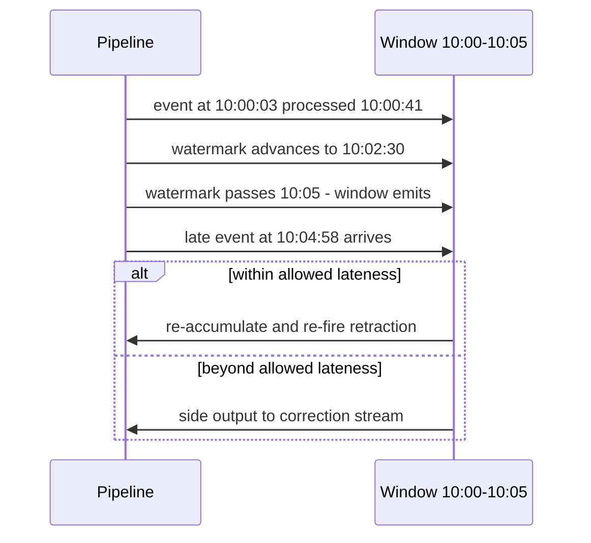

## Batch vs Streaming


:::tldr
- Batch answers "what is true given all data up to now" (bounded); streaming "what is true right now" (unbounded) — the trade is latency vs reprocessing/state cost, not throughput.
- Escalation path: batch → micro-batch (Spark SS ~500 ms floor) → true streaming (Flink/Kafka Streams 10–100 ms); each step up is a permanent tax: state ops, checkpoints, watermark tuning.
- Only event time is reproducible; processing time is for lag monitoring.
- Watermark `W = maxObservedEventTime − allowedLateness` (typ. 20 s–5 min); a window emits when W passes its end; W = min across partitions, so one idle source stalls everything.
- Late events: within allowedLateness → re-accumulate and re-fire (retraction); beyond → side output or dead-letter queue.
- State (windows, join buffers, dedup keys) needs a TTL or it grows forever.
- Exactly-once exists only end-to-end: replayable source + exactly-once state + transactional/idempotent sink — else at-least-once plus dedupe.
:::

Batch answers "what is true given all data up to now" over bounded input; streaming answers "what is true right now" over unbounded input — the real trade is latency vs reprocessing cost, not throughput.

:::scenario Scenario — Batch or Streaming?
@start Frame the question :: Batch answers what is true given all data up to now over bounded input; streaming answers what is true right now.
-> frame => @sla
@sla Pick by SLA :: Fraud under 5 s is product-correctness; an hourly dashboard gets cheap batch; between them, micro-batch.
? SLA under 5 seconds? => @stream |success
-> hourly => @batch
@batch Schedule the batch :: Bounded input, logical execution date, partition filters; backfill by rerunning old partitions deterministically.
? Freshness now hurts decisions? => @micro |success
-> rerun => @eos
@micro Step up to micro-batch :: Spark Structured Streaming: about a 500 ms floor, batch SQL reuse, coarse watermarks.
-> eventtime => @etime
@stream Go true streaming :: Flink or Kafka Streams at 10–100 ms — and a permanent tax of state ops, checkpoints, watermark tuning.
-> eventtime => @etime
@etime Reason in event time :: Only event time is reproducible; windows, billing, analytics hang off it; processing time is for lag monitoring.
-> watch => @wm
@wm Trust the watermark :: W = maxObservedEventTime minus allowedLateness, a monotonic promise; a window emits when W passes its end.
? One partition goes idle? => @idle |success
-> closes => @late
@idle Pin the min-watermark :: W is the min across partitions, so one stalled source freezes every window; idle sources need special handling.
-> resume => @wm
@late Handle the stragglers :: Within allowedLateness: re-accumulate and re-fire as a retraction; beyond it: side output or dead-letter queue.
-> bound => @state
@state Bound the state :: Window contents, join buffers, dedup keys live in RocksDB or heap and grow forever without a TTL.
-> guarantee => @eos
@eos Make it exactly-once :: Replayable source, exactly-once state, transactional or idempotent sink — otherwise at-least-once plus dedupe.
? Sink is plain non-transactional HTTP? => @dedupe |fail
@dedupe Dedupe downstream :: No transactional or idempotent sink means at-least-once is the ceiling — dedupe by key at the consumer.
:::
::::diagram batch-vs-stream.png
:::

### Batch: Scheduled, Bounded, Reproducible

- **Input bounded, job runs to termination.** Triggered on a cadence (Airflow/dbt/cron) with a *logical execution date*: the 3am Feb 5 run processes Feb 4's partition.
- **Windows = partition filters**: `WHERE dt = '2026-05-01'`. No late-data problem — the window "closes" only when the job runs, long after all data landed.
- **Backfill is the killer feature**: fix logic, rerun old partitions, overwrite outputs. Deterministic code over bounded input → reproducible results.
- **Retry safety = idempotency.** Non-idempotent `INSERT INTO` + retry silently double-counts — the classic batch production bug.

```sql
-- rerun-safe patterns; key outputs by (pipeline, logical partition)
INSERT OVERWRITE daily_metrics SELECT ... WHERE dt = '2026-05-01';  -- replace
MERGE INTO daily_metrics t USING staged s ON t.dt = s.dt
  WHEN MATCHED THEN UPDATE ...;                                     -- keyed merge
```

- Latency: minutes–hours (schedule + runtime). Cost per TB: lowest — spot instances, columnar scans, no per-record overhead.

### Streaming: Event Time, Watermarks, State

| Time domain | Definition | Use for |
|---|---|---|
| **Event time** | When the event occurred (device clock) | Correctness: windows, billing, analytics |
| **Processing time** | When the system sees the event | Lag monitoring, alerting |
| **Ingestion time** | When the pipeline received it | Compromise; rarely correct |

- Events arrive out of order (offline mobile, retries, cross-region): a 10:00:00 click processed at 10:00:41. **Only event time is reproducible.**
- **Watermark** `W = maxObservedEventTime − allowedLateness` (typically 20 s–5 min): monotonic promise "no event ≤ W arrives later"; window emits when W passes its end ([Flink event time](https://nightlies.apache.org/flink/flink-docs-release-1.9/dev/event_time.html)). Too tight → drops; too loose → delayed results + longer state. Parallel pipelines: W = **min across partitions** — one idle source stalls progress.
- **State** (window contents, join buffers, dedup keys) lives keyed in RocksDB/heap; needs **TTL** or it grows forever.
- **Checkpoints** (Flink aligned barriers): async distributed snapshot of state + source offsets; on failure restore and replay from Kafka ([checkpoint docs](https://nightlies.apache.org/flink/flink-docs-release-1.13/docs/ops/state/checkpoints)).

```text
processing time ---------------------------->
events:   e1@10:00:03 e2@10:01:10 e3@10:04:50 e4@10:04:58(LATE)
watermark W: 10:02:30     10:03:40     10:07:00
window [10:00,10:05) ── W≥10:05 → EMIT (e3 in window)
e4 arrives after W passed 10:05:
  within allowedLateness → re-accumulate, re-fire (retraction/upsert)
  beyond → side output / dead-letter
```

| Window | Semantics | Use |
|---|---|---|
| **Tumbling** | Fixed, non-overlapping (5 min) | Rollups, billing intervals |
| **Sliding** | Size 1 h, slide 5 m → each event in 12 windows | Moving averages |
| **Session** | Gap-based, closes after inactivity | User sessions |

:::warning Watermark tunables are the streaming interview
Allowed lateness is a correctness-vs-latency dial from the [Dataflow Model](https://research.google/pubs/pub43864/). Name the three levers: watermark delay, allowed lateness, side outputs — and that idle parallel sources freeze W.
:::



### Lambda vs Kappa

| Dimension | Lambda ([Marz](https://nathanmarz.com/blog/how-to-beat-the-cap-theorem.html)) | Kappa ([Kreps](https://www.oreilly.com/radar/questioning-the-lambda-architecture/)) |
|---|---|---|
| Codepaths | 2 (batch + speed) — **drift risk** | 1 |
| Backfill | Batch layer over full history | Replay log (long/compacted retention) |
| Ops | 2 stacks, 2 deploy cycles | 1 stack, heavy retention/state ops |
| Consistency | Eventual merge of two views | Single view |
| Fits | Legacy batch estates, huge-history recompute | Log-centric orgs (Kafka + Flink) |

- Micro-batch (Spark Structured Streaming): ~500 ms–seconds floor, batch SQL reuse, coarse watermarks. True streaming (Flink/Kafka Streams): 10–100 ms, first-class watermarks/session windows.
- **Beam**: bounded vs unbounded is a *runtime* choice — one API, windows/triggers/accumulation as config, runner executes ([Beam guide](https://beam.apache.org/documentation/programming-guide/)).

### Delivery Semantics

| Guarantee | Meaning | Cost |
|---|---|---|
| At-most-once | May drop, never duplicate | Cheapest; lossy |
| At-least-once | Never lost, may duplicate | Idempotent sinks |
| Exactly-once | Each record affects output once | Transactions end-to-end |

**"Exactly-once" only exists end-to-end** ([Confluent](https://docs.confluent.io/kafka/design/delivery-semantics.html)); three layers must align:

1. **Source replayable** — offsets stored and restored atomically with state (offsets inside the checkpoint).
2. **State exactly-once** — Flink checkpoint snapshot/restore.
3. **Sink exactly-once** — Kafka transactions (`read_committed`, [KIP-447](https://cwiki.apache.org/confluence/spaces/KAFKA/pages/103093950/KIP-447+Producer+scalability+for+exactly+once+semantics)), or idempotent upsert into DB/Iceberg by primary key.

:::tip The honest one-liner
"Exactly-once = at-least-once processing + idempotent or transactional effects." Native in Kafka+Flink; no engine gives EOS into a plain non-transactional HTTP sink.
:::

### Choosing Between Them

**Worked Example — 100k ev/s clickstream: batch or streaming?**

```text
Ingest:   100k ev/s x 200 B = 20 MB/s = 1.7 TB/day raw
State:    10 M users/h x 100 B = 1 GB/window; sliding 1h/5m = 12 GB
Decision: fraud SLA < 5 s → streaming (20 MB/s at 10 tasks); hourly
          dashboard → batch is cheap. Fraud SLA is product-correctness
          → true streaming; batch for backfill only. Hourly batch =
          ~59 min mean detection latency — fails SLA.
```

| Question | Batch | Micro-batch | True streaming |
|---|---|---|---|
| Latency floor | > 15 min | 1–15 min | ms–sec |
| Backfill | Trivial (rerun) | Moderate | Replay log |
| Cost/TB + ops | Lowest | Low–med | Highest (always-on, state, W tuning) |

**Use cases:**
- **Fraud detection** → true streaming: score per event < 5 s, session windows per card/user, retract on late evidence.
- **Monthly billing** → batch: complete-input determinism, auditable reruns, `INSERT OVERWRITE` partitions; latency irrelevant.
- **ML features** → hybrid: online features via streaming (freshness, point-in-time correctness), offline training via batch over the same logic — Beam / `FOR SYSTEM_TIME AS OF` keeps them consistent.
- Frequent reprocessing → **Kappa-plus-lakehouse**: log lands in Iceberg/Hudi/Delta, batch rides the same tables — one codepath, cheap history.

:::tip Default escalation path
Start batch → micro-batch when freshness measurably hurts decisions → true streaming only when latency is a product requirement. Every step up is a permanent tax: state ops, checkpoints, watermark tuning.
:::

:::cards
Q: What is the real batch-vs-streaming tradeoff? :: Latency vs reprocessing/state cost — never throughput.
Q: Latency floors of micro-batch vs true streaming? :: Spark Structured Streaming ~500 ms; Flink/Kafka Streams 10–100 ms.
Q: Define the watermark. :: W = maxObservedEventTime − allowedLateness — a monotonic promise; the window emits when W passes its end.
Q: Why can one idle partition freeze all windows? :: W is the min across partitions, so a stalled source stalls watermark progress everywhere.
Q: What happens to an event later than allowed lateness? :: Side output or dead-letter queue; within lateness, re-accumulate and re-fire as a retraction.
Q: Fraud SLA under 5 s — batch or streaming? :: True streaming; an hourly dashboard gets cheap batch, in between micro-batch.
Q: Name the three layers that must align for exactly-once. :: Replayable source, exactly-once checkpointed state, transactional or idempotent sink.
:::

:::lab watermark
Try it: event-time vs processing-time — scrub through arrivals in order and watch the watermark `W = maxSeen − 5 s` advance over tumbling windows [0,10s) and [10,20s). Events land blue (on-time), green (late but accepted) or red ✕ (dropped). Flip allowed lateness to rescue borderline events.

<div class="lab-row">
<label>arrival <input type="range" id="wm-i" min="0" max="9" value="0" aria-label="arrival index"> <b id="wm-kv"></b></label>
<label><input type="checkbox" id="wm-late"> allowed lateness 2 s</label>
</div>

<svg id="wm-svg" viewBox="0 0 600 120" width="100%" height="120" role="img" aria-label="event-time axis with watermark line and tumbling windows"></svg>

<p class="lab-stats">W = maxSeen − 5 s = <b id="wm-wv"></b> · accepted <b id="wm-acc">0</b> · late-dropped <b id="wm-drop">0</b></p>

<p class="lab-verdict" id="wm-msg"></p>
:::

### Key Takeaways

- Batch = bounded input, deterministic reruns, cheapest per byte; streaming's hard problems are **event time, watermarks, state** — never throughput.
- Watermarks trade correctness vs latency; late events handled by allowed lateness, retractions, or side outputs; idle partitions stall the min-watermark.
- Exactly-once is end-to-end: replayable source + atomic state restore + transactional/idempotent sink; else at-least-once + dedupe.
- Lambda = two codepaths and drift; Kappa = one log but long retention; modern answer: Kappa-plus-lakehouse (log in Iceberg/Delta). Micro-batch for 1 s–15 min, Flink/Kafka Streams for sub-second, Beam unifies the API not the ops.

### Interview Lens

- "Why is exactly-once hard?" → aligned barriers freeze a consistent cut; state + offsets in one artifact; sink must commit atomically or dedupe by key.
- "Job double-counts on retry" → non-idempotent append; fix with partition overwrite or keyed MERGE — same dedupe discipline as streaming sinks.
- Lambda vs Kappa → argue **drift cost vs retention cost**, land on lakehouse middle ground (Flink 10–100 ms, micro-batch ~500 ms floor, watermark lag 20 s–5 min).
