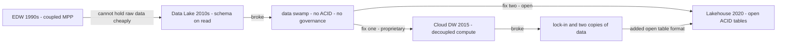

## Data Warehouse vs Data Lake vs Lakehouse

Analytics storage evolved through four generations because each one's failure mode became the next one's feature list — know the mechanisms, not just the product names.

:::scenario Scenario — Storage Generation Choice
@start Scope the estate :: Structured BI only, or raw logs, JSON, images, ML too? Utilization and lock-in tolerance pick the storage generation.
? Analytics needs raw logs, JSON, images, ML assets? => @lake |success
-> structured-bi-only => @dw
@dw Run the cloud DW :: Disaggregated compute, micro-partition pruning, auto-suspend bills zero while idle — but formats stay proprietary.
-> copies => @lakehouse
@lake Land everything raw :: Open object storage plus schema-on-read: landing anything is free — including silence about schema drift.
-> breaks => @swamp
@swamp Hit the swamp :: No atomic commits corrupt partitions, no enforcement, no compaction, no governance — structural, not bad engineers.
-> fix-open => @lakehouse
@lakehouse Add the table format :: Parquet plus a transactional table format plus catalog plus any engine — the format and catalog are the platform.
? Compliance forbids raw PII landing? => @etl |success
-> pick-compute => @tco
@etl Keep ETL at the boundary :: Mask PII before load, honor cross-region rules — transform before the trust boundary; ELT everywhere else.
-> pick-compute => @tco
@tco Right-size the compute :: Under 30 percent utilization, per-second auto-suspend; over 60 sustained, always-on or reserved — watch egress.
? Sub-second high-QPS dashboards? => @olap |success
-> own => @own
@olap Add an OLAP serving tier :: MPP warehouses trade latency for SQL breadth; feed a hot engine from the lake or DW for interactive serving.
@own Mesh the ownership :: Centralize the substrate — storage, formats, catalog, governance — and decentralize product ownership on top.
:::
::::diagram lakehouse-stack.png
:::

### Evolution: Database → Warehouse → Lake → Lakehouse



| Stage | What it added | What it broke or lost |
|---|---|---|
| EDW 1980s–2000s: Teradata, Exadata | SQL analytics at scale, ACID, Kimball/Inmon modeling | $/TB; can't hold logs, JSON, images, ML assets |
| Lake 2010s: HDFS → S3 + Spark | Cheap open storage, land anything, schema-on-read | Transactions, quality, governance → swamps |
| Cloud DW 2015: Snowflake, BigQuery | Storage/compute split, elasticity, near-zero ops | Proprietary formats; lake + warehouse = two copies |
| Lakehouse 2020: Iceberg, Delta, Hudi | ACID + time travel on open Parquet ([CIDR 2021](https://people.eecs.berkeley.edu/~matei/papers/2021/cidr_lakehouse.pdf), [Iceberg docs](https://iceberg.apache.org/docs/latest/)) | Still maturing: compaction, catalogs, write concurrency |

**Lakehouse = open file format (Parquet) + transactional table format + object storage + catalog + any engine** (Spark, Trino, Flink, DuckDB, and the warehouses themselves). The table format becomes the platform; warehouses become engines over it.

### Why Data Lakes Failed

60–85% of big-data-era projects were abandoned; the swamp was structural, not operator error ([arXiv retrospective](https://arxiv.org/pdf/2606.08266)):

- **No atomic commits** — concurrent writers corrupted partitions; readers saw partial files (worse pre-Dec-2020 S3 eventual consistency).
- **No schema enforcement** — schema-on-read means the writer checks nothing; a renamed column silently poisons every downstream job.
- **No performance layer** — no stats, no pruning, no compaction → millions of small files, full-partition scans.
- **No governance** — duplicate contradictory datasets; the "single source of truth" silently stayed in the EDW → paying for two synced copies.
- **Hive Metastore was a partition directory, not a transactional catalog** — no commit protocol, MySQL-backed SPOF. Successor: REST catalogs (Iceberg REST, Unity, Polaris).

:::warning Interview trap
Blaming "bad engineers" for lake failure is the junior answer. The platform made hygiene expensive and sloppiness free — at scale, the equilibrium is a swamp. Name the structural mechanisms.
:::

### Architecture: Coupled vs Disaggregated

- **Shared-nothing MPP** (Teradata, classic Redshift): node owns disk + CPU. Fastest per-dollar at steady state; adding nodes forces rebalancing; storage growth forces compute growth.
- **Disaggregated** (Snowflake, BigQuery, Databricks): stateless clusters query immutable files on object storage through a cache. Compute and storage scale independently, per-second.

```text
       Cloud services: parser - optimizer - RBAC - metadata
                                |
  +-------------+  +-------------+  +-------------+
  | VW ETL  L   |  | VW BI   XS  |  | VW ML   L   |  per-second billing
  | 2h nightly  |  | 200 q/day   |  | suspended   |
  +------+------+  +------+------+  +------+------+
         |                |                |
  +------v----------------v----------------v------+
  | Object storage: S3 - columnar - micro-parts   |
  | ~16 MB compressed - immutable - min/max stats |
  +-----------------------------------------------+
```

Snowflake mechanics to defend: **micro-partitions** (~16 MB) with automatic min/max metadata → partition pruning without user-defined keys; **virtual warehouse isolation** → ETL/BI/ML get separate clusters, no noisy neighbors; **result cache** → repeat queries in ms. Auto-suspend bills $0 while idle; per-second with 60s minimum ([Snowflake 2025 compute updates](https://www.snowflake.com/en/news/press-releases/snowflake-unveils-next-wave-of-compute-innovations-for-faster-more-efficient-warehouses-and-ai-driven-data-governance)).

Tradeoff: every cold query pays an S3 round-trip; hot sub-second high-QPS serving still belongs to dedicated OLAP engines.

### Schema-on-Read vs Schema-on-Write

| | Warehouse | Lake | Lakehouse |
|---|---|---|---|
| Enforcement | at write | at read | at commit (declared schema, additive evolution) |
| Producer cost | high — change = migration | zero — anything lands | moderate — corrupt writes rejected |
| Reader cost | none | re-parse + re-validate every query | low — stats enable pruning |
| Zones | gold only | bronze only | bronze (raw) → silver (cleaned) → gold (modeled) |

Lakehouse contribution: **schema-on-write with late binding** — enforce on commit, evolve without rewriting files.

### ETL vs ELT

| | ETL | ELT |
|---|---|---|
| Transform runs | separate compute tier, before load | inside warehouse, after raw load |
| Target receives | modeled data only | raw + transformed in place |
| Auditability | raw lost unless archived | raw retained → replay, backfill |
| Compute | dedicated ETL servers | target's elastic compute (dbt, Snowflake tasks) |

:::tip Where ETL still wins
ELT won because decoupled storage made landing raw cheap and elastic compute made in-warehouse transforms cheap. ETL survives at trust boundaries: PII masking before load, cross-region compliance, and streaming where "L" is continuous ingest.
:::

### Cost Models: A Worked Example

:::info Worked Example
**Workload:** 2h nightly ETL + 200 BI queries/day (avg 15s ≈ 50 min query time), 5 TB stored.
**Snowflake, auto-suspend** (illustrative list: $2/credit, Standard, AWS US-EAST-1 — verify at [snowflake.com/en/pricing](https://www.snowflake.com/en/pricing/)):
- ETL: Large = 8 credits/h × 2h = 16 credits/day
- BI: X-Small = 1 credit/h × ~1.5h effective (idle suspend) = 1.5 credits/day
- Total: 17.5 credits/day × 30 = 525 credits ≈ **$1,050** + 5 TB × $23/TB-mo = $115 → **≈ $1,165/mo**

**Same power, always-on cluster** (illustrative: 8 DBU/h all-purpose, $0.40/DBU — verify at [databricks.com/product/pricing](https://www.databricks.com/product/pricing/)):
- 8 DBU/h × 730 h/mo × $0.40 = **$2,336** + $115 storage → **≈ $2,451/mo**

**Utilization is the driver:** 4h compute/24h ≈ 17% utilization → always-on pays ~6× compute for idle. Flip it: if BI is steady 24/7, always-on ≈ $2.3k vs auto-suspend Large ≈ $11.7k — a 5× win the other way.
:::
**Decision rule:** utilization <30% → per-second auto-suspend; >60% sustained → committed/always-on clusters or reserved capacity. Watch hidden costs: egress, `SELECT *` on per-TB-scanned pricing ($6.25/TB BigQuery on-demand), compaction compute, FinOps guardrails (resource monitors, per-query attribution).

### Data Mesh vs Centralized Platform

Four principles: domain ownership, data as a product, self-serve platform, federated governance ([Dehghani](https://martinfowler.com/articles/data-mesh-principles.html)). Reality: adoption humbled — domains without engineers ship orphaned "products," and N domain stores force a de facto central catalog ([InfoWorld](https://www.infoworld.com/article/4080370/was-data-mesh-just-a-fad.html)).

- Mesh is an **org model for ownership**, not a storage architecture.
- Pragmatic synthesis: **centralize the substrate** (storage, formats, catalog, governance), **decentralize product ownership** on top.

### Decision Table

| Situation | Recommend | Why |
|---|---|---|
| BI 95% of workload, structured sources, small team | Cloud warehouse | Managed everything; openness buys nothing |
| ML on text/images/events + growing BI | Lakehouse | One copy, open formats, both engine families |
| Existing lake with unreliable tables + DW sync | Retrofit table format | Kill the sync, add ACID per table |
| Sub-second dashboards, high-QPS serving | OLAP engine fed from lake/DW | MPP warehouses trade latency for SQL breadth |
| 100+ engineers, multi-domain, platform team exists | Central platform + domain-owned products | "Mesh the ownership, centralize the substrate" |
| Heavy cross-cloud / lock-in concerns | Open lakehouse | Files portable; egress is the only lock |
| Compliance forbids raw PII landing | ETL before the trust boundary | Mask pre-load |
| <100 GB, one team | Postgres + dbt | Platform ceremony is negative value |

**Use cases:**
- **Regulated BI reporting** → warehouse: schema-on-write, RBAC, audit lineage, certified metrics.
- **ML feature store** → lakehouse bronze/silver: cheap raw retention, time travel for reproducible training sets, Spark/DuckDB access.
- **Log analytics** → lake landing zone + OLAP serving tier: schema-on-read ingestion fidelity, then prune/aggregate into a hot engine.

### Key Takeaways

- Each generation solved the previous one's binding constraint; answer "why the transition" with failure mechanisms (swamp, two-copies, lock-in), not product names.
- Lakes failed structurally: no ACID, no enforcement, no compaction, no governance — schema-on-read priced hygiene as optional.
- Disaggregation (micro-partitions + metadata pruning + isolated per-second virtual warehouses) is the reference elasticity answer; shared-nothing's rebalancing cost is the contrast.
- A lakehouse = Parquet + transactional table format + object storage + catalog + multi-engine; the format + catalog *is* the platform.
- ELT displaced ETL where storage/compute are decoupled; cost risk became controllable-but-unbounded opex, making utilization-driven FinOps a senior skill.

### Interview Lens

- Whiteboard the disaggregated architecture; defend micro-partition pruning and auto-suspend vs Teradata's shared-nothing rebalancing.
- For "which would you choose," start from workload mix, utilization, team size, lock-in tolerance — cite a cost sketch with real numbers, not adjectives.
- Have one scar per anti-pattern ready: small-files blowup, always-on idle waste, orphaned mesh domain.
