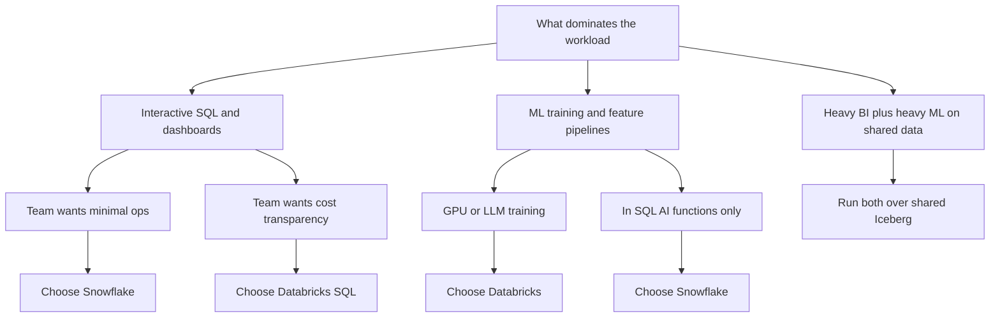

## Snowflake vs Databricks

Two platforms converging from opposite origins — Snowflake grew a SQL warehouse outward into the lakehouse, Databricks grew a Spark lakehouse inward into SQL/BI — so the honest comparison is mechanisms and tradeoffs, not feature checklists.

:::glide Glide — Who Owns the Storage
1) Converging origins :: Snowflake grew a SQL warehouse outward into the lakehouse; Databricks grew a Spark lakehouse inward into SQL/BI — compare mechanisms, not feature checklists
2) Storage ownership :: **Snowflake abstracts storage away** (micro-partitions, ~16 MB, bundled bill); **Databricks makes your lake the source of truth** (your S3 + Delta ACID log) — this one choice explains pricing, governance, and lock-in
3) Compute model :: Warehouses XS→6XL auto-suspend to zero vs Spark + **Photon** clusters — why BI defaults to Snowflake and code-heavy pipelines to Databricks
4) Billing shape :: **Credits bundle IaaS**; **DBUs stack on the VM bill** — never compare list rates; the ~15% Databricks edge in the worked example is entirely assumption-driven
5) Workload verdicts :: SQL/BI → Snowflake; ML/GPU/code-first pipelines and continuous streaming → Databricks; governance is capability parity but openness favors Unity Catalog
6) Lock-in asymmetry :: Snowflake locks in **data gravity** (exit = unload proprietary native tables to Iceberg); Databricks locks in **workflows** (exit = re-platform notebooks/jobs, data stays in your bucket)
7) The neutral layer :: **Iceberg + one REST catalog** (Open Catalog/Polaris or UC) lets both engines read shared data — no efficient cross-read of Snowflake native tables otherwise
8) The exit :: Iceberg support is table stakes on both sides now; catalog ownership is the live differentiator — design the exit before you need it
? Why is Databricks ~15% cheaper in the worked example, and why not trust that number? :: It is entirely assumption-driven — swap the credit price ($2–4 by cloud/region), warehouse sizes, or the analyst/ETL mix and either side wins; model 3-year all-in TCO on your workload, never list rates.
? Where does each platform's lock-in actually bite? :: **Snowflake locks in data gravity**: native tables are proprietary, so exiting means re-platforming storage by unloading to Iceberg. **Databricks locks in workflows**: exiting means re-platforming notebooks/jobs, but data stays in your cloud account.
? Why can't the two platforms just share data naively? :: Snowflake native tables are proprietary and Spark can't scan them efficiently — the neutral pattern is Iceberg in S3 with a REST catalog (Open Catalog/Polaris or UC) both engines read, at the cost of two contracts, two governance models, two teams.
? Why discount vendor benchmarks like TPC-DS 2023 or TPC-DI 2025? :: Claims contradict each other year over year (~3× DBX, then ~5× for DBX SQL Serverless, Snowflake's Gen2 rebuttal, consultancies reporting the reverse on pure BI) — workload shape dominates, so run a 2-week PoC with your schemas, query mix, and concurrency profile.
:::

::::diagram vendor-arch.png
:::
### Architecture: Two Different Answers

```text
         SNOWFLAKE                        DATABRICKS
┌───────────────────────────┐   ┌───────────────────────────┐
│ Cloud services: optimizer │   │ Control plane: UC, SQL    │
│ Virtual warehouses XS-6XL │   │ Spark + Photon clusters   │
│ Storage: micro-partitions │   │ Your S3 + Delta ACID log  │
│ Bundled bill              │   │ Unbundled: DBU + VM bill  │
└───────────────────────────┘   └───────────────────────────┘
```

- **Snowflake**: storage/compute/cloud-services decoupled; warehouses (XS→6XL) auto-suspend to zero; micro-partitions (~16 MB, min/max pruning) remove partition design; Time Travel + zero-copy cloning included.
- **Databricks**: control plane + Spark/Photon compute over **your** S3/ADLS/GCS; Delta Lake transaction log gives ACID with optimistic concurrency; Photon (C++ vectorized) is why its SQL got competitive.
- Deepest difference: **Snowflake abstracts storage away; Databricks makes your lake the source of truth** — that choice explains pricing, governance, and lock-in below.
- Sharing data between them is the 2025–26 pain: Snowflake native tables are proprietary and Spark can't scan them efficiently; the neutral pattern is Iceberg + REST catalog (Open Catalog/Polaris or UC) with both engines reading.

### Pricing: Credits vs DBUs

| Dimension | Snowflake | Databricks |
|---|---|---|
| Unit | Credit; per-second, 60s minimum | DBU; per-second on serverless |
| Rate shape | 1 credit/hr at XS, ×2 per size, × edition multiplier | Per-SKU: Jobs ≈ $0.15, All-purpose $0.40–0.55, SQL Serverless $0.70 /DBU (US list 2025) |
| Compute + IaaS | Bundled in the credit price | DBU **plus** the underlying EC2/VM bill |
| Storage | ~$23–40/TB/mo compressed | Your S3/ADLS bill + small-file request overhead |
| Idle cost | Auto-suspend to zero if configured | Classic clusters bill while up; serverless scales to zero |

:::info Worked Example - Monthly Bill, Same Workload
Assumptions: 500 GB data, transforms 4 h/day, 100 analysts driving ~10 h/day of BI, 22 business days, US East list prices, no commitments, credit = $2.50, Medium = 4 credits/hr.

| Line item | Snowflake | Databricks |
|---|---|---|
| Storage | 0.5 TB × $40 = **$20** | S3 0.5 TB × $23 = **$12** |
| Transforms, 120 h/mo | Medium: 4 cr/h × 120 h × $2.50 = **$1,200** | 4× r5.2xlarge + driver ≈ $2.27/h VM + 9 DBU/h × $0.15 → **$434** |
| BI, 220 h/mo | Medium: 880 cr × $2.50 = **$2,200** | SQL Serverless Small: 16 DBU/h × 220 h × $0.70 = **$2,464** |
| **Total** | **≈ $3,420/mo** | **≈ $2,910/mo** |

Read: ~15% Databricks edge at list, and it is entirely assumption-driven — swap credit price ($2–4 by cloud/region), warehouse sizes, or the analyst/ETL mix and either side wins. Add ~10% to both for cloud-services credits beyond the waiver, serverless-feature spend, and egress.
:::

:::tip TCO Traps
- Snowflake: forgotten warehouses never suspending, spill-to-storage on big sorts, separately-credited serverless features (Snowpipe, search optimization, MV maintenance), cloud-services credits past the ~10% daily waiver.
- Databricks: all-purpose ($0.55) vs jobs ($0.15) misclassification is ~3×; classic clusters stack VM cost; small Delta files inflate S3 requests.
- Model 3-year all-in cost; a spreadsheet older than Snowflake Gen2 warehouses (GA 2025, ~2.1× Gen1 analytics) is stale.
:::

### Workload Strength

| Workload | Snowflake | Databricks | Verdict |
|---|---|---|---|
| SQL / BI | Result cache, Gen2 warehouses, mature BI ecosystem | Databricks SQL + serverless, competitive since 2022 | Snowflake default; DBX on cost at scale |
| ETL pipelines | Snowpark, Dynamic Tables, tasks/streams (SQL-centric) | Spark + Photon, Lakeflow pipelines, code-first Python | DBX for complex code-heavy pipelines |
| ML / AI | Snowpark ML, Cortex in-SQL functions | MLflow origin, GPU clusters, Mosaic AI, Model Serving, Lakebase (2025) | DBX clearly for training/LLM |
| Streaming | Streams/tasks, Snowpipe Streaming sub-second (2025) | Structured Streaming, Auto Loader | DBX for continuous; SF fine at minutes |
| Governance | Horizon: RBAC, masking, lineage — turnkey | Unity Catalog: ABAC (2025), lineage, Delta Sharing — more open | Capability parity; openness favors UC |

**Use cases:**
- BI-heavy org of analysts, not engineers → **Snowflake**: near-zero ops, auto-suspend, cloning, Horizon masking out of the box.
- ML platform with GPU training, notebooks, MLOps lifecycle → **Databricks**: MLflow lineage end-to-end, feature store, model serving.
- Regulated shared data across orgs → **Snowflake** Horizon + Secure Data Sharing for turnkey audit/masking; **Databricks** UC + Delta Sharing when recipients must read Delta/Iceberg with their own engines.

### Governance, Openness, and Benchmarks

- **Databricks**: Delta is Apache-2.0 OSS; UniForm exposes Delta tables as Iceberg; June 2025 added full managed Iceberg in UC plus REST catalog federation ([blog](https://www.databricks.com/blog/announcing-full-apache-iceberg-support-databricks)); UC itself is OSS ([docs](https://docs.databricks.com/aws/en/tables/managed)).
- **Snowflake**: native tables stay proprietary — the core lock-in. Exit ramps: Iceberg tables (managed or via any Iceberg REST catalog), catalog-linked databases (2025), and **Open Catalog**, a managed Apache Polaris that Snowflake donated to the ASF ([blog](https://www.snowflake.com/en/engineering-blog/apache-polaris-iceberg-rest-catalog), [docs](https://docs.snowflake.com/en/user-guide/tables-iceberg)).
- Benchmark honesty: dueling TPC-DS 100TB claims in 2023 (~3× DBX, [Databricks](https://www.databricks.com/blog/2021/11/15/snowflake-claims-similar-price-performance-to-databricks-but-not-so-fast.html)); 2025 TPC-DI claims of ~5× for DBX SQL Serverless ([Medium](https://medium.com/dbsql-sme-engineering/benchmarking-etl-with-the-tpc-di-snowflake-cb0a83aaad5b)) vs Snowflake's Gen2 rebuttal ([Snowflake](https://www.snowflake.com/en/blog/engineering/snowflake-vs-databricks)); independent consultancies report the reverse on pure BI. Workload shape dominates.

:::warning
Vendor benchmarks contradict each other year over year. Basing procurement on them is malpractice: run a 2-week PoC with your schemas, query mix, and concurrency profile.
:::

### Ecosystem and Hybrid Reality

- Snowflake optimizes for analysts staying in-SQL (Snowpark, Streamlit-in-Snowflake, Native Apps, Marketplace); Databricks for code-first teams (notebooks, Asset Bundles, Lakeflow Jobs, Mosaic AI). Hiring profiles follow.
- Running both hits: catalog mismatch (no efficient cross-read of Snowflake native tables), two storage bills, duplicated RBAC/audit/lineage.
- Common convergence: Iceberg in S3 as the neutral layer, Polaris or UC as catalog, Snowflake for BI/finance consumers, Databricks for ML and heavy pipelines — best of both, at the cost of two contracts, two governance models, two teams.

### Decision Matrix

| Choose **Snowflake** when… | Choose **Databricks** when… |
|---|---|
| SQL/BI-centric; analysts, not engineers | ML/AI-heavy or code-first Spark pipelines |
| Near-zero ops; cloning and Time Travel default-on | Cluster/version/GPU control; Spark skills in-house |
| Turnkey governance fast (Horizon RBAC + masking) | Open formats/catalog as a strategic hedge |
| Snowflake already the BI product | Lake is source of truth; warehouse just one consumer |
| Minutes-latency streaming acceptable | Continuous sub-second streaming (Kafka) required |
| One predictable bundled bill wanted | VM/storage transparency and cloud optimization matter |



### Lock-In Analysis

| Vector | Snowflake | Databricks |
|---|---|---|
| Table format | Proprietary native; Iceberg as exit ramp | Delta OSS; Iceberg via UniForm/managed Iceberg |
| Catalog | Proprietary + Open Catalog (Polaris, OSS) | UC OSS, Iceberg REST endpoint |
| Storage | Snowflake-managed buckets | Your cloud account — lower data gravity |
| Engine / skills | Closed engine, but ops abstracted away | Spark skills transfer everywhere |
| Exit cost driver | Re-platforming storage: unload native → Iceberg | Re-platforming pipelines: notebooks/jobs, not data |

Net: **Snowflake locks in data gravity; Databricks locks in workflows**. The Iceberg REST ecosystem erodes both — which is exactly why both vendors embraced it.

### Key Takeaways

- Storage ownership (bundled vs your-bucket) drives pricing, governance, and lock-in more than feature lists do; warehouse vs lakehouse framing is stale.
- Credits bundle IaaS; DBUs stack on VMs — never compare list rates, model 3-year all-in TCO on your workload.
- Iceberg support is table stakes on both sides now; catalog ownership (UC vs Open Catalog/Polaris) is the live differentiator.
- Vendor benchmarks (TPC-DS 2023, TPC-DI 2025) contradict each other; only your PoC settles price/performance.
- Fit: BI + turnkey ops → Snowflake; ML/GPU/code-first/continuous streaming → Databricks; run both over shared Delta/Iceberg when you must — and design the exit before you need it.

### Interview Lens

- "Which would you pick?" — name the workload mix first, then mechanisms (micro-partition pruning vs Delta log, bundled vs unbundled billing), then decide with tradeoffs stated; never a fanpage verdict.
- Expect probes on TCO divergence (serverless feature credits vs all-purpose/jobs misclassification, VM stacking), keeping the two platforms consistent on shared data (Iceberg + one REST catalog owner, Delta Sharing), and the lock-in story (data gravity vs workflow).
- Cite the dueling benchmarks as evidence claims invert by workload shape, then pivot to how you would benchmark with your own data.
