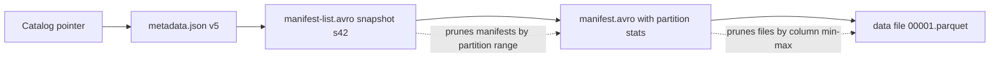

## Table Formats: Delta Lake vs Iceberg vs Hudi


:::tldr
- A table format adds what Parquet lacks: atomic commits, updates/deletes, schema/partition evolution, and pruning metadata over immutable files.
- Delta is a log: `_delta_log` JSON commits + Parquet checkpoint every 10th commit, optimistic concurrency, Deletion Vectors since 2.x.
- Iceberg is a tree: catalog CAS pointer → metadata.json → manifest list → manifests → data files, with pruning summaries at every level.
- Hidden partitioning: transforms (`days(ts)`, `bucket(16, user_id)`) live in the spec — partition evolution is metadata-only, no rewrite.
- Hudi is a timeline of instants (the WAL) over file groups; CoW rewrites bases, MoR appends logs until compaction folds them.
- Delete cost ladder: CoW rewrite → position deletes → DV bitmaps → MoR log records — write cost falls, read cost rises. GDPR deletes: DVs make them KB-scale.
- Time travel = replay; only VACUUM/expire_snapshots/clean truly deletes. Benchmarks are vendor-shaped — decide from estate: Iceberg multi-engine, Delta Databricks, Hudi keyed CDC.
:::

A table format is a transactional metadata layer over Parquet/ORC files that turns an object-storage prefix into a versioned ACID table — same goal, three different metadata structures.

:::scenario Scenario — Table Format Triage
@start Name the estate :: every published benchmark is vendor-shaped — decide from estate and workload shape, not a leaderboard
? multi-engine or external readers => @iceberg |success
? all-in Databricks / Spark => @delta |fail
? keyed CDC, upsert-heavy => @hudi
@iceberg Iceberg — metadata tree :: catalog CAS pointer swap → metadata.json → manifest-list → manifests → data files, pruned at every level
-> where do deletes land? => @ladder
@delta Delta — one log :: commits append `_delta_log` JSONs; optimistic concurrency — losers re-validate and retry; checkpoint every 10th
-> where do deletes land? => @ladder
@hudi Hudi — timeline :: instants are the WAL over file groups; CoW rewrites bases, MoR appends logs until compaction folds them
-> where do deletes land? => @ladder
@ladder Deletes are a cost ladder :: same rows, four rungs — write cost falls and read cost rises as you descend
? GDPR row deletes => @dv |success
? streaming delete-heavy CDC => @mor |fail
? tiny table, simplest reads => @cow
@dv Deletion vectors :: DV bitmaps (Delta 2.x / Iceberg v3) make compliance deletes KB-scale instead of base-file rewrites
-> what does time travel cost? => @replay
@mor MoR log records :: delete records are write-cheap; background compaction folds them in and readers pay at query time
-> what does time travel cost? => @replay
@cow Copy-on-write :: full base-file rewrites per touch — brutal write cost, simplest reads; reserve for tiny tables
-> what does time travel cost? => @replay
@replay Time travel = replay :: old log / old snapshot / old slices resurrect rows; only VACUUM / expire_snapshots / clean truly delete
-> set the maintenance gate => @maintenance
@maintenance Checkpoint + expire :: Delta checkpoints every 10th commit keeps replay short; schedule snapshot expiry or metadata bloats
-> publish the decision => @done
@done Publish the table :: pick justified by estate + delete workload; benchmark on your own data, never the vendor's
:::

::::diagram table-format-commit.png
::::
:::

### Why Parquet Alone Is Not Enough

- Parquet is a **file format** — it says nothing about the *collection* of files that form a table.
- **No atomicity/isolation** — multi-file commits crash into half-states; S3/GCS/Azure have no atomic directory rename, and readers listing mid-write see torn state.
- **No updates/deletes** — files are immutable; row-level changes mean whole-file rewrites with no invalidation protocol.
- **No schema/partition evolution** — repartitioning = full rewrite or broken readers.
- **Planning is O(all files)** — engines list directories and read footers; millions of files dominate query latency.

### Delta Lake: One Transaction Log

- Whole architecture = **`_delta_log/`**: each commit appends `000...N.json` with atomic actions — `add` (data file + stats), `remove`, `metaData`, `txn` (idempotent streaming), `commitInfo`.
- **Checkpoint every 10th commit** (`000...10.parquet`) — readers replay ≤10 JSONs instead of thousands; current state = deterministic replay of the log.
- Writers use **optimistic concurrency**: attempt commit by creating file N+1; conditional put / catalog conflict manager arbitrates; losers re-validate against new state and retry.
- **Deletes**: copy-on-write historically; since Delta 2.x, **Deletion Vectors** (Roaring bitmaps as side files, referenced from `add` actions) make `DELETE`/`MERGE` metadata + bitmap only ([delta.io](https://delta.io/blog/2023-07-05-deletion-vectors)).
- **Liquid clustering** (GA DBR 15.4+) supersedes `ZORDER`; **time travel** via `VERSION AS OF`, retention via `VACUUM` + `logRetentionDuration`.
- **Ecosystem**: Linux-Foundation-governed ([2019 announcement](https://www.linuxfoundation.org/press/press-release/the-delta-lake-project-turns-to-linux-foundation-to-become-the-open-standard-for-data-lakes)); **delta-rs** powers Python `deltalake`, Polars, DuckDB's Delta extension ([DuckDB docs](https://duckdb.org/docs/stable/core_extensions/delta)); **UniForm** exposes a Delta table as Iceberg — same Parquet, generated metadata ([Databricks docs](https://docs.databricks.com/aws/en/delta/uniform)).

### Apache Iceberg: A Metadata Tree and a Catalog



- **Commit = catalog pointer swap**: write new manifests + `metadata.json` vN+1, then CAS the catalog entry. Arbitration lives in the catalog, not on storage.
- **Planning is O(pruned metadata)**: manifest lists carry partition-range summaries; manifests carry per-column min/max/null counts — data files pruned before any I/O.
- **Hidden partitioning**: transforms (`days(ts)`, `bucket(16, user_id)`) live in the spec; engines never hand-write partition filters, and **partition evolution is metadata-only** — old files stay queryable under their old spec ([docs](https://iceberg.apache.org/docs/latest/partitioning/)).
- **Snapshots form a DAG** — branches and tags for audit and backfills. **v3 (finalized 2025)**: DV bitmaps, `variant`, row lineage ([spec](https://iceberg.apache.org/spec)); **REST catalog** ([spec](https://iceberg.apache.org/rest-catalog-spec/)) decouples engines from catalogs (Polaris/Open Catalog, Unity, Nessie), vending short-lived storage credentials.

### Apache Hudi: Timeline, File Groups, and MoR/CoW

- Models the table as an **LSM-style log** ([tech spec](https://hudi.apache.org/tech-specs/)): a **timeline** of instants — `commit` (CoW), `delta-commit` (MoR), `compaction`, `clean`, `rollback`, `replacecommit` (clustering). The timeline *is* the WAL and the version history.
- **File groups / slices**: records keyed by `record key` + `precombine`; a file group owns a key range; a slice = base Parquet + zero or more log files.
- **CoW**: upserts rewrite affected base files — compact reads, expensive writes. **MoR**: writes append to logs; readers merge base+logs; background **compaction** (scheduled separately — key for Flink) folds logs into new bases. Small-file sizing built into writers; clustering runs inline or async.

```text
Timeline:  [t0 commit][t1 delta-commit][t2 compaction][t3 delta-commit]
File grp1: |-- slice t0: base.parquet --|
           |-- slice t2: base.parquet + log + log2 --|
MoR read = base + replay logs   |  read-optimized = base only
CoW: no logs exist; every upsert rewrites the base file
```

### Deletes: Four Strategies

| Strategy | Formats | Write cost | Read cost |
|---|---|---|---|
| CoW rewrite | Delta (legacy), Hudi CoW | High — rewrite files | None |
| Position deletes | Iceberg v2 | Low — `(file, pos)` delete files | Merge at scan |
| Deletion vectors | Delta 2.x, Iceberg v3 | Lowest — bitmap in metadata | Bitmap filter at scan |
| MoR log record | Hudi MoR | Lowest — append to log | Merge until compaction |

### Worked Example: One UPDATE, Then Time Travel

:::info Worked Example: One UPDATE, Then Time Travel
`orders`: 100M rows, 1,000 files of 100k rows, partitioned by `order_date` — 10 files (~100 MB) per day.

```sql
UPDATE orders SET status = 'void' WHERE order_date = '2026-10-01' AND amount > 5000;  -- 400 rows, 10 files
SELECT count(*) FROM orders VERSION AS OF 1041;  -- the 400 rows reappear
```

| Format | Commit writes | Volume |
|---|---|---|
| Delta | 1 log JSON + 10 DV bitmaps on existing `add` entries | ~KBs |
| Iceberg v3 | snapshot s42: manifest list + manifests referencing DVs; catalog pointer swap | ~KBs |
| Hudi CoW | 10 base files rewritten as new slices under instant t42 | ~100 MB |
| Hudi MoR | 400 change records appended to log files, delta-commit t42 | ~50 KB |

Time travel replays the old log / old snapshot / old slices, so the 400 rows reappear. Only `VACUUM` / `expire_snapshots` / `clean` actually delete the files.
:::

### Feature Comparison

| Dimension | Delta Lake | Iceberg | Hudi |
|---|---|---|---|
| Metadata unit | `_delta_log` JSON + Parquet checkpoints | Catalog pointer → metadata.json → manifest list → manifests | Timeline instants (Avro) |
| ACID mechanism | Optimistic; log-based conflict manager | Optimistic; catalog CAS | MVCC on timeline; non-blocking compaction |
| Partition evolution | `REPLACE`-ish; liquid clustering mitigates | Metadata-only, multi-spec coexistence | Via `replacecommit`, heavier |
| Hidden partitioning | No (explicit partition cols) | Yes — transforms in spec | Keyed buckets, not transforms |
| Incremental/CDC reads | `table_changes` (CDF) | Incremental scans; v3 row lineage | CDF + `read.incremental`, strongest |
| Interop | UniForm (Delta→Iceberg), XTable | REST catalog lingua franca; XTable | XTable sync ([docs](https://hudi.apache.org/docs/syncing_xtable)) |

:::tip Interop Exits
UniForm and XTable translate *metadata only* — the translated copy is read-mostly. Keep writes on the source format and re-sync; one copy of Parquet serves many engines ([xtable.apache.org](https://xtable.apache.org/)).
:::

### Engine Matrix (2025–26)

| Engine | Delta | Iceberg | Hudi |
|---|---|---|---|
| Spark | ✅/✅ first-class | ✅/✅ reference impl | ✅/✅ first-class |
| Flink | ⚠️ connector unmaintained | ✅/✅ | ✅/✅ strongest |
| Snowflake | ✅ read | ✅/✅ managed + Polaris ([docs](https://docs.snowflake.com/en/user-guide/opencatalog/overview)) | ❌ |
| Databricks | ✅/✅ native | ✅/✅ managed, GA in Unity | ⚠️ via XTable |
| BigQuery | ✅ read | ✅/✅ BigLake | ❌ |
| DuckDB | ✅/✅ delta ext | ✅ read, ✅ via REST attach ([catalogs](https://duckdb.org/docs/current/core_extensions/iceberg/catalogs)) | ❌ |
| Python/Polars | ✅/✅ delta-rs | ✅/✅ PyIceberg | ⚠️ |

### Decision Table: When Each Wins

| Situation | Pick | Why |
|---|---|---|
| Multi-engine estate, vendor neutrality | **Iceberg** | REST catalog + universal engine support |
| All-in Databricks / Spark-centric | **Delta** | Deepest integration; UniForm covers Iceberg readers |
| Keyed CDC, upsert-heavy, near-real-time | **Hudi** | Record index, MoR logs, decoupled compaction |
| Share with Snowflake/BigQuery/Athena | **Iceberg** | Native managed-table support everywhere |

**Use cases:**
- **GDPR deletes** → DVs (Delta/Iceberg v3) for cheap compliance deletes; MoR logs for delete-heavy streaming; CoW only for tiny tables.
- **CDC upserts** → Hudi (record index + MoR); Delta MERGE + DVs acceptable; Iceberg v2 equality deletes get expensive at high key cardinality.
- **Multi-engine org** → Iceberg behind a REST catalog; Delta + UniForm if Databricks is the writer.

:::warning Benchmarks Are Vendor-Shaped
Every vendor publishes one where they win. Hudi's own 2026 post: no single benchmark settles Hudi-vs-Iceberg ([blog](https://hudi.apache.org/blog/2026/08/13/hudi-vs-iceberg-performance-benchmarks)). Workload shape, compaction discipline, DV settings, and catalog latency flip results — operational differences usually outweigh format differences. Benchmark on your own data.
:::

:::cards
Q: What does a table format add over bare Parquet? :: Atomic commits, updates/deletes, schema/partition evolution, and pruning metadata over immutable files.
Q: Describe Delta's metadata structure. :: One `_delta_log` of JSON commits with a Parquet checkpoint every 10th commit.
Q: Walk the Iceberg metadata tree. :: Catalog CAS pointer → metadata.json → manifest list → manifests → data files, pruned at each level.
Q: What is Iceberg hidden partitioning? :: Transforms like `days(ts)` live in the spec — engines never hand-write partition filters; evolution is metadata-only.
Q: Name the four delete strategies by cost ladder. :: CoW rewrites, position deletes, deletion-vector bitmaps, MoR log records — write cost falls, read cost rises.
Q: When is data actually deleted? :: Only by VACUUM/expire_snapshots/clean — time travel is replay, not deletion.
Q: Commit size of one 400-row UPDATE across formats? :: Delta/Iceberg ~KBs via DVs; Hudi CoW ~100 MB rewritten; Hudi MoR ~50 KB log append.
:::

### Key Takeaways

- Table format = transactional metadata over immutable columnar files: atomic commits, snapshot isolation, evolution, pruning — none of which Parquet provides.
- Delta is a **log** (`_delta_log` + checkpoints, pointer-swap commits); Iceberg is a **tree** (catalog → metadata.json → manifests, pruning summaries at every level); Hudi is a **timeline** over file groups with MoR/CoW duality and first-class indexes.
- Iceberg v3 + REST catalog (Polaris, Unity) made Iceberg the interop standard; Delta counters with UniForm, Hudi with XTable.
- Benchmarks are vendor-shaped; workload shape and maintenance discipline dominate format choice.

### Interview Lens

- Expect "draw the Iceberg metadata tree" or "walk me through a Delta commit" — know what each layer prunes and where the atomic swap happens (catalog CAS vs log file creation).
- Explain hidden partitioning with the failure it prevents (Hive-style partition-column filter bugs) and why partition evolution needs no rewrite (specs attach per-file).
- The delete question is a trap ladder: CoW → position deletes → DVs → MoR logs; name write-vs-read cost at each rung.
