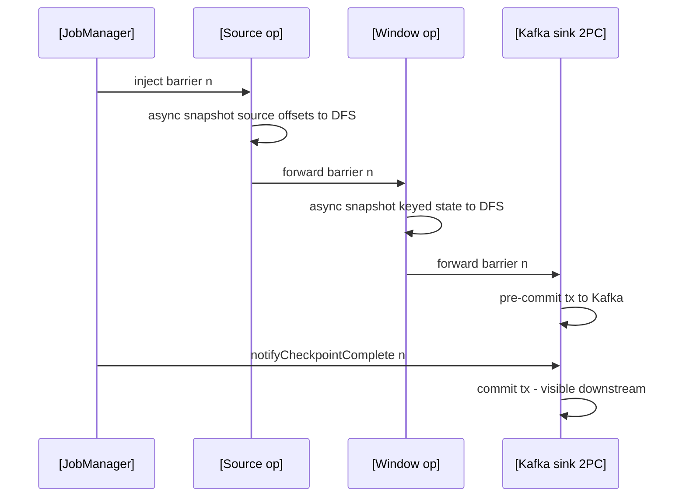

## Compute Engines: Spark vs Flink

Spark is a batch engine that grew streaming (micro-batches); Flink is a streaming engine that grew batch — scheduling, state, and failure handling all follow from that one choice.

:::scenario Scenario — Exactly-Once Assembly
@start Latency floor :: streaming-first: records one at a time → ~10 ms floor; batch is just a bounded stream of the same machinery
? sub-second stateful event-time => @flink |success
? batch ETL, SQL, ML breadth => @spark |fail
@spark Spark micro-batch :: incremental batches with offset+state checkpoints; commit overhead pins p99 near the batch interval — fine ≥ 1 min
@flink Watermarked topology :: native watermarks: a monotonic promise fires windows/timers when passed; late data routes to side outputs
-> pick the state backend => @backend
@backend Backend = capacity plan :: heap for small/low-latency, RocksDB for TBs, ForSt/disaggregated for cloud
? TB-scale or cloud state => @incremental |success
? small hot state, lowest latency => @heap |fail
@heap Heap backend :: fastest access with full-snapshot checkpoints — comfortable under a few GB of keyed state
-> design checkpoints => @barrier
@incremental RocksDB incremental :: snapshots upload only changed sstables, keeping duration flat as state grows to TBs
-> design checkpoints => @barrier
@barrier Barrier snapshot :: Chandy–Lamport barriers ride the data; processing never pauses while state lands on DFS
? backpressure stretches duration => @unaligned |success
? consumption keeps up => @aligned |fail
@aligned Aligned cut :: the operator waits for barriers from all inputs — cheapest consistent global cut when flow is steady
-> choose the sink => @sink
@unaligned Unaligned cut :: barriers overtake in-flight buffers and snapshot those too — larger snapshots, steady duration
-> choose the sink => @sink
@sink Sink two-phase commit :: TwoPhaseCommittingSink pre-commits at checkpoint, commits on notifyCheckpointComplete — Kafka exactly-once
-> audit the guarantee => @assemble
@assemble Assembly audit :: rewindable source + barrier snapshot + 2PC/idempotent sink — drop any one piece and it degrades
? upgrades, rescaling, migration ahead => @savepoint |success
@savepoint Savepoint surgery :: canonical version-stable manual checkpoint; plain checkpoints optimize speed, not 1.x→2.x compatibility
:::

::::diagram engine-runtimes.png
::::
:::

### Spark: DAG, Shuffle, Catalyst

- **Driver** builds the DAG and splits it into stages; **executors** run tasks and cache blocks ([architecture](https://spark.apache.org/docs/latest/cluster-overview.html)). Client mode for dev, cluster mode for prod — a lost submit machine must not kill the job.
- **DAGScheduler** cuts the plan at *shuffle boundaries*; **TaskScheduler** assigns tasks to slots, retries 4×, speculates stragglers.
- Lazy transformations only build a plan — laziness is what lets Catalyst optimize:

| Catalyst phase | What it does |
|---|---|
| Analysis | resolves names/types against the catalog |
| Logical optimization | predicate pushdown, projection pruning, constant folding |
| Physical planning | picks broadcast vs shuffled-hash vs sort-merge join from stats |
| Whole-stage codegen | fuses a stage into one Java function — no per-row virtual calls |
```text
DataFrame plan --> Catalyst --> physical plan --> DAGScheduler
                                                      |
                stages cut at every shuffle boundary
Stage 0: read parquet, filter        Stage 1: shuffle read, agg
  tasks 0..199 --sort-based shuffle-- tasks 0..199
  one file per map task, indexed by reduce partition
  reduce tasks fetch their partition segment over HTTP
AQE at the boundary: coalesce 200 -> 24  |  skew split 512 GB -> 8192
```

- **Structured Streaming** = incremental query over an unbounded table; checkpoint holds offsets + state snapshot → exactly-once into replayable sinks; **RocksDB state store default since Spark 4.0** ([migration guide](https://spark.apache.org/docs/latest/sql-migration-guide.html)). `Trigger.AvailableNow` for backfills; `Trigger.Continuous` (~1 ms) still experimental.

### Flink: True Streaming, State, Checkpoints

- **JobManager** (ResourceManager + Dispatcher + per-job JobMaster) builds the ExecutionGraph; **TaskManagers** run operator chains in slots. Records flow one at a time → ~10 ms end-to-end; Spark's floor is one micro-batch (0.5–10 s).
- **Watermarks are native**, not SQL sugar: sources emit timestamps plus a monotonic promise; windows/timers fire when the watermark passes; late data → side outputs. Flink 2.0 stops backpressured splits falsely reporting idle.
- **State backends**:

| Backend | Storage | Fits |
|---|---|---|
| HashMapStateBackend | JVM heap | small/medium state, lowest latency |
| EmbeddedRocksDBStateBackend | off-heap LSM | TBs of keyed state; incremental checkpoints |
| ForSt / disaggregated, 2.0 | remote object store as primary | cloud K8s, fast rescale ([release notes](https://nightlies.apache.org/flink/flink-docs-stable/release-notes/flink-2.0/)) |

- **Checkpoint = asynchronous barrier snapshot** (Chandy–Lamport): barriers flow with the data; an operator snapshots state once barriers arrive from all inputs; processing never pauses ([internals](https://nightlies.apache.org/flink/flink-docs-stable/docs/internals/stream_checkpointing.html)).



- **Unaligned checkpoints**: under backpressure, barriers overtake in-flight buffers and snapshot those too — steady checkpoint duration, larger snapshots.
- **Exactly-once** = rewindable source (Kafka) + barrier snapshot + **2PC sink**: `TwoPhaseCommittingSink` pre-commits on checkpoint, commits on `notifyCheckpointComplete`; idempotent commits (Iceberg) also qualify.
- **Savepoints**: manually triggered checkpoints in a canonical, version-stable format — upgrades, rescaling, migration. Plain checkpoints optimize speed, not compatibility; **no 1.x→2.x state compatibility**.
- **Flink 2.0** (Mar 2025): removed DataSet/Scala APIs, `SourceFunction`, per-job mode, `flink-conf.yaml`; added disaggregated state, adaptive broadcast + automatic skew-split joins, Materialized Tables; Java 17 default.
- **Ops**: K8s via the Flink Kubernetes Operator; its autoscaler reads per-vertex lag/backpressure (FLIP-271) — naive HPA breaks stateful jobs.

### Head-to-Head

| Dimension | Spark | Flink |
|---|---|---|
| Model | micro-batch default; continuous experimental | record-at-a-time; batch = bounded stream |
| Latency floor | ~batch interval, typ. 0.5–10 s | ~10 ms routine |
| Event time | watermark API on DataFrames | native runtime concept, per-source idleness |
| State | per-batch state store; RocksDB default in 4.0 | keyed operator state; heap/RocksDB/disaggregated |
| Exactly-once | per-batch commit to replayable sinks | barriers + 2PC sinks, event-level |
| Batch/SQL | strongest: Catalyst + AQE + ecosystem | good; batch optimizer historically weaker |
| Ecosystem | Delta/Iceberg, MLlib, Spark Connect, Python-first | CEP, Flink CDC, Paimon, stateful functions |
| Ops | moderate knobs | more: state sizing, watermarks, checkpoints, operator |

### Tuning Playbook

**Spark**

- Trust AQE for `shuffle.partitions`; watch "spill (memory and disk)" metrics — spikes mean add memory or partitions.
- `broadcast(df)` small dimensions; bucket/pre-partition to skip repeat shuffles; Kryo for custom RDD types; dynamic allocation + external shuffle service on shared clusters.

**Flink**

- Set TTL on every keyed op — unbounded state is the #1 production killer; RocksDB needs block-cache/write-buffer sizing.
- 2PC sinks commit only on checkpoint completion → checkpoint interval bounds deliverable latency.
- Backpressure + unstable checkpoints → unaligned checkpoints (bigger, but steady).

:::info Worked Example — Skewed groupBy: AQE split vs salting
`SELECT user_id, count(*) FROM events GROUP BY user_id` over 2 TB.
Median partition 8 GB; partition 37 = 512 GB (one bot user): 1 straggler
reduce task at ~150 MB/s ≈ 59 min → stage wall ≈ 60 min.
AQE, zero code: 512 GB > 256 MB threshold and > 5× median → split into
8,192 × 64 MB subtasks (`advisoryPartitionSizeInBytes`), each ~0.4 s →
wall ≈ 8 min (−87%), bounded by Stage 0 + the 8 GB runner-up.
Salting fallback (RDD/pre-AQE): key `(user_id, pmod(rand()*16, 16))`,
partial agg shrinks 800 M bot rows to 16 → shuffle 2 TB → ~150 GB, then
a second shuffle strips salt. Cost: two shuffles + 16× partial state.
:::

:::tip
AQE first, salting second: skew-split needs no code and no state blowup; salt only on RDD APIs, older Spark, or non-Spark engines.
:::

### When Each Wins

**Use cases:**
- Hourly/daily ETL or backfill → Spark; DuckDB if one node fits.
- Sub-second event-driven alerting with event-time correctness → Flink.
- Ad-hoc interactive BI → Trino (federated) or DuckDB (local), not Spark; distributed Python ML → Ray.

| Engine | Choose when | Avoid when |
|---|---|---|
| Spark | large batch ETL, lakehouse, ML at TB–PB scale | p99 latency < 1 s |
| Flink | stateful event-time streaming, CEP | workload is batch SQL |
| Trino ([docs](https://trino.io/docs/current/overview.html)) | interactive federated queries via connectors | ETL or streaming |
| DuckDB ([docs](https://duckdb.org/docs/stable/)) | GBs-scale analytics in-process | distribution or serving |
| Ray ([docs](https://docs.ray.io/en/latest/ray-overview/index.html)) | Python ML/AI tasks and actors | SQL analytics |

:::warning
Flink "for speed" with an SLA ≥ 1 min buys state-sizing, watermark, and checkpoint tuning for no benefit. Micro-batch Spark for sub-second alerting makes p99 hostage to per-batch commit overhead.
:::

### Key Takeaways

- Spark: lazy plans → Catalyst/Tungsten → stages cut at shuffles; AQE coalesces, de-skews, re-picks joins at runtime; shuffle is the cost center.
- Structured Streaming = incremental micro-batch with offset+state checkpoints; RocksDB state store default since 4.0; continuous mode still experimental.
- Flink: native watermarks → keyed state → async barrier snapshots → 2PC sinks = exactly-once at ~10 ms; backend choice is the capacity decision.
- Flink 2.0 removed DataSet/Scala APIs, added disaggregated state + auto skew-split joins; Spark 4.0 shipped ANSI default, VARIANT, pipes, Connect parity.
- Choose by latency floor and semantic fit: unified batch/stream optimizer (Spark) vs event-time stateful streaming (Flink).

### Interview Lens

- On "walk me through `groupBy`": stage split at shuffle, sort-based shuffle files, 200-partition default, AQE coalesce/skew-split, spill symptoms — mechanism, not keywords.
- Flink exactly-once as three cooperating pieces — rewindable source, barrier-aligned snapshot, 2PC/idempotent sink; draw the barrier flow; unaligned checkpoints answer backpressure.
- Frame tradeoffs: "Spark wins ≥1-min ETL + SQL/ML breadth; Flink wins sub-second stateful event-time" — defend with batch-commit overhead vs state-ops complexity.
