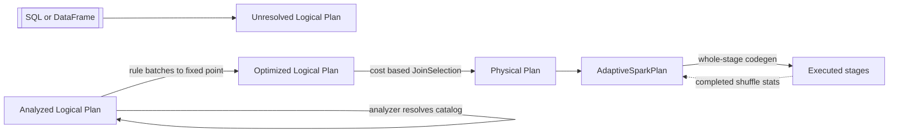

## Spark Performance: Catalyst, AQE & Tuning

Catalyst compiles your query into fused machine code, AQE repairs bad plans mid-flight using runtime stats, and nearly every production Spark incident reduces to one UI metric: shuffle size, skew, spill, or GC.

:::glide Glide — Diagnosing the Slow Spark Join
1) Find the hot stage :: Open the stage with the **largest shuffle read** — nearly every production incident is shuffle size, skew, spill, or GC.
2) Compare task p50 vs max :: Summary metrics show **median 35 s, max 24 min** — a huge max-vs-p50 gap means skew, not slow code.
3) Read the partition bytes :: the max task (partition 113) reads **40 GB** while a median partition is 500 GB ÷ 200 = **2.5 GB** — one fat key.
4) Check the AQE skew thresholds :: 40 GB > `skewedPartitionThresholdInBytes` (256 MB) **and** > 5 × 2.5 GB = 12.5 GB — both conditions met, so the skew-join split fires (joins only).
5) Verify the split math :: 40 GB ÷ 64 MB target ≈ **625 subtasks** of ~0.6 s each — stage wall drops from 24 min to the runner-up ≈ **40 s**.
6) Aggregate skew? Salt instead :: AQE skew split does not help `groupBy` — use `pmod(hash(key, rand()), N)`, partial-aggregate salted, second pass strips the salt.
7) Check the broadcast escape hatch :: dim table is 8 GB ≫ 10 MB threshold — forcing `/*+ BROADCAST */` would collect it all on the driver and OOM.
8) No skew? Read spill and GC :: `spill (disk) > 0` → per-task memory short (partitions ↑, memory ↑); GC time > 10–15% of task time → G1GC and smaller objects.
? Why is the 200 default for `spark.sql.shuffle.partitions` wrong in both directions? :: 500 GB shuffle → 2.5 GB partitions (spill, skew); 2 GB shuffle → 200 tasks of 10 MB (scheduling overhead). Size from bytes: `partitions ≈ shuffle_bytes / (128–256 MB)` — or over-provision and let AQE coalesce.
? When can AQE not rescue a plan at runtime? :: Nothing to re-plan without an `Exchange`; coalesce skips user-forced `repartition(n)`; skew split covers joins only — aggregate skew needs salting.
? Why does execution memory spill to disk while storage memory does not? :: In the unified model storage and execution borrow from each other, but storage blocks evict under pressure while **execution never evicts — it spills**; per-task execution memory ≈ pool ÷ concurrent tasks.
? Why is forcing `/*+ BROADCAST */` on stale statistics dangerous? :: The hint overrides stats — after heavy appends the "small" side can be huge at runtime, the driver collects it all and dies. Verify `sizeInBytes` in the plan first.
:::
::::diagram skew-diagnosis.png
::::
:::

### Catalyst: The Query Optimizer

- Four phases: parse → analyze (resolve names/types against the catalog) → optimize the logical plan (rules) → pick a physical plan (cost) → whole-stage codegen per stage:



- **Rule-based** optimizer: batches of `Rule[LogicalPlan]` applied to a fixed point — no statistics needed ([SQL docs](https://spark.apache.org/docs/latest/sql-programming-guide.html)):

| Rule | What it does | Example |
|---|---|---|
| PredicatePushdown | filters before join/exchange | `WHERE` on partition column prunes files |
| ColumnPruning | reads only referenced columns | parquet scan of 3 of 200 columns |
| ConstantFolding | folds literal math / dead branches | `WHERE 1 = 0` → empty relation |

- **Cost-based** physical planning: `JoinSelection` compares plan sizes from catalog stats (`sizeInBytes`, `rowCount`); `spark.sql.cbo.enabled` (default `false`) enables richer stats. Without `ANALYZE TABLE`, `sizeInBytes` defaults to a huge value → auto-broadcast never fires at compile time.
- **Whole-stage codegen** fuses all operators of one stage into a single Java function — no per-row virtual dispatch; falls back above `spark.sql.codegen.maxFields` (100).
- Read it in `explain("formatted")`: look for `PushedFilters`, the `ReadSchema` column list, the number of `Exchange` nodes, and the `*` codegen marker — abridged:

```text
== Physical Plan ==                     <- isFinalPlan=true means AQE re-planned
AdaptiveSparkPlan (6)
+- Sort (5)
   +- Exchange hashpartitioning(customer_id, 4096)   <- each Exchange = a stage cut
      +- Project (3)                                  <- ColumnPruning happened
         +- Filter (2)                                <- Pushdown happened
            +- Scan parquet (1)
               PushedFilters: [IsNotNull(customer_id)]
               ReadSchema: struct<customer_id:string,amount:decimal(10,2)>
```

- Tungsten carries this to hardware: `sun.misc.Unsafe` off-heap allocation, a compact binary row format (`UnsafeRow`) instead of JVM objects, and cache-aware computation ([Databricks, Project Tungsten](https://www.databricks.com/blog/2015/04/28/project-tungsten-bringing-spark-closer-to-bare-metal.html)) — GC pressure drops because data stops living as objects.

### AQE: Adaptive Query Execution

- Re-optimizes at each shuffle boundary using **actual map-output stats** from completed stages ([performance tuning docs](https://spark.apache.org/docs/latest/sql-performance-tuning.html), [Databricks AQE](https://www.databricks.com/blog/2020/05/29/adaptive-query-execution-speeding-up-spark-sql-at-runtime.html)); on by default since 3.2.0 (`spark.sql.adaptive.enabled`).

| Feature | Triggers when | Knobs |
|---|---|---|
| Coalesce partitions | many tiny post-shuffle partitions | merge toward `advisoryPartitionSizeInBytes` (64 MB); `parallelismFirst=true` keeps a floor |
| Skew-join split | partition > `skewedPartitionFactor` (5) × median **and** > `skewedPartitionThresholdInBytes` (256 MB) | splits only the fat side into target-size subtasks; joins only (SMJ/SHJ) |
| Join-strategy switch | runtime side fits `spark.sql.adaptive.autoBroadcastJoinThreshold`, or empty-partition ratio ≥ `nonEmptyPartitionRatioForBroadcastJoin` (0.2) | SMJ → broadcast hash or shuffled hash |

- Limits: nothing to re-plan without an `Exchange`; coalesce skips user-forced `repartition(n)`; skew split does not help groupBy/aggregate skew — salt those.

### Join Strategies

| Strategy | Condition | Trade-off |
|---|---|---|
| Broadcast hash (BHJ) | one side ≤ `spark.sql.autoBroadcastJoinThreshold` (10 MB default) per stats | no shuffle of the big side; driver collects + broadcasts; misestimate → driver OOM |
| Shuffled hash (SHJ) | both shuffled, build side fits hash map | no sort needed, faster; chosen only if `preferSortMergeJoin=false` or hinted |
| Sort-merge (SMJ) | default for large equi-joins | both sides sorted; spills gracefully; the robust pick |

- SMJ wins when neither side is reliably small, inputs are unsorted, or you need predictable spill behavior at 3 a.m. — SHJ needs a hint or config; BHJ needs honest stats or AQE runtime rescue.
- **Use cases:**
- Broadcast: star-schema dimensions (MBs to low GBs), enrichment joins in streaming micro-batches, repeated small-lookup joins.
- SMJ: TB-scale fact-fact joins, unknown cardinality, skewed keys (AQE splits apply); SHJ: medium build side where sorting is the bottleneck.

```python
from pyspark.sql import functions as F

dim = spark.read.table("dim_customer")          # 8 MB, stats fresh
orders = spark.read.table("fct_orders")
orders.join(F.broadcast(dim), "customer_id")    # API hint
# SQL: SELECT /*+ BROADCAST(d) */ * FROM fct_orders o JOIN dim_customer d ON ...

spark.conf.set("spark.sql.adaptive.enabled", "true")              # default since 3.2.0
spark.conf.set("spark.sql.adaptive.advisoryPartitionSizeInBytes", "128m")
spark.conf.set("spark.sql.adaptive.skewJoin.enabled", "true")
spark.conf.set("spark.sql.shuffle.partitions", "4096")            # size from data; AQE merges down
```

### Shuffle & Partitioning

- Sort-based shuffle (default since 1.2): each map task writes **one** sorted, serialized data file plus an index; each reduce task fetches its byte range from the map task's block manager. No `shuffle.partitions` files per map task — that was the hash era.
- ≤ `spark.shuffle.sort.bypassMergeThreshold` (200) reduce partitions with no map-side combine → bypass: unsorted per-reducer files, no sort cost.
- 200 default is wrong in both directions: 500 GB shuffle → 2.5 GB partitions (spill, skew); 2 GB shuffle → 200 tasks of 10 MB (scheduling overhead). Size from data: `partitions ≈ shuffle_bytes / (128–256 MB)` — or over-provision and let AQE coalesce.
- Skew fixes, in order: AQE skew-join split (joins, zero code) → salting `pmod(hash(key, rand()), N)` for aggregates (two-phase: salted partial agg, then strip) → isolate the hot key with a separate pass.
- `repartition(n)`: full shuffle, can raise partition count — use before heavy joins/writes. `coalesce(n)`: merges without shuffle — cheap, but few fat tasks land on few cores → skew/OOM; only after a filter shrank the data or for small final outputs.

### Memory, Spill & GC

```text
Executor JVM heap, say 20 GB
+---------------------------------------------------------------+
| reserved 300 MB                                                 |
| unified = spark.memory.fraction 0.6 -> 11.8 GB                  |
|   storage 5.9 GB  <--- borrow --->  execution 5.9 GB            |
|     cache, broadcast:      sorts, aggs, joins, shuffles:        |
|     evicted under pressure           SPILL to disk              |
| user memory 0.4 -> 7.9 GB: UDF objects, your collections        |
+---------------------------------------------------------------+
```

- Unified model ([tuning guide](https://spark.apache.org/docs/latest/tuning.html)): `spark.memory.fraction` (0.6) carves the pool; storage and execution borrow from each other. Storage blocks evict; **execution never evicts — it spills**. Per-task execution memory ≈ pool ÷ concurrent tasks, so 5 cores on 12 GB → ~1.4 GB per sort/agg.
- Spill appears when a sort/hash table exceeds that share: `spill (memory)` converts to `spill (disk)` in stage metrics. Fix by target: more partitions, less per-task data, more executor memory, or reduce skew.
- GC pressure: UnsafeRow churn + fat UDF objects → GC time competes with task time. G1GC for ≥4–8 GB heaps (`-XX:+UseG1GC`), Kryo for custom-typed RDDs, avoid `collect()`-scale object graphs.
- OOM patterns: **driver** — `collect()` or broadcasting an underestimated table (fix: limit, `toLocalIterator`, honest stats). **Executor** — skewed task or over-`coalesce`d partitions (fix: AQE/salting, raise partitions). **YARN "memory overhead exceeded"** — raise `spark.executor.memoryOverhead`.

### Reading the Spark UI

| Signal (where) | Means | Action |
|---|---|---|
| Spill (disk) > 0 on sort/agg stages ([web UI](https://spark.apache.org/docs/latest/web-ui.html)) | per-task memory short | partitions ↑, memory ↑, skew ↓ |
| Task max ≫ p50 (Summary Metrics) | skew | AQE skew split or salting |
| GC Time > 10–15% of task time | allocation churn | G1GC, smaller objects, less caching |
| #Files in scan (SQL tab) ≫ data size | small-file problem | compaction, `optimizeWrite` |
| Initial vs final AQE plan differ | runtime rescue fired | verify what changed — do not assume compile-time plan runs |
| Failures concentrated on one executor (Executors tab) | bad node | exclude the node |

:::info Worked Example — Diagnosing a slow join stage
Stats: 2 TB fact join, stage shows shuffle write 500 GB, `spark.sql.shuffle.partitions=200`; summary metrics — median task 35 s, max task **24 min**; the max task (partition 113) reads **40 GB** while a median partition is 500 GB ÷ 200 = **2.5 GB**.
Decision: 40 GB > 256 MB threshold and > 5 × 2.5 GB = 12.5 GB → AQE skew-join split fires, splitting into 40 GB ÷ 64 MB ≈ **625 subtasks** of ~64 MB ≈ 0.6 s each at ~100 MB/s. Stage wall drops from 24 min to the runner-up ≈ 2.5 GB ≈ 40 s.
If it were a `groupBy`, AQE skew split does not apply → salt: `(user_id, pmod(hash(user_id, rand()), 16))`, partial-aggregate salted, second pass strips the salt — 16× parallelism on the hot key.
Broadcast escape hatch? Dim table is 8 GB ≫ 10 MB threshold — forcing `/*+ BROADCAST */` would OOM the driver. No.
:::

:::tip
Over-provision `spark.sql.shuffle.partitions` and let AQE coalesce — AQE merges small partitions but cannot split ordinary (non-skewed) oversized ones. Under-provisioning is unrecoverable at runtime.
:::

:::warning
`/*+ BROADCAST */` overrides stats. Stale statistics after heavy appends make a "small" side huge at runtime — the driver collects it all and dies. Verify `sizeInBytes` in the plan before forcing.
:::

### Key Takeaways

- Catalyst = rule-based logical optimization + cost-based physical planning; Tungsten = off-heap binary rows + whole-stage codegen; `explain("formatted")` proves pushdown, pruning, codegen actually happened.
- AQE re-plans at shuffle boundaries since 3.2: coalesce to ~64 MB, split >5×-median-and->256 MB skewed join partitions, switch SMJ→BHJ/SHJ; useless without an Exchange, blind to aggregate skew.
- Join choice = one threshold (10 MB) + honest stats: broadcast when one side truly fits, SHJ when sort hurts, SMJ as the robust default.
- Shuffle is the cost center: size partitions from bytes (~128–256 MB), not the 200 default; `repartition` for width, `coalesce` only shrinking.
- The UI answers first: p50-vs-max for skew, spill counters for memory, GC time for pressure — fix data shape before knobs.

### Interview Lens

- On "why is my Spark job slow": open the stage with the largest shuffle read, compare task p50 vs max, check spill and GC — then classify into skew / partitions / memory / GC with numbers, not knob names.
- Whiteboard `SparkPlan` end to end: parsed → analyzed → optimized logical → physical (JoinSelection cost) → AQE re-plan points at each Exchange → codegen; know which optimizations need stats and which need only rules.
- Defend a threshold decision: given a dim table size, compute broadcast feasibility (10 MB rule, driver memory), expected shuffle bytes ÷ 128 MB → partition count, and when you would salt instead of trusting AQE.
