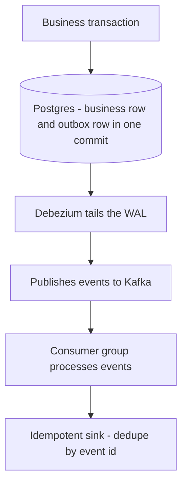

## Messaging & Streaming Backbones: Kafka and Friends


:::tldr
- Three messaging models: queue (one consumer, ack-then-delete), pub/sub (fan-out, no replay), log (Kafka: partitioned, replayable, consumer-owned offsets — replay is an offset reset).
- Ordering is per-partition only: `hash(key) % partitions` gives per-entity order; changing partition count silently breaks the key map.
- ISR = replicas current within `replica.lag.time.max.ms` (30 s); high watermark = highest offset replicated to all ISR — consumers read only up to HW.
- Durability recipe: `acks=all` + RF=3 + `min.insync.replicas=2` + `unclean.leader.election.enable=false`; ISR shrunk to 1 → explicit `NOT_ENOUGH_REPLICAS`, not silent loss.
- Exactly-once stops at Kafka's edge: idempotent producer (PID + sequence, default since 3.0) + transactions + `read_committed`; across boundaries use the outbox — never dual-write.
- Rebalance-proofing: cooperative-sticky assignor (KIP-429) + static membership + `max.poll.records` finishing inside `max.poll.interval.ms` (5 min default).
- KRaft replaced ZooKeeper (removed in 4.0, 2025); schema evolution `FULL_TRANSITIVE` on shared topics; tiered storage decouples retention from broker disk.
:::

Queues distribute work, pub/sub fans out events, and Kafka is a third model — the partitioned, replayable log — from which most modern backbones derive.

:::scenario Scenario — Call the Kafka Durability Shots
@produce Produce to the leader :: batches per partition (linger.ms, batch.size); murmur2 key hash fixes ordering
-> followers fetch => @isr
@isr ISR caught up? :: replicas within replica.lag.time.max.ms (30s) stay in-sync
? yes, all in ISR => @acks
? ISR shrunk to 1 => @durfail |fail
@acks acks level? :: acks=1 covers only the leader's local write
? acks=1, leader writes => @durfail |fail
? acks=all + min.insync=2 => @hw |success
@durfail Durability lost :: acks=1 loses acknowledged data on leader crash; ISR=1 → NOT_ENOUGH_REPLICAS, explicit not silent
-> retry when ISR recovers => @isr
@hw HW advances past the write :: consumers only read offsets replicated to all ISR
-> leader dies => @elect
@elect unclean.leader.election? :: controller picks the new leader
? false (default): wait for ISR member => @clean |success
? true: elect out-of-sync replica => @unclean |fail
@clean Zero acknowledged-data loss :: availability traded for durability — the canonical recipe holds
@unclean Acknowledged offsets vanish :: out-of-sync leader truncates what the old leader had committed
-> durable recipe => @eos
@eos Need exactly-once across a boundary? :: EOS stops at Kafka's edge — outside it's at-least-once
? inside Kafka only: idempotent producer + txns => @eidok |success
? db.save + kafka.send dual-write => @dual |fail
? outbox row commits with business change => @outbox |success
@eidok Transactions + read_committed :: atomic multi-partition writes inside Kafka — real EOS
@dual Crash-in-between loses the event :: DB committed, Kafka never saw it — dual-write is not atomic
@outbox CDC publishes the outbox row :: atomic DB↔Kafka — the only boundary-safe pattern
:::

:::diagram kafka-write-path.png
:::


### Queues, Pub/Sub, and Logs

- **Queue** (SQS, RabbitMQ): each message to exactly one consumer, ack-then-delete, no replay.
- **Pub/sub**: every subscriber gets every event; broker tracks subscriptions, not replay positions.
- **Log** (Kafka): append-only, ordered per partition; consumer-owned offsets make replay an offset reset, not a redeliver.
- **Push vs pull**: push (RabbitMQ) = lower latency, credit/prefetch flow control; pull (Kafka, SQS long-poll ≤20s) = consumer-paced batching and trivial replay.
- **Ordering**: strict only *within a partition*; `hash(key) % partitionCount` gives per-entity order — and changing partition count silently breaks that key→partition map.

### Kafka Internals: Partitions, ISR, Offsets

- **Topic → partitions → segments**: each partition is an append-only log split into ~1 GB segment files (`log.segment.bytes`) plus sparse offset and time indexes. Deletes/compaction work at segment granularity, never in-place — the whole reason writes are sequential I/O.
- **Page cache + zero-copy**: Kafka caches nothing itself; hot tail reads hit the OS page cache (small JVM heap, no GC pressure) and `sendfile()` ships bytes disk→socket without user-space copies (disabled under TLS).
- **Replication**: one leader per partition; followers fetch continuously. Replicas current within `replica.lag.time.max.ms` (30s) form the **ISR**. The **high watermark** is the highest offset replicated to all ISR — consumers read only up to HW. Leader dies → controller elects from ISR; `unclean.leader.election.enable=false` (default) trades availability for zero acknowledged-data loss.
- **Offsets**: consumers commit to `__consumer_offsets`, a 50-partition log-compacted internal topic.
- **Retention & compaction**: `retention.ms`/`retention.bytes` per partition (default 7 days). **Compaction** keeps only the latest value per key plus tombstones for deletes; requires keyed records; used for `__consumer_offsets`, state-store changelogs, entity/CDC topics. **Tiered storage** (KIP-405, GA 3.6+): local disk keeps recent segments, older offloaded to S3/GCS — retention decoupled from broker disk.
- **KRaft** (KIP-500): a Raft metadata quorum replaces ZooKeeper — production-ready in 3.3, ZooKeeper removed entirely in Kafka 4.0 (2025) ([upgrade guide](https://kafka.apache.org/41/getting-started/upgrade), [KIP-500](https://cwiki.apache.org/confluence/display/KAFKA/KIP-500%3A+Replace+ZooKeeper+with+a+Self-Managed+Metadata+Quorum)).

```text
Topic "orders" - 3 partitions, RF=3
Broker1       Broker2       Broker3
 P0 leader    P1 leader     P2 leader
 P2 follower  P0 follower   P1 follower

P0 log: [0][1][2][3][4][5][6]   append-only, per-partition offsets
         ^            ^
         |            +--- consumer B (group "billing")
   consumer A         group "billing": A owns P0+P2, B owns P1
group "analytics" also reads all 3 - groups have independent offsets
```

:::info Worked Example
Size a topic: 50k events/s × 500 B = **25 MB/s** ingress.
- Daily volume: 25 MB/s × 86,400 s ≈ **2.16 TB/day**; 7-day retention ≈ **15.1 TB**; × 3 replicas ≈ **45 TB** of raw disk.
- Partitions: consumers sustaining ~10 MB/s each need ⌈25 ÷ 10⌉ = 3 just to keep up; 3–4× headroom → **12 partitions** (also the max parallelism of one consumer group).
- Per partition: ~2.1 MB/s in, ~1.26 TB per 7 days — a 1 GB segment rolls every ~8 min, so cleanup is frequent small segment deletes, not giant rewrites.
- Decision: 12 partitions, RF=3, `min.insync.replicas=2`; at 45 TB either spread across ~5 brokers (9 TB each) or enable tiered storage.
:::

### Producers & Consumers

| `acks` | Durability | Latency | Failure window |
|---|---|---|---|
| `0` | Fire-and-forget | Lowest | Leader loss silently drops records |
| `1` | Leader wrote locally | Medium | Leader crash before replication loses records |
| `all` + `min.insync.replicas` | All ISR acknowledged | Highest, batchable | Survives `min.insync.replicas−1` broker failures |

- **Canonical durability**: `acks=all` + RF=3 + `min.insync.replicas=2` — if ISR shrinks to 1, producers get `NOT_ENOUGH_REPLICAS` instead of silent degradation.
- **Producer pipeline**: batch per partition (`linger.ms`, `batch.size`), compress (`lz4`/`zstd` — works best on batches), partition by murmur2 key hash or sticky batching for keyless records.
- **Idempotence**: `enable.idempotence=true` (default since 3.0 with `acks=all`) — broker dedups retries via per-partition `(PID, sequence)`; exactly-once per partition per producer session.
- **Transactions** (KIP-98): atomic writes across partitions + `read_committed` consumers; enables consume-transform-produce loops. Cost: coordination latency, in-flight txns block the LSO — never per-record transactions on bulk flows.
- **Consumer groups**: coordinator broker + elected group leader assign partitions; consumers in a group split partitions (max parallelism = partition count); independent groups fan out.
- **Rebalancing**: eager (classic) revokes *all* partitions — stop-the-world; **cooperative-sticky** (KIP-429) moves only affected partitions. **Static membership** (`group.instance.id`) makes rolling restarts rebalance-free ([KIP-429](https://cwiki.apache.org/confluence/display/KAFKA/KIP-429%3A+Kafka+Consumer+Incremental+Rebalance+Protocol)).

:::tip Rebalance-Proofing
Set `CooperativeStickyAssignor` + `group.instance.id` + `max.poll.records` sized so one poll finishes well inside `max.poll.interval.ms` (5 min default). Exceeding it = kicked member → rejoin → rebalance storm.
:::

### Schema Registry & Connect

- **Schema Registry**: versioned schemas per subject (default `TopicNameStrategy`), formats Avro/Protobuf/JSON Schema; wire format = magic byte + schema ID + payload. Enforces evolution rules:
- **Kafka Connect**: source/sink framework (Debezium CDC, JDBC, S3); distributed mode stores offsets/config in compacted internal topics — restart-safe; SMTs filter/route in-flight.
- **MirrorMaker 2** (KIP-382): cluster-to-cluster replication for DR/active-active with offset translation via checkpoints ([KIP-382](https://cwiki.apache.org/confluence/display/KAFKA/KIP-382%3A+MirrorMaker+2.0)).

| Mode | New reads old | Old reads new | Typical safe change |
|---|---|---|---|
| `BACKWARD` (default) | ✅ | — | Add optional field with default |
| `FORWARD` | — | ✅ | Delete optional field |
| `FULL` | ✅ | ✅ | Only optional-with-default changes |
| `*_TRANSITIVE` | checked against **all** previous versions, not just latest | | |

:::warning Schemaless Shared Topics
Run `FULL_TRANSITIVE` on any shared backbone topic; shipping raw JSON with no registry means every consumer is coupled to every producer's mood.
:::

### Kafka vs Pulsar vs Kinesis vs RabbitMQ

| System | Model | Ordering | Replay | Wins when |
|---|---|---|---|---|
| **Kafka** | Partitioned log, storage+serving on same brokers | Per partition | Days–infinite | Event backbone, stream processing, ecosystem depth |
| **Pulsar** | Stateless brokers over BookKeeper storage | Per partition-ish | Yes, native tiering | Multi-tenant, millions of topics, elastic failover |
| **Kinesis** | Managed shards | Per shard | 24h–365d | AWS-native pipelines, zero ops, shard planning |
| **RabbitMQ** | Smart broker, AMQP routing | FIFO per queue | No (delete-on-ack) | Complex routing, per-message TTL/priority, job queues |
| **SQS/SNS** | Managed queue / fan-out | FIFO per MessageGroupId only | No | Serverless decoupling, Lambda triggers, built-in DLQ |
| **Redpanda** | Kafka API, C++, Raft, thread-per-core | Per partition | Yes | Kafka workloads without JVM ops, NVMe-first |

- The architectural fork: Kafka couples storage and serving (broker failure moves leadership *and* reads); Pulsar splits them — brokers are stateless, failover instant, at the cost of an extra system and write amplification (ensemble/write/ack quorum, e.g. 3/2/2).
- **Use cases:**
  - **Event-driven microservices** — Kafka/Pulsar as backbone: per-service consumer groups, DLQs, schema-governed contracts.
  - **Data pipeline** — Kafka + Connect/Flink/Spark CDC-ing into a warehouse; Kinesis when the warehouse is Redshift and ops budget is zero.
  - **Event sourcing** — compacted+retained topics as the system of record; state rebuilt by replaying offsets, snapshots via changelog compaction.

### Failure Patterns & Fixes

| Symptom | Root cause | Fix |
|---|---|---|
| Hot key starves one partition | Skewed key distribution | Salt keys (`key#bucket`), two-stage aggregate |
| Lag grows without bound | Slow processing / under-provisioned group | Add partitions + consumers, cut per-record cost; alarm on lag *growth rate* |
| Rebalance storm | Polls exceed `max.poll.interval.ms`; flapping member | Cooperative assignor, static membership, smaller `max.poll.records` |
| Poison pill blocks partition | Undeserializable record at head | Retry topics with backoff → DLQ with headers + error metadata |
| Duplicate side effects | Kafka redelivers (at-least-once) | Idempotent sink (DB unique key/upsert) or processed-messages dedupe table |
| Acknowledged data lost | `acks=1` or unclean leader election | `acks=all` + `min.insync.replicas=2` + `unclean.leader.election.enable=false` |
| DB and Kafka disagree | Dual write ("write DB, then produce") — crash between the two | Outbox pattern below |

:::steps Outbox write path

One transaction writes the business row and the outbox row together — that single commit is the whole trick. :: A,B
Debezium tails the WAL and CDC publishes afterwards — delivery is at-least-once. :: C
Events publish to Kafka with at-least-once delivery — exactly-once is real only inside Kafka. :: D
A consumer group processes events; retries can duplicate. :: E
The sink dedupes by event id: at-least-once + idempotent effect is the honest cross-system contract. :: F
:::

The outbox makes DB↔Kafka atomic: the event row commits with the business change, CDC publishes afterwards, delivery is at-least-once, consumers dedupe by event ID. Exactly-once is real *within* Kafka (idempotent producer + transactions + `read_committed`); across system boundaries it is always at-least-once + idempotent effect ([Debezium outbox](https://debezium.io/documentation/reference/transformations/outbox-event-router.html), [Kafka design docs](https://kafka.apache.org/documentation/#design)).

:::warning Dual Writes
`db.save(x); kafka.send(event(x))` fails on the crash-in-between window — one side misses the write with no record of it. No amount of retries fixes a missing fact; only the outbox (or transactions spanning both systems) does.
:::

:::cards
Q: What third model does Kafka add beyond queue and pub/sub? :: A partitioned, replayable append-only log with consumer-owned offsets.
Q: What ordering does Kafka guarantee? :: Strict order only within a partition — key hashing fixes per-entity order.
Q: State the canonical Kafka durability recipe. :: acks=all + RF=3 + min.insync.replicas=2 + unclean.leader.election disabled.
Q: Define the high watermark. :: The highest offset replicated to all ISR — consumers read only up to it.
Q: Why is dual-writing DB + Kafka wrong? :: A crash in between loses the event with no record — use the outbox pattern with CDC.
Q: Where is exactly-once real in Kafka? :: Inside Kafka — idempotent producer + transactions + read_committed; across boundaries, at-least-once + idempotent sinks.
Q: Name two rebalance-storm fixes. :: Cooperative-sticky assignor and static membership (group.instance.id).
:::

### Key Takeaways

- Kafka = partitioned append-only log on OS page cache: sequential I/O, per-partition ordering only, consumer-owned offsets, replay = offset reset.
- Durability recipe: `acks=all` + `min.insync.replicas≥2` + RF≥3 + no unclean election; idempotent producers kill retry dups; EOS stops at Kafka's edge.
- KRaft replaced ZooKeeper (complete in 4.0, 2025); cooperative rebalancing + static membership kill rebalance storms; tiered storage decouples retention from disk.
- Schema Registry with `FULL_TRANSITIVE` + Connect/Debezium make the backbone contract-governed; never dual-write — use the outbox.
- Platform choice is architectural: Kafka (coupled, richest ecosystem), Pulsar (stateless serving over BookKeeper), Kinesis/SQS (managed AWS, no replay), Redpanda (Kafka API, leaner runtime), RabbitMQ (rich routing, not streaming scale).

### Interview Lens

- Draw the replication model cold: leader/followers, ISR, high watermark, `acks` × `min.insync.replicas`, and what happens when the leader dies with ISR shrunk (`NOT_ENOUGH_REPLICAS` vs unclean election).
- Scale probes: "why not 10k partitions per broker" (election/recovery/rebalance cost, file handles), "hot key", "lag is rising — triage it", "three rebalance-storm causes".
- Consistency framing: exactly-once across boundaries is marketing — answer with idempotent producers (in-Kafka), transactions (in-Kafka pipelines), outbox + idempotent sinks (external effects).
