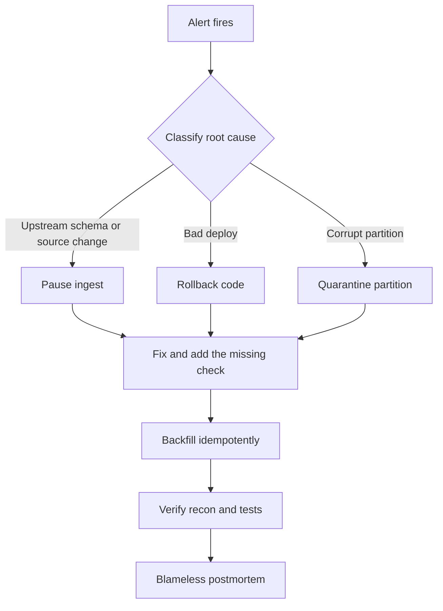

## Pipeline Reliability: Testing, Quality, Observability


:::tldr
- Six quality dimensions are the shared vocabulary: accuracy, completeness, freshness, validity, uniqueness, consistency — every tool (GE, dbt, Soda) maps to them.
- Test pyramid: unit tests every PR, data tests every pipeline run, expensive reconciliations daily/before publish, production monitoring continuous.
- Observability = metrics (what broke) + logs (where) + lineage (what else); OpenLineage/Marquez bounds the blast radius.
- Gate failure → circuit breaker: publish to staging, promote atomically — consumers keep last-known-good; alert when quarantine rate exceeds ~1%.
- SLO math: 99% on-time over 30 daily runs → error budget 0.3 runs → page on the first miss; thresholds come from budget math, not complaints.
- Idempotent backfill: DELETE + INSERT per partition or MERGE — never blind append; same input must give same output.
- Incident loop: alert → classify → contain → fix → backfill → verify → blameless postmortem; every incident ends as a new automated check.
:::

Production pipelines fail more often through silent bad data than loud crashes — the senior differentiator is treating quality gates, tests, and observability as first-class pipeline code, not an afterthought.

:::scenario Scenario — Bad-Data Incident
@start Alert fires :: gates catch silent bad data — quarantine rate, freshness lag, test pass rate; never wait for complaints
-> classify => @classify
@classify Classify the root cause :: the branch decides containment: upstream change, bad deploy, or corrupt partition
? upstream schema or source change => @pause |success
? deploy correlated with the break => @rollback |fail
? isolated corrupt partition => @quarantine
@pause Pause ingest :: circuit breaker stops the swap — publish to staging, promote only when gates pass; consumers keep last-known-good
-> fix => @fix
@rollback Rollback the deploy :: revert to last-known-good code; the pipeline resumes from checkpointed offsets and state
-> fix => @fix
@quarantine Quarantine the partition :: fence the bad slices so healthy partitions keep flowing — lineage bounds the blast radius
-> fix => @fix
@fix Fix and add the check :: every incident ends as a new automated check — that is how reliability compounds
-> backfill => @backfill
@backfill Idempotent backfill :: DELETE + INSERT per partition or MERGE — never blind append; same input must give same output
? blast radius known => @verify |success
? downstream impact unclear => @lineage |fail
@lineage Map the lineage :: OpenLineage answers "which dashboards and models are downstream?" — bounding scope before reprocessing
-> verify => @verify
@verify Verify reconciliation :: row counts per partition, SUM(hash(...)) on business keys, sampled source-vs-target diff
? gates pass => @postmortem |success
? still failing => @classify |fail
@postmortem Blameless postmortem :: close the loop — the check added at fix time is what makes the next alert fire earlier
:::
::::diagram incident-loop.png
::::
:::

### The Six Quality Dimensions

Every data check you will ever write targets one of six dimensions ([Great Expectations](https://greatexpectations.io/), dbt tests, and Soda all map to them):

| Dimension | Question it answers | Real failure example | Typical check |
|---|---|---|---|
| Accuracy | Does data match reality? | FX rate stored as 1.10 vs true 1.01 | Sample-diff against trusted source |
| Completeness | Are all expected rows present? | 2.1M rows land vs 2.4M in source | Row-count ratio, NOT NULL |
| Freshness | How recent is the data? | Dashboard serves yesterday's noon snapshot | `max(event_ts)` vs now |
| Validity | Are values well-formed and in range? | Negative ages, emails without `@` | Schema, regex, range tests |
| Uniqueness | Any duplicates from retries? | Kafka at-least-once → double-loaded partition | Primary-key uniqueness test |
| Consistency | Do systems agree with each other? | Warehouse revenue ≠ app-DB revenue | Cross-system reconciliation |

**Use cases:**
- GDPR-delete audit trail → lineage + a uniqueness check on `user_id` proves the delete propagated to every derived table.
- Finance-grade reconciliation → accuracy + consistency: checksums and source-vs-target diffs, not just row counts.
- ML feature freshness → freshness SLIs on feature tables; stale features silently degrade model quality.

### Testing Pyramid for Data

Fast and cheap at the base, expensive and rare at the top — run the base on every commit, the top in production:

| Layer | Scope | Example | When it runs |
|---|---|---|---|
| Unit tests | Transform logic in isolation | Spark UDF / dbt macro against fixture input, edge cases (nulls, dupes, tz) | Every PR (CI) |
| Data tests | Assertions on real data | `unique`, `not_null`, `accepted_values`, `relationships` | Every pipeline run |
| Integration / reconciliation | End-to-end truth | Source-vs-target row counts + checksums on a small fixture | Daily / before publish |
| Production monitoring | Live anomalies | Freshness lag, volume spikes, quarantine rate | Continuous |

```sql
-- dbt tests: YAML-declared SQL assertions that gate a model's publish
models:
  - name: fct_orders
    columns:
      - order_id:
          tests: [unique, not_null]
      - status:
          tests:
            - accepted_values: [placed, shipped, refunded]
```

- **Great Expectations**: Python expectations-as-code with rich data docs; best inside ingestion/Spark/Airflow jobs.
- **dbt tests**: SQL-native, live next to the models they gate; best for warehouse layers.
- **Soda**: YAML SodaCL checks including freshness and anomaly scans; lightweight, pipeline-friendly ([Soda docs](https://docs.soda.io/)).

### Observability: Metrics, Lineage, Alerts

Three pillars — metrics tell you *what* broke, logs *where*, lineage *what else* is impacted:

- **Metrics**: rows in/out, bytes, run duration, freshness lag, quarantine rate, test pass rate.
- **Logs**: structured and keyed by run ID, so one query joins every event of a failed run.
- **Lineage**: [OpenLineage](https://openlineage.io/) events flowing into [Marquez](https://marquezproject.ai/) — "this table is wrong; which dashboards and models are downstream?" in one click, and it scopes your backfill.

```text
        +---------+     +---------+     +---------+
src --->| BRONZE  |---->| SILVER  |---->|  GOLD   |--> dashboards
        +---------+     +---------+     +---------+
  schema validity   not_null/unique  recon vs source
  volume anomaly    relationships    business bounds
  quarantine DLQ    freshness lag    freshness SLO
  circuit breaker   row-count gate   test-gated publish
        +------ OpenLineage events ---> Marquez ------+
```

- **Circuit breaker / graceful degradation**: when a gate fails, stop the swap — publish to staging and atomically promote, so consumers keep last-known-good data instead of receiving garbage.
- **Quarantine & DLQ**: route malformed records to a quarantine table with a counter metric; alert when quarantine rate exceeds ~1%; never drop silently.

### SLOs for Data Products

Treat datasets as products with contracts — SLI/SLO/SLA map cleanly onto data ([Google SRE Workbook](https://sre.google/workbook/implementing-slos/)):

| Term | Data meaning | Example |
|---|---|---|
| SLI | The measured indicator | % of daily runs landing by 07:00 UTC |
| SLO | Target over a rolling window | 99% on-time over 30 days |
| SLA | Contract with consequences | Two breached windows → escalation/credit |

:::info Worked Example
**Freshness SLO for a revenue dashboard**

- SLI: `run_landed_by_07:00` ∈ {true, false}, sampled once per daily run.
- SLO: 99% of daily runs on time, rolling 30 days.
- Error budget = (1 − 0.99) × 30 runs = **0.3 runs** → a single miss gives 29/30 = 96.7%, which already breaches the SLO.
- Decision: with daily sampling the budget is below one run, so **page on the first miss** — or reshape the SLI as a 15-minute freshness probe (2,880 samples/month, budget ≈ 28 late samples) and alert on fast burn: > 2% of budget consumed in 1 h AND > 5% in 6 h.
- Point for interview: the alert threshold falls out of the budget math, never out of "when someone complains."
:::

### Incident Playbook

One loop: alert → classify → contain → fix → backfill → verify → learn.

:::steps One incident, walked end to end

Alert fires — quality gates and freshness SLOs page before consumers notice. :: A
Classify first: upstream schema or source change, bad deploy, or corrupt partition — contain before fixing. :: B,C,D,E
Containment options: pause ingest, roll back the deploy, quarantine the partition — alert when quarantine passes ~1 percent, never drop records silently. :: C,D,E
Fix and add the missing check — every incident ends as a new automated check; that is how reliability compounds. :: F
Backfill idempotently: DELETE + INSERT per partition or MERGE — same input, same output, never blind append. :: G
Verify reconciliation: row counts per partition, checksums on business keys, sampled source-vs-target diff. :: H
Close with a blameless postmortem. :: I
:::

- **Backfill runbook**: use lineage to enumerate impacted tables; reprocess only affected partitions; idempotent means `DELETE + INSERT` per partition or `MERGE` — never blind append.
- **Replay**: re-consume from source offsets, or reprocess DLQ records into the main path once the fix ships.
- **Reconciliation**: row counts per partition, checksums on business keys (`SUM(hash(...))`), sampled source-vs-target diff.
- **Idempotent reruns**: same input → same output, which is what makes retries and surgical backfills safe.
- **Postmortem**: blameless, and every incident ends as a new automated check — that is how reliability compounds ([SRE postmortem culture](https://sre.google/sre-book/postmortem-culture/)).

:::cards
Q: Name the six data-quality dimensions. :: Accuracy, completeness, freshness, validity, uniqueness, consistency.
Q: What runs at each data-test-pyramid layer? :: Unit tests every PR, data tests every run, reconciliation daily, production monitoring continuous.
Q: What happens when a quality gate fails? :: Circuit breaker — publish to staging, promote atomically so consumers keep last-known-good.
Q: When should quarantine alerts fire? :: When the quarantine rate exceeds ~1% — never drop records silently.
Q: Error budget for 99% freshness over 30 daily runs? :: 0.3 runs — so page on the very first miss.
Q: What makes a backfill idempotent? :: DELETE + INSERT per partition or MERGE — same input, same output, never blind append.
Q: Name the incident loop stages. :: Alert, classify, contain, fix, backfill, verify, blameless postmortem — each incident adds a check.
:::

### Key Takeaways

- The six dimensions (accuracy, completeness, freshness, validity, uniqueness, consistency) are the shared vocabulary of every data quality tool and test.
- Test pyramid: many unit tests on transforms, some data tests on every run, few expensive reconciliations.
- Observability = metrics + logs + lineage; OpenLineage/Marquez turns "table X is wrong" into a bounded blast radius.
- SLOs make freshness a number with an error budget; alert thresholds derive from burn rate math, not vibes.
- Quarantine first (stop the bleeding), fix, backfill idempotently, verify, postmortem — every incident must leave behind a new check.

### Interview Lens

- When asked "how do you ensure data quality?", answer in dimensions plus where each check sits in the pipeline — never "we test a lot."
- Volunteer the SLO error-budget math: almost no candidate quantifies freshness, so it lands as senior-level signal.
- Close with the incident loop and idempotent backfills; it shows you have been paged and survived.
