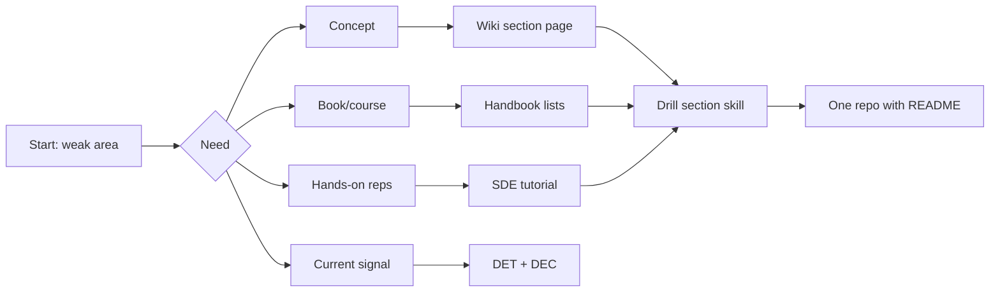

## Resources & Practice Lab


:::tldr
- Five sources, five jobs: the wiki explains concepts, the handbook curates, Start Data Engineering builds (100+ posts), DET gives community signal, DEC practitioner benchmarks.
- Canonical reading list = 4 books + 2 papers — Fundamentals of DE, DDIA 2e, Kimball, Learning Spark 2e; GFS, Lakehouse CIDR — not the handbook's 25-book firehose.
- Hold a 1:2 read-to-build ratio: tutorial hell (the 40th Spark video) compounds to zero; if you can't whiteboard your build's failure modes, you watched, not learned.
- Attach every drill to one build spine — API → ingest → lake → transform+DQ → serve → ops — one repo, layers added weekly, reps compound.
- Pick ONE portfolio archetype (batch lakehouse, streaming, CDC, DQ-gated, LLM) and finish it; a small finished repo with a tradeoffs README beats three half-cloned tutorials.
- Drill 15 — a 5-minute walkthrough of your own design doc — IS the A3 architecture screen; rehearse until 5 minutes feels short.
:::

Five sources cover the whole A3 surface with different jobs: the [Data Engineering Wiki](https://dataengineering.wiki/Index) explains concepts, Zach Wilson's [Data Engineer Handbook](https://github.com/dataexpert-io/data-engineer-handbook) curates everything else, Joseph Machado's [Start Data Engineering](https://www.startdataengineering.com/) provides the builds, and two newsletters — [Data Engineer Things](https://dataengineerthings.substack.com/) and [Data Engineering Central](https://dataengineeringcentral.substack.com/) — keep you current. Use them as a pipeline: wiki to learn, handbook to find, SDE to build, newsletters to stay sharp.

:::scenario Scenario — From Five Sources to One Repo
@diagnose Diagnose the weak area :: Start from the need, not the firehose: wiki explains, handbook curates, SDE builds, newsletters keep you sharp.
? Need a concept mid-build => @wiki |success
? Need a book or course => @handbook |success
? Need hands-on reps => @sde |success
? Need current signal => @news |success
@wiki Open the Wiki page :: Mid-build lookups — `Kappa Architecture`, `Idempotence`; one verified link per section, never search blind.
-> looked it up => @spine
@handbook Read the Handbook like a menu :: The single index for books and courses — commit to the Fundamentals → DDIA 2e pair, close the tab, build.
-> picked the pair => @ratio
@sde Build from Start Data Engineering :: 100+ posts with full code; each drill names its tutorial and the section it trains.
-> drilling => @spine
@news Finish the newsletter archives :: DET for community and events, DEC for practitioner benchmarks — Week 6, for current tool takes only.
-> chose current signal => @ratio
@ratio Hold the 1:2 read-to-build ratio :: Tutorial hell: a 40th Spark video compounds to zero — every reading hour earns two hours in drills.
? Whiteboard rerun, schema drift, hot-key failures => @spine |success
? Cannot explain what breaks on rerun => @wiki |fail
@spine Attach drills to one build spine :: `API → ingest → lake → transform+DQ → serve → ops` — one repo, layers added weekly, reps compound.
-> archetype chosen => @archetype
@archetype Pick ONE archetype, finish it :: Batch lakehouse, streaming, CDC, DQ-gated, or LLM — a small finished repo beats three half-cloned tutorials.
? Finished the archetype => @ship |success
? Three half-cloned tutorials instead => @diagnose |fail
@ship Ship README + rehearse the walkthrough :: The drill-15 walkthrough **IS** the A3 architecture screen — rehearse until 5 minutes feels short.
:::

:::diagram study-path.png
:::


### The Five Sources at a Glance

| Source | What it is | Best for | Real entry points |
|---|---|---|---|
| [Data Engineering Wiki](https://dataengineering.wiki/Index) | Community-maintained Obsidian wiki ([GitHub repo](https://github.com/data-engineering-community/data-engineering-wiki)) with six index sections: [Concepts](https://dataengineering.wiki/Concepts), [Guides](https://dataengineering.wiki/Guides), [Tools](https://dataengineering.wiki/Tools), [Learning Resources](https://dataengineering.wiki/Learning+Resources), [Community](https://dataengineering.wiki/Community), FAQ | Concept lookups mid-build: [Data Pipeline](https://dataengineering.wiki/Concepts/Data+Pipeline), [Kappa Architecture](https://dataengineering.wiki/Concepts/Data+Architecture/Kappa+Architecture), [Idempotence](https://dataengineering.wiki/Concepts/Software+Engineering/Idempotence), [Apache Airflow](https://dataengineering.wiki/Tools/Workflow+Orchestrators/Apache+Airflow) |
| [Data Engineer Handbook](https://github.com/dataexpert-io/data-engineer-handbook) | Zach Wilson's repo (DataExpert.io): 25+ [books](https://github.com/dataexpert-io/data-engineer-handbook/blob/main/books.md), free 4-week beginner + 6-week intermediate bootcamps, [interview prep](https://github.com/dataexpert-io/data-engineer-handbook/blob/main/interviews.md), [projects](https://github.com/dataexpert-io/data-engineer-handbook/blob/main/projects.md), [communities](https://github.com/dataexpert-io/data-engineer-handbook/blob/main/communities.md), [newsletters](https://github.com/dataexpert-io/data-engineer-handbook/blob/main/newsletters.md), whitepapers, company blogs | Curation — the single index for books, courses, interview rounds, design-pattern repos |
| [Start Data Engineering](https://www.startdataengineering.com/) | Joseph Machado's site: 100+ hands-on posts (sitemap-verified) plus paid [DE](https://www.startdataengineering.com/courses/data-engineering-course) and [design-patterns](https://www.startdataengineering.com/courses/data-engineering-design-patterns-course) courses; free [Efficient Data Processing in Spark](https://josephmachado.podia.com/efficient-data-processing-in-spark) course | Guided builds with full code: projects, Spark, Airflow, dbt, CDC, DQ, a 3-part interview series ([DSA](https://www.startdataengineering.com/post/de_interview_dsa/), [system design](https://www.startdataengineering.com/post/de_interview_sd/), [SQL](https://www.startdataengineering.com/post/de_interview_sql/)) |
| [Data Engineer Things](https://dataengineerthings.substack.com/) | Newsletter of the DET global community (founder Xinran Waibel; [site](https://www.dataengineerthings.org/): 43K+ LinkedIn, 15K+ subscribers). Two editions a month: "Data Pulse" (trends, tools) and "Community Spotlight" (members, [meetups, webinars](https://www.dataengineerthings.org/events)) | Community, events, mentorship, curated signal — not deep technical dives |
| [Data Engineering Central](https://dataengineeringcentral.substack.com/) | Daniel Beach ("Confessions of a Data Guy"), 24K+ subscribers, 2–3 posts/week: benchmarks (DuckDB vs Polars vs Spark), tool news, practitioner opinions, a "Back to the Basics" series, free + paid mix | Practitioner realism — opinions and benchmarks on Iceberg, DuckDB, Databricks, Rust engines |



### The Canonical Reading List

The handbook's [books.md](https://github.com/dataexpert-io/data-engineer-handbook/blob/main/books.md) names three must-reads — Fundamentals of Data Engineering, Designing Data-Intensive Applications, Designing Machine Learning Systems. Sequence for A3:

:::tip DDIA 2nd Edition — March 2026
[DDIA 2e](https://martin.kleppmann.com/2026/03/24/designing-data-intensive-applications-2e.html) (Kleppmann + Riccomini, 670 pp) shipped March 2026 — cloud-native rewrite: new ch1 (trade-offs: ops vs analytical, cloud vs self-hosted), ch2 (nonfunctional requirements), "Partitioning"→"Sharding" (ch7), new ch13 "A Philosophy of Streaming Systems", vector/AI-era storage woven in. Chapter refs for all 14 chapters free at [ept/ddia2-references](https://github.com/ept/ddia2-references); free excerpt (ch1+2+9) via [ScyllaDB](https://lp.scylladb.com/designing-data-intensive-apps-book-offer). Note: dataintensive.net still hosts the **1st** edition TOC.
:::

| Book / resource | Why it earns the time | Deepens section |
|---|---|---|
| [Fundamentals of Data Engineering](https://www.amazon.com/Fundamentals-Data-Engineering-Robust-Systems/dp/1098108302/) | The lifecycle + undercurrents frame every interview answer wants | 01, 05 Platform architecture |
| [DDIA 2e — Kleppmann & Riccomini](https://learning.oreilly.com/library/view/designing-data-intensive-applications/9781098119058) | 2nd ed (Mar 2026): storage, replication, sharding, transactions, consistency — the distributed ground truth, now cloud/object-store native | 04 Distributed, 06, 12 Messaging |
| [The Data Warehouse Toolkit (Kimball)](https://ia801609.us.archive.org/14/items/the-data-warehouse-toolkit-kimball/The%20Data%20Warehouse%20Toolkit%20-%20Kimball.pdf) | Dim/fact, star schemas, SCD — asked in every modeling round | 02, 15 Modeling + design |
| [Learning Spark, 2nd Edition (free PDF)](https://pages.databricks.com/rs/094-YMS-629/images/LearningSpark2.0.pdf) | DataFrame API, Catalyst, AQE — free and current | 03, 10, 11 Spark |
| [Streaming Systems](https://www.amazon.com/Streaming-Systems-Where-Large-Scale-Processing/dp/1491983876) | Watermarks, windows, exactly-once semantics from first principles | 06 Batch vs streaming |
| [Apache Iceberg docs](https://iceberg.apache.org/docs/latest/) | Spec-level table format mechanics behind our Delta/Iceberg/Hudi compare | 09 Table formats |
| [Data Engineering Design Patterns](https://www.dedp.online/) | Named patterns (idempotency, backfill, DQ) to cite verbatim | 13 Reliability |
| [Snowflake Data Engineering (Manning)](https://www.manning.com/books/snowflake-data-engineering) | Warehouse-native DE — the Snowflake side of section 08 | 08 Snowflake vs Databricks |
| [Designing Machine Learning Systems](https://www.amazon.com/Designing-Machine-Learning-Systems-Production-Ready/dp/1098107969) | Handbook must-read #3; where DE meets ML lifecycle | 05, 14 |
| Handbook [whitepapers list](https://github.com/dataexpert-io/data-engineer-handbook#resources) | [GFS](https://research.google/pubs/the-google-file-system/), [MapReduce](https://research.google/pubs/mapreduce-simplified-data-processing-on-large-clusters/), [Lakehouse CIDR 2021](https://www.cidrdb.org/cidr2021/papers/cidr2021_paper17.pdf) | 04, 07 Lakehouse |

**DDIA 2e chapter → course section:** ch6–10 → 04 (replication, sharding, txns, failure modes, consensus); ch11–13 → 06 + 12 (batch, stream processing — ch13 is *new in 2e*, unbundling/lambda critique); ch1–2 → 05 (trade-offs, nonfunctionals); ch4–5 → 07/09 (storage, encoding); ch2+9 → 13 (reliability). Older chapter references online are 1e — numbering shifted +1 from ch2 onward.

### Free Courses & Communities

| Course | Cost / format | Notes |
|---|---|---|
| [DataTalks.Club DE Zoomcamp](https://github.com/DataTalksClub/data-engineering-zoomcamp) | Free cohort (Jan–Apr) + self-paced; [course page](https://datatalks.club/docs/courses/data-engineering-zoomcamp/) | Docker, Terraform, orchestration, warehouse, streaming, projects with peer review |
| [DataExpert 6-week intermediate bootcamp](https://learn.dataexpert.io/program/free-community-boot-camp/details) | Free video bootcamp; materials in [handbook repo](https://github.com/dataexpert-io/data-engineer-handbook) | Dimensional modeling, fact tables, Spark, Flink, KPIs, pipeline maintenance |
| [Databricks AI bootcamp](https://learn.dataexpert.io/program/the-one-week-beginners-databricks-boot-camp-7129) | Free 1-week | Lakebase, vector DBs, agent apps — current Databricks surface |
| [Efficient Data Processing in Spark](https://josephmachado.podia.com/efficient-data-processing-in-spark) | Free (Joseph Machado) | Spark performance + testing — pairs with section 11 |
| [IBM Data Engineering for Everyone](https://www.edx.org/learn/data-engineering/ibm-data-engineering-basics-for-everyone) | Free edX course | Gentle overview if any section feels shaky |
| [50+ free data lake SQL questions](https://www.dataexpert.io/questions) + [100+ FAANG SQL questions](https://datalemur.com/sql-interview-questions) | Free practice banks | Timed SQL reps for section 02 and screens |

| Community | What you actually get |
|---|---|
| [EcZachly Discord](https://discord.gg/JGumAXncAK) | Zach Wilson's DataExpert community; bootcamp cohorts, mock interviews |
| [DataTalks.Club Slack](https://datatalks.club/slack.html) | Course cohorts (#course-data-engineering), book clubs, podcasts |
| [Data Engineer Things](https://www.dataengineerthings.org/) | Webinars, meetups, mentorship, [blog](https://dataengineerthings.substack.com/) + events |
| [Seattle Data Guy Discord](https://discord.gg/ah95MZKkFF) | Ben Rogojan's community; project feedback |
| [dbt Community](https://www.getdbt.com/community/join-the-community/) | Analytics-engineering Slack, local meetups |
| [r/dataengineering](https://www.reddit.com/r/dataengineering/) | Daily practitioner Q&A, salary and tool threads |

### Curated Reading by Topic

One best external link per course section — verified reachable; never search blind when the index exists.

| Section | Read first | Link |
|---|---|---|
| 01 EPAM A3 assessment | Data architecture interview guide | [How to pass the data architecture round](https://blog.dataengineer.io/p/how-to-pass-the-data-architecture) |
| 02 SQL deep dive | Window functions, 6 concepts | [6 concepts to clearly understand window functions](https://www.startdataengineering.com/post/6-concepts-to-clearly-understand-window-functions/) |
| 03 Python & PySpark | Local Spark setup | [Spark local setup](https://www.startdataengineering.com/post/spark-local-setup/) |
| 04 Distributed fundamentals | GFS paper | [The Google File System](https://research.google/pubs/the-google-file-system/) |
| 05 Platform architecture | Pipeline architecture tutorial | [Architect data pipelines](https://www.startdataengineering.com/post/architect-data-pipelines/) |
| 06 Batch vs streaming | Kappa vs Lambda | [Wiki: Kappa Architecture](https://dataengineering.wiki/Concepts/Data+Architecture/Kappa+Architecture) |
| 07 Warehouse vs lakehouse | The original lakehouse paper | [Lakehouse: CIDR 2021](https://www.cidrdb.org/cidr2021/papers/cidr2021_paper17.pdf) |
| 08 Snowflake vs Databricks | Vendor engineering blog | [Databricks data engineering blog](https://www.databricks.com/blog/category/engineering/data-engineering) |
| 09 Table formats | Why table formats exist | [What & why of table formats](https://www.startdataengineering.com/post/what_why_table_format/) |
| 10 Spark vs Flink | Flink's own docs | [Flink documentation](https://nightlies.apache.org/flink/flink-docs-stable/) |
| 11 Spark optimization | Three optimization techniques | [How to optimize your Spark jobs](https://www.startdataengineering.com/post/how-to-optimize-your-spark-jobs/) |
| 12 Messaging & Kafka | Kafka what/why/how | [What, why and how Apache Kafka](https://www.startdataengineering.com/post/what-why-and-how-apache-kafka/) |
| 13 Reliability | Idempotency + DQ checks | [Idempotent data pipelines](https://www.startdataengineering.com/post/why-how-idempotent-data-pipeline/), [Types of DQ checks](https://www.startdataengineering.com/post/types-of-dq-checks/) |
| 14 This lab | The five sources above | [Data Engineer Handbook](https://github.com/dataexpert-io/data-engineer-handbook) |
| 15 Interview playbook | Handbook interview file | [interviews.md](https://github.com/dataexpert-io/data-engineer-handbook/blob/main/interviews.md) |

```text
Build spine every drill attaches to (one repo, layers added weekly):

  [API/DB source] --> [ingest: batch | CDC] --> [lake: S3/MinIO + Iceberg]
        --> [transform: Spark/dbt + DQ gates] --> [serve: warehouse/BI]
        --> [ops: Airflow + retries + backfill + CI] --> README + walkthrough
```

### Drills: Exercises That Build Skill

Each drill names its tutorial or source and the section it trains. Build first; read only what the build forces.

1. Replicate [Local development setup](https://www.startdataengineering.com/post/local-dev/) + [Docker for DE](https://www.startdataengineering.com/post/docker-for-de/): Postgres + MinIO + Spark containers, one `make up`. *[03]*
2. Sessionize a clickstream with 30-min gaps using window functions from the [window-functions post](https://www.startdataengineering.com/post/6-concepts-to-clearly-understand-window-functions/). *[02]*
3. Solve 10 questions from [dataexpert.io/questions](https://www.dataexpert.io/questions) under a 20-minute timer; redo the two slowest in pure CTE form. *[02, 15]*
4. Run a groupBy + broadcast join in the [Spark local setup](https://www.startdataengineering.com/post/spark-local-setup/) container; screenshot the DAG and explain each stage. *[03, 11]*
5. Apply the [three Spark optimization techniques](https://www.startdataengineering.com/post/how-to-optimize-your-spark-jobs/): salt a hot key, re-measure stage time, record the delta in the README. *[11]*
6. Test a Spark job with [pytest for PySpark](https://www.startdataengineering.com/post/test-pyspark/): fixture data, one transform test, one schema assertion. *[13]*
7. Run a 3-topic Kafka per the [Kafka what/why/how post](https://www.startdataengineering.com/post/what-why-and-how-apache-kafka/); Python consumer with manual offset commit, kill and resume mid-partition. *[12]*
8. Stream [Debezium CDC](https://www.startdataengineering.com/post/change-data-capture-using-debezium-kafka-and-pg/) from Postgres to Kafka; replay one UPDATE end-to-end and prove no duplicates. *[12, 13]*
9. Build the [batch beginner project](https://www.startdataengineering.com/post/data-engineering-project-for-beginners-batch-edition/): API → S3 → warehouse → dbt. *[05]*
10. Add [Great Expectations checks](https://www.startdataengineering.com/post/implement_data_quality_with_great_expectations/) that fail the build on null keys and row-count drift >5%. *[13]*
11. Make yesterday's partition rerun [idempotently](https://www.startdataengineering.com/post/why-how-idempotent-data-pipeline/) — overwrite partition, zero dupes. *[13]*
12. Build SCD2 with [MERGE INTO on Spark + Iceberg](https://www.startdataengineering.com/post/create-scd2-table-with-merge-into-with-spark-iceberg/); query time travel at two snapshots. *[09]*
13. Orchestrate drills 9–12 in the [Airflow tutorial](https://www.startdataengineering.com/post/airflow-tutorial/): retries, SLA, one manual backfill. *[05]*
14. Wire [dbt tests into CI](https://www.startdataengineering.com/post/cicd-dbt/) — merge blocked on failing test. *[13]*
15. Write a 1-page design doc for your portfolio repo and present it aloud in 5 minutes; compare against the [SDE system design interview post](https://www.startdataengineering.com/post/de_interview_sd/). *[15, 01]*

### Portfolio Projects That Get You Hired

Archetypes grounded in [SDE free templates](https://www.startdataengineering.com/post/data-engineering-projects-with-free-template/), the handbook [projects.md](https://github.com/dataexpert-io/data-engineer-handbook/blob/main/projects.md) (Uber E2E on BigQuery, LLM pipelines), and the [practical DE project](https://github.com/sspaeti-com/practical-data-engineering).

| Archetype | Stack | Deliverable | Interview angle |
|---|---|---|---|
| Batch lakehouse | API + MinIO/S3 + Iceberg + Spark + Airflow (drills 9, 12–13) | Modeled tables, time-travel demo, DAG diagram in README | Partitioning, small-file compaction, cost per run |
| Streaming clickstream | Kafka + Python consumer + Postgres/ClickHouse (drill 7) | Live dashboard over a 3-topic pipeline | Offset semantics, replay, at-least-once vs exactly-once |
| CDC history pipeline | Debezium + Kafka + Spark MERGE (drill 8) | Postgres → lake sync with SCD2 (drill 12) | Deletes, schema drift, out-of-order events |
| DQ-gated platform | dbt + Great Expectations + CI (drills 10, 14) | Pipeline that blocks merge on red tests | Fail-loud vs warn, alert routing, blast radius |
| LLM-assisted pipeline | Python + LangChain (handbook LLM lecture/lab) | Text-to-SQL over your own lake | Where AI broke, what validation you added |

Pick ONE archetype and finish it. A small finished repo with a README naming tradeoffs beats three half-cloned tutorials.

:::info Six-Week Curriculum
- **Week 1 — SQL + setup:** sections 02–03; read the [window functions post](https://www.startdataengineering.com/post/6-concepts-to-clearly-understand-window-functions/), skim [interviews.md](https://github.com/dataexpert-io/data-engineer-handbook/blob/main/interviews.md) to know the target. Drills 1–3.
- **Week 2 — Platform + distributed:** sections 04–05; DDIA 2e ch1–2 (trade-offs, nonfunctionals) + ch6 (replication), [GFS](https://research.google/pubs/the-google-file-system/). Drill 9 started (it is the spine).
- **Week 3 — Streaming + Kafka:** sections 06, 12; wiki [Kappa](https://dataengineering.wiki/Concepts/Data+Architecture/Kappa+Architecture), Kafka post. Drills 7–8; *Streaming Systems* watermark chapter.
- **Week 4 — Formats + lakehouse:** sections 07, 09; [Lakehouse CIDR paper](https://www.cidrdb.org/cidr2021/papers/cidr2021_paper17.pdf). Drill 12; Kimball SCD chapter.
- **Week 5 — Spark performance:** section 11; [Learning Spark 2e PDF](https://pages.databricks.com/rs/094-YMS-629/images/LearningSpark2.0.pdf) + [optimization post](https://www.startdataengineering.com/post/how-to-optimize-your-spark-jobs/). Drills 4–6.
- **Week 6 — Reliability + rehearse:** sections 13, 15; [idempotency](https://www.startdataengineering.com/post/why-how-idempotent-data-pipeline/) and [DQ checks](https://www.startdataengineering.com/post/types-of-dq-checks/). Drills 10–11, 14–15. Ship repo + walkthrough; finish [Data Engineering Central](https://dataengineeringcentral.substack.com/)/[DET](https://dataengineerthings.substack.com/) archives for current tool takes.
:::

:::tip Read the handbook like a menu, not a course
Open [books.md](https://github.com/dataexpert-io/data-engineer-handbook/blob/main/books.md), commit to the FDDE → DDIA pair above, then close the tab and build. One book finished per course phase — pair each reading week with its drill set so every chapter lands on code you just wrote.
:::

:::warning Tutorial hell is the failure mode
Watching a 40th Spark video feels like progress and compounds to zero. Hold a 1:2 read-to-build ratio: every hour of reading, two hours in drills 1–15. If you cannot whiteboard the failure modes of your last build — what breaks on rerun, on schema drift, on a hot key — you watched, you did not learn.
:::

:::cards
Q: What job does each of the five sources do? :: Wiki explains, handbook curates, SDE builds, DET community, DEC practitioner benchmarks.
Q: How big is the canonical reading list? :: Four books plus two papers, each tied to a course section — not the 25-book firehose.
Q: Required read-to-build ratio, and the failure it prevents? :: 1:2 — prevents tutorial hell, where the 40th Spark video compounds to zero.
Q: What is the build spine? :: API → ingest → lake → transform+DQ → serve → ops — one repo, layers added weekly.
Q: How many portfolio projects should you finish? :: One archetype — a small finished repo with a README of tradeoffs.
Q: What is drill 15 and why does it matter? :: A 5-minute walkthrough of your design doc — it IS the A3 architecture screen.
:::

### Key Takeaways

- Five sources, five jobs: [wiki](https://dataengineering.wiki/Index) for concepts, [handbook](https://github.com/dataexpert-io/data-engineer-handbook) for curation, [SDE](https://www.startdataengineering.com/) for builds, [DET](https://dataengineerthings.substack.com/) for community, [DEC](https://dataengineeringcentral.substack.com/) for practitioner signal.
- The reading list is 4 books + 2 papers, each tied to a course section — not the handbook's 25-book firehose.
- Free structure exists: [DE Zoomcamp](https://github.com/DataTalksClub/data-engineering-zoomcamp) and the [DataExpert bootcamp](https://learn.dataexpert.io/program/free-community-boot-camp/details) supply cadence, community, and peer review.
- Curated reading maps all 15 sections to one verified starting link each; drills 1–15 attach to the same build spine so reps compound.
- One finished portfolio archetype with a README of tradeoffs outcompetes any certificate.

### Interview Lens

- When asked "how do you keep up", name the handbook and cite one thing you *applied* — e.g. the [idempotency post](https://www.startdataengineering.com/post/why-how-idempotent-data-pipeline/) that changed your rerun design — never the list itself.
- Anchor stories in drill language: "I salted the hot key and stage time dropped 40%" beats "I know Spark tuning".
- The drill-15 walkthrough IS the A3 architecture screen — rehearse it on your own repo until 5 minutes feels short.
- Borrow DEC's benchmark habit: bring one current number ("DuckDB beat Spark on my 1GB join by 3x local") to sound current, not memorized.
