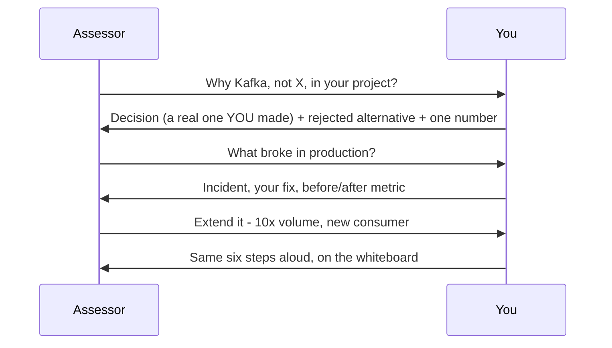

## System Design Interview Playbook


:::tldr
- The internal design round probes YOUR project plus hypothetical extensions; the committee scores narrative + evidence against the competency matrix.
- Six steps: Clarify (SLA first, 3–5 min) → Estimate → High-level design (SLA on every hop) → Tradeoffs (per arrow: alternative, why rejected, one number) → Ops & failure (unprompted) → Evolution (precomputed 10x).
- Evidence ledger replaces STAR: claim → story → artifact → metric → matrix line; 4–5 proof stories, 90 s each, "I" never "we".
- Capacity math before architecture; your pipeline's real numbers beat textbook figures — 100k ev/s × 500 B = 4.32 TB/day, RF=3 ≈ 13 TB → 6 brokers × 4 TB, 48 partitions ≈ 1.04 MB/s each.
- Exactly-once is not correctness: checkpoints/2PC are processing semantics — late joins, timezones, fraud need dedup windows and reconciliation.
- Migration invariant: no consumer ever sees wrong data — waves ordered by consumer, parity gate 7 consecutive days < 0.01% delta.
- English delivery is scored (B2 gates staffing); honest "I don't know — here's how I'd reason" reads senior.
:::

Inside an internal assessment the design round probes **your project plus hypothetical extensions** — not a green-field prompt. The committee scores narrative + evidence against the competency matrix ([EPAM careers blog](https://www.epam.com/careers/blog/assessment-at-epam-what-it-means-for-your-career-growth)); ⚠ EPAM publishes no internal rubric, so treat scoring claims as directional. Highest-value scenario: the system you already own — the framework below runs first on Scenario 0.


:::scenario Scenario — The Six-Step Answer Under Probe
@round Read the round :: Your project is Scenario 0, hypotheticals are the extension round — the committee scores narrative + evidence.
? "Why Kafka, not X, in your project?" => @tradeoff |success
? "What broke in production — your fix?" => @ops |success
? "Extend it: 10x volume, new consumer" => @evolve |success
-> narrate steps => @clarify
@clarify Step 1 — Clarify :: State back freshness SLA, consumers, correctness, constraints — never skip SLA; it decides the architecture.
-> capacity first => @estimate
@estimate Step 2 — Estimate :: ev/s → ev/day → raw → replicated → compressed — capacity math before architecture; your numbers beat textbook figures.
? Probe: why 48 partitions at 100k ev/s => @partitions |success
-> draw design => @design
@partitions Defend the partition count :: Per-partition ≈ 1.04 MB/s ≪ 10 MB/s ceiling, 48 matches Flink parallelism — 13 TB/24 h → 6 brokers × 4 TB.
-> resume walkthrough => @design
@design Step 3 — High-level design :: Draw the happy path, SLA named on every hop.
-> per-arrow costs => @tradeoff
@tradeoff Step 4 — Tradeoffs :: Per arrow: alternative, why rejected, one number — probes land hardest here; answer in "I", never "we".
? Hide behind exactly-once semantics => @correctness |fail
-> offer ops unprompted => @ops
@correctness Exactly-once is not correctness :: Checkpoints/2PC are processing semantics only — late joins, timezones, fraud are yours: dedup windows, reconciliation.
-> corrected => @tradeoff
@ops Step 5 — Ops & failure :: Lag, DLQ, schema gates, replay, GDPR, cost — offered unprompted, as incident + your fix + before/after metric.
-> precompute 10x => @evolve
@evolve Step 6 — Evolution :: "At 10x, bottleneck X; I change Y" — pre-computed per scenario, numbers kept visible.
? Hand-wave the 10x bottleneck => @tenx |fail
-> close => @ledger
@tenx The precomputed 10x answer :: Flink state, not Kafka throughput — and in migration, waves order by consumer, not table; no consumer sees wrong data.
-> close => @ledger
@ledger Step 7 — Close on evidence :: Claim → story → artifact → metric → matrix line — "I", never "we"; 4–5 proof stories, 90 s each.
:::
:::diagram answer-framework.png
:::

### The Six-Step Framework

| # | Step | Time | Must produce |
|---|------|------|--------------|
| 1 | Clarify | 3–5 min | Freshness SLA, consumers, correctness, constraints — stated back |
| 2 | Estimate | 2–3 min | ev/s → ev/day → raw → replicated → compressed |
| 3 | High-level design | 5–7 min | Happy path, SLA named on every hop |
| 4 | Tradeoffs | 10 min | Per arrow: alternative, why rejected, one number |
| 5 | Ops & failure | 5 min | Lag, DLQ, schema gates, replay, GDPR, cost — unprompted |
| 6 | Evolution | 3 min | "At 10x, bottleneck X; I change Y" |

:::tip Highest-signal opening moves
- Defense: open with the SLA your pipeline *actually has* — "our contract is sub-minute freshness; this hop enforces it."
- Extension round: "Before I draw — sub-second or sub-minute? That decides Kafka+Flink vs a 30-second-commit lakehouse sink."
- **Use cases** — defense prep: steps 1–6 prewritten for YOUR project, probes land hardest on 4–5; live extension round: steps aloud, time-boxed, merge 2 into 3 if squeezed, never skip the SLA question.
:::


### Scenario 0: Defend Your Own Project

The committee judges real delivered work — impact, progression, matrix coverage ([Built In FAQ](https://builtin.com/company/epam-systems/faq/career-growth-development), ⚠ AI-generated summaries, directional). The 10 questions below come from reported EPAM DE interview topics — ⚠ external-hiring-loop sourced; internal DE lists are not public. Draw the platform you own; narrate decisions, not boxes.

```text
sources --> CDC/ingest (Debezium/ADF) --> Kafka / bus --> stream jobs (Flink)
batch ETL (Spark) ------> lakehouse tables (Iceberg/Delta, raw -> curated)   [SLA per hop]
                                  v --> BI dashboards / ML features / reverse-ETL
```

```text
1 end-to-end trace: one record, source -> dashboard  | 6 SLA: where enforced, how monitored
2 why THIS table format (Iceberg/Delta)?             | 7 a new column arrives - what happens?
3 why Kafka, not Kinesis / direct sink?              | 8 cost per month + which levers move it
4 what broke in prod - YOUR fix + metric             | 9 what did YOU do vs the team?
5 rebuild it today - what changes                    | 10 extend: 10x, new consumer - what breaks?
```

- Red flags the committee punishes: describing architecture you didn't build (one "why" probe exposes it) · "we" with no "I" (no matrix credit for team work) · no trade-off or number attached to YOUR choices · blaming teammates/vendors for incidents.

**Evidence prep replaces STAR**: 4–5 proof stories, 90 s each — project context → *your* action → artifact (PR, dashboard, design doc, incident review) → quantified outcome → matrix competency it evidences. A "claim / story / artifact / metric" ledger beats memory under pressure.

### Scenario 1: CDC Pipeline to Lakehouse

Extension round. 50k changes/min ≈ 833/s at ~1 KB — a correctness/freshness problem, not throughput ([Debezium limits](https://estuary.dev/blog/debezium-cdc-pain-points), [benchmarks](https://debezium.io/blog/2026/02/02/measuring-debezium-server-performance-mysql-streaming)).

```text
Postgres WAL --logical slot--> Debezium --8p RF=3--> Flink key=PK
  snapshot 1st then stream from LSN - no gap no overlap  ckpt 30s
  REPLICA IDENTITY FULL - slot-lag monitor - wal_keep_size alarm
  -> Iceberg MoR upsert on S3 -> Trino / StarRocks BI, <1min SLA
```

- Log-based CDC beats polling, resumes from LSN ([features](https://debezium.io/documentation/reference/stable/features.html)); snapshot-then-stream = no gap, no overlap; `REPLICA IDENTITY FULL` → before-images; MoR upserts; 7d replay.
- Probes: slot fills WAL if Flink is down 12h → `wal_keep_size` alarms + slot-lag monitoring, drop-and-resnapshot last; new column → schema history + Registry BACKWARD. If your project ingests via CDC, defend it with these; if not, propose it for batch-fed tables and say why.

### Scenario 2: Real-Time Click Analytics

Extension round. 100k ev/s, 500 B each, dashboard p95 < 2s:

```text
SDKs --batched ev--> ingest svc --> Kafka 48p RF=3 --> Flink key=ad_id
  1m tumbling windows - watermark 30s - lateness 5m - RocksDB state
    |--> Redis hot 1m windows --> dashboard p95 < 2s
    +--> Iceberg raw + preagg --> replay - ML - audit
```

- Serve pre-aggregated windows, never raw; two key spaces (per-ad, per-campaign) → two derived topics from one Flink job; hot key (celebrity ad, 40% of traffic) → salt suffix + two-stage aggregation; duplicate clicks → idempotency on `click_id`, 15-min dedup window.

:::info Worked Example
- Events/day: 100,000 ev/s × 86,400 = **8.64 B** → × 500 B = **4.32 TB raw/day**
- Kafka: RF=3 → **12.96 TB/day**; 24h footprint ≈ 13 TB → **6 brokers × 4 TB usable** (one-failure headroom)
- **48 partitions** (≤2k msg/s each): per-partition ≈ **1.04 MB/s** ≪ 10 MB/s ceiling; 48 = Flink parallelism; Flink state ~2M active ad_ids × ~500 B ≈ **1 GB** → RocksDB
- Sink: **50 MB/s** raw → ÷8 (Parquet+ZSTD) = **6 MB/s** ≈ 540 GB/day compressed; serving = 1m windows from Redis, single-digit ms
:::

:::warning Exactly-once is not correctness
Checkpoints/2PC guarantee processing semantics only — late joins, timezone bugs, fraud are yours; answer with watermarks, dedup windows, reconciliation.
:::

### Scenario 3: Batch Warehouse → Streaming Lakehouse Migration

Touching a migration at work? This becomes Scenario 0 material. Invariant first: **no consumer ever sees wrong data mid-migration** — sequencing, not tools. Inventory each table's SLA/consumers/owner; order waves by *consumer*, not table.

| Wave | Move | Exit criterion |
|---|---|---|
| 1 | New spine: CDC → Kafka → Flink → Iceberg raw zone | Old warehouse untouched |
| 2 | Snapshot backfill, then stream from snapshot LSN ([pattern](https://pipecode.ai/blogs/warehouse-lakehouse-migration-dual-write-backfill)) | History + stream join seamlessly |
| 3 | Daily reconciliation: counts, sampled checksums, aggregates | 7 consecutive days < 0.01% delta |
| 4 | Cutover per consumer: BI first, reverse-ETL last; rollback = connection string | Parity holds throughout |
| 5 | Decommission with archive + lineage | Auditors trace pre-migration numbers |

- Kappa-plus-backfill over Lambda: one code path, replay through the same stack; batch `SELECT DISTINCT` dedup maps to the stream key/window or the parity gate catches it; schema drift → Registry compatibility + versioned models. The parity gate *is* your "what failed" story, with numbers.

### Capacity Math Cheat Sheet

```text
events/sec x 86400              = events/day
events/day x avg_bytes          = raw bytes/day
raw/day    x 3 replication      = Kafka footprint per retention day
raw/day    / 5-10 Parquet+ZSTD  = lake storage/day
rate / partitions               = per-partition MB/s, keep <= 10
```

| System | ev/s | ev/day | Raw/day @500B | Kafka RF=3 7d | Lake/day |
|---|---|---|---|---|---|
| CDC (S1) | ~833 | 72M | 36 GB | ~7 TB | ~5 GB |
| Clicks (S2) | 100k | 8.64B | 4.3 TB | ~90 TB | ~540 GB |

For the defense, run this arithmetic on YOUR pipeline's real volumes — your numbers outweigh textbook figures in front of a committee. Matrix-probe refreshers: schema evolution (Registry BACKWARD, `default` values, Iceberg evolution is metadata-only — [Confluent](https://docs.confluent.io/platform/current/schema-registry/avro.html)); GDPR delete = Iceberg row-level `DELETE` **plus** snapshot expiry/VACUUM ([walkthrough](https://iceberglakehouse.com/posts/gdpr-hard-deletes-on-iceberg), [VACUUM](https://learn.microsoft.com/en-us/azure/databricks/delta/vacuum)); cost levers: tiered storage, spot Flink, compaction cadence, "does this consumer need streaming at all?" ([tradeoffs](https://hudi.apache.org/blog/2026/07/21/what-is-a-streaming-data-lake)).

### Study Plan

| Week | Master | Deliverable |
|---|---|---|
| 1 | **Evidence collection**: project inventory, I-vs-We ledger, real metrics, platform diagram; confirm manager sponsorship ([Built In FAQ](https://builtin.com/company/epam-systems/faq/career-growth-development)) | Scenario 0 one-pager: architecture + 5 trade-offs + 5 artifacts |
| 2 | **Defense narrative**: 10-question drill, walkthrough rehearsed aloud (English B2 is scored and gates staffing); name mentorship/code-review leadership for A3→A4 ([EPAM senior DE posting](https://careers.epam.com/en/vacancy/senior-data-engineer-with-python-blt205341dab4156e91_en)) | 15-min presentation recorded, self-scored vs matrix |
| 3 | Fundamentals refresh: Spark architecture/optimization, SQL window functions, cloud services, table formats | Scenarios 1–3 whiteboarded from memory; capacity drill in 10 min, no notes |
| 4 | Hypothetical extensions + full mocks | 2 timed 35-min mocks recorded; committee Q&A dry-run with a peer |

:::cards
Q: What does the internal design round probe? :: Your own project (Scenario 0) plus hypothetical extensions — scored on narrative + evidence.
Q: Name the six answer-framework steps. :: Clarify, estimate, high-level design, tradeoffs, ops and failure, evolution.
Q: Why state the freshness SLA first? :: It decides the architecture — sub-second means Kafka+Flink; sub-minute allows a committing lakehouse sink.
Q: What replaces STAR in defense prep? :: The evidence ledger: claim → story → artifact → metric → matrix line — 4–5 stories, 90 seconds each.
Q: Storage math for 100k ev/s at 500 B with RF=3? :: 4.32 TB/day raw → ~13 TB replicated → 6 brokers × 4 TB, 48 partitions at ~1 MB/s.
Q: Why is exactly-once not correctness? :: Checkpoints/2PC are processing semantics only — dedup windows and reconciliation handle late, wrong, or fraudulent data.
Q: Golden invariant of a warehouse-to-lakehouse migration? :: No consumer ever sees wrong data — waves ordered by consumer, gated on 7 days under 0.01% delta.
:::

### Key Takeaways

- The committee scores narrative + evidence from your real project: your architecture is Scenario 0, hypothetical designs are the extension round; every claim needs "I", a trade-off, and a number — the evidence ledger (claim → story → artifact → metric → matrix line) replaces STAR.
- Capacity math before architecture — on the defense, your pipeline's real numbers beat textbook figures; manager sponsorship and project visibility are gates beyond skill.

### Interview Lens

- Rehearse spoken-English delivery end to end — English is a standing scored requirement; pre-compute the 10x answer per scenario (Scenario 2 at 10x breaks on Flink state, not Kafka throughput); knocked off sequence, keep numbers visible; honest "I don't know — here's how I'd reason" reads senior, bluffing reads fatal in front of peers.
