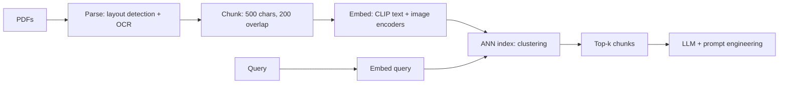

## Generative AI System Design (Aminian & Sheng)

Your A3 defense treats your pipeline as Scenario 0 and hypothetical extensions as the follow-up round - when the committee asks "where would GenAI plug into your system?", this note is the vocabulary and decision framework. One repeating skeleton across all 11 designs; density here favors the chapters that map to data-engineering work (RAG, LLM serving) over the image/video ones.

:::scenario Scenario — Where GenAI Plugs In
@requirements Clarify before naming a model :: Pin freshness, latency, confidence thresholds first — the Scenario-0 discipline transferred to GenAI.
? Fresh answers over private docs => @approach |success
? Generate images or video => @model |success
@model Choose model by arithmetic :: One-pass latency → GAN/VAE; ceiling quality → diffusion; resolution at scale → AR; video → latent diffusion.
-> evaluate => @answers
@approach Exhaust retrieval + prompts first :: Finetuning can't cite sources and needs constant retraining; RAG balances cost, scalability, freshness.
? All docs fit the 128K context window => @prompt |success
-> size the index => @pipeline
@prompt Prompt-engineer only :: No index needed when context fits — rare at enterprise scale; monitor cost per user as prompts grow.
@pipeline Run the RAG pipeline :: parse → chunk (500 chars, 200 overlap) → embed → ANN-index; 5M pages → 40M chunks, +20%/yr.
-> query => @retrieve
@retrieve Interrogate retrieval quality :: Response quality is highly dependent on retrieval relevance — a better LLM cannot fix bad chunks.
? Chunks are relevant => @answers |success
-> still irrelevant => @fixretrieval |fail
@fixretrieval Fix retrieval before the model :: Rule-based parsers break on varied layouts — Layout-Parser + OCR; cross-modal via CLIP space or caption-then-embed.
? Index still exact nearest-neighbor => @ann |fail
? Retrieval fixed, answers still bad => @raft |success
@ann Swap in ANN indexing :: Linear scan is O(N x D) — 40M comparisons per query; ANN (tree / LSH / clustering / HNSW) is mandatory past millions.
-> then RAFT if needed => @raft
@raft Finetune last, via RAFT :: Finetune with golden + distractor docs to ignore retrieval noise — only when retrieval is fixed and answers still bad.
-> evaluate => @answers
@answers Evaluate offline + online :: Name the instrument (BLEU, CIDEr, CLIPScore, FID/FVD, DINO) and the business metric (CTR, adoption, cost per user).
? Identity claim on CLIP alone => @metrics |fail
-> deploy => @serve
@metrics Match metric to claim :: CLIP = semantics, DINO = visual detail, face models = identity — CLIP and DINO can score high on two different people.
-> deploy => @serve
@serve Deploy + monitor as a named stage :: Serving + retraining loops are their own step — re-rolling seeds with new prompts quietly multiplies GPU spend.
:::

:::diagram rag-pipeline.png
:::

### The Repeating Framework (ch2-ch11)

- Every design chapter runs the same core sections: Clarifying Requirements → Frame the Problem as an ML Task → Data Preparation → Model Development → Evaluation → Overall ML System Design - and the underlying seven-step framework adds Deployment + Monitoring on top (ch1, p13; ch2-ch11 structure). Drill the skeleton once, reuse it on any prompt.
- **Data prep shifts for GenAI**: classical ML leans on feature engineering (task-specific, needs subject-matter expertise); GenAI leans on collecting vast data, ensuring quality/safety, and efficient storage + retrieval (ch1 §Data preparation, p14).
- **Scale anchors**: Llama 3 pretrained on 15T tokens ≈ 50TB scraped from web/social/forums; collection, then cleaning, then data-efficiency are the three named steps (ch1 §Data collection, p15).
- **Deployment is a named stage, not an afterthought**: serving services, monitoring, and retraining loops appear as their own step - e.g. the GAN system ships generator + training + evaluation + deployment services with a retraining loop on user-approved images (ch1, p13; ch7 §Overall ML System Design, p211).

### ch2 - Gmail Smart Compose (inline suggestion)

- Requirements pinned by interviewer: no personalization; suggest only when confident; ~1B email conversations available for finetuning (ch2 §Finetuning, p55).
- Task: next-token prediction with a decoder-only Transformer; two-stage training - unsupervised pretraining on generic text, then finetuning on the email corpus; cross-entropy loss per position (ch2, p54-55).
- **Sharp insight**: training computes losses for all token lengths of a sequence in parallel - one forward pass per sequence, not sequential generation; parallelism is why pretraining is affordable (ch2, p55).

### ch3 - Google Translate

- Encoder-decoder Transformer; **BPE** builds the subword vocabulary by iteratively merging the most frequent symbol pairs, so rare/unseen words decompose into known subwords (ch3 §Byte-Pair Encoding, p77).
- Language detection: encoder-only Transformer + prediction head (one option shown alongside a shared-multilingual variant) (ch3, p95).
- Decoding applies beam search over the target sequence; the classic sequence metrics are BLEU/ROUGE/METEOR and WER (ch3 §Translation service, p95; ch5 §Evaluation, p151).

### ch4 - ChatGPT (LLM serving)

- **Compute asymmetry** is the headline: pretraining needs 1000s of GPUs for months; supervised finetuning and RLHF each need 1-100 GPUs for days (ch4, p114).
- RLHF = reward model learns score-consistent rankings, then reinforcement learning generates tokens maximizing that reward (ch4, p114).
- Landscape table to quote: open-weights (Llama 3 8/70B, Mixtral 8x22B 141B, Grok-1 314B, Gemma, Phi-3, DBRX) vs API-only (GPT-4o, Claude 3, Gemini 1.5, o1) (ch4 §Sampling, p115).
- **Sharp insight**: the build-vs-buy question resolves on that asymmetry - you never redo pretraining; every adaptation decision happens in the cheap stages.

### ch5 - Image Captioning

- Dataset: 400M image-caption pairs. Caption cleaning: dedup via perceptual hashing / CLIP similarity, drop pairs below CLIP relevance threshold (0.25 quoted), summarize long captions with an LLM so the model learns short captions, then BPE-tokenize (ch5 §Caption preparation, p142).
- Images: drop <256x256, quality-score (LAION Aesthetics Predictor), resize-then-center-crop to preserve aspect ratio (ch5 §Image preparation, p142-143).
- Architecture: **ViT** encoder - patchify (256x256 → 64x64 patches → 16 embeddings) + positional encoding (1D vs 2D, learnable vs fixed; ViT uses learnable 1D) - chosen over CNN for long-range dependencies; sequence-of-tokens output beats a single vector for detailed captions; decoder-only text head generates the caption (ch5 §Image encoder, p144-148).
- **Beam search over stochastic sampling** for three reasons: quality, determinism (same image → same caption), coherence (ch5 §Sampling, p151).
- **CIDEr**: TF-IDF-weighted n-gram consensus against multiple human reference captions - a captioning-specific metric (ch5 §CIDEr, p152).

### ch6 - RAG / ChatPDF (highest leverage for a data engineer)

- Approach elimination: finetuning can't cite sources and needs constant retraining; prompt engineering with all docs exceeds the context window (GPT-4o quoted at 128K tokens); RAG balances cost, scalability, freshness (ch6 §Which approach, p164; §Prompt Engineering, p162).
- Pipeline = parse → chunk → embed → index:

- Parsing: rule-based parsers break on varied layouts; AI-based (Layout-Parser) does object detection → OCR → structured text/non-text blocks (ch6 §Document parsing, p164-165).
- **Sizing math to memorize**: 5M pages x (1500 chars, 3 images) → 500-char chunks with 200 overlap + 3 image chunks/page = 40M chunks, +20%/yr (ch6 §Indexing, p168).
- Cross-modal alignment: either CLIP's shared embedding space, or caption images first and embed the captions as text (ch6 §Text encoder, p170).
- Retrieval: exact nearest neighbor is O(N x D) - 40M comparisons per query, infeasible; ANN families are tree / LSH / clustering / graph (HNSW); clustering = inter-cluster centroid search then intra-cluster; FAISS, ScaNN, Elasticsearch ship ANN (ch6 §Nearest neighbor search, p173-175).
- **RAFT**: finetune the LLM with golden + distractor documents so it learns to ignore retrieval noise (ch6 §RAFT, p171).
- **Sharp insight**: finetune the LLM last - a well-designed retrieval plus prompts usually suffices; finetune only when retrieval is fixed and answers are still bad (ch6 §Training, p171). Evaluation borrows IR measures and frameworks like Ragas/ARES (ch6 Reference Material, p185).

### ch7 - Realistic Face Generation (GANs)

Four generative approaches compared - the model-choice table to quote:

| Characteristic | VAE | GAN | Autoregressive | Diffusion |
|---|---|---|---|---|
| Quality | Low | Moderate | High | Exceptional |
| Speed | Fast | Fast | Slow | Slow |
| Training stability | Stable | Unstable | Stable | Stable |
| Control over generation | Limited | Limited | Flexible | Moderate |
| Facial manipulation | No | Yes | No | No |
| Novelty | Limited | Limited | High | High |
| **Trade-off driver** | compression | attribute control + one-pass speed | fidelity at cost of latency | best quality at highest cost |

(ch7 Table 1, p196)

- Choice: GAN, because the structured latent space enables facial-attribute manipulation (ch7, p196).
- Generator = upsampling blocks (transposed conv → BatchNorm → ReLU; final Tanh to match [-1,1] pixels); discriminator = strided Conv2D downsampling + sigmoid head (ch7 §Generator/§Discriminator, p198-200). Normalization choice matters because GAN training is two networks in competition - BatchNorm stabilizes activations and permits higher learning rates (ch7 §Normalization layer, p199).
- Training: alternately freeze-and-train discriminator, then generator; keeping them balanced is empirically crucial (ch7 §Training, p201).
- **Three named failure modes**: vanishing gradients (discriminator too good → generator starves; fix: modified minimax loss or WGAN critic), mode collapse (one plausible image forever; fix: WGAN, unrolled GAN), failure to converge (discriminator accuracy → 50%, feedback becomes coin flips; fix: normalization, different learning rates) (ch7 §Common training challenges, p203-205).
- System design: face generator + training + evaluation + deployment services; retraining loop on user-approved images (ch7 §Overall ML System Design, p211).

### ch8 - High-Resolution Image Synthesis (autoregressive + VQ-VAE)

- Why AR here: VAEs/GANs hit posterior collapse at >=512x512 (decoder ignores the latent); diffusion is O(TN^2); AR is O(N^2) but chunk-based - a 1024x1024 image with 64x64-pixel tokens takes 256 steps (ch8 §Frame the Problem, p218).
- **Image tokenizer = VQ-VAE**: CNN encoder → codebook quantizer (nearest-embedding lookup) → transposed-conv decoder. The quantizer exists to (1) avoid posterior collapse by forcing discrete latent use, (2) shrink the learning space to k discrete tokens the Transformer can predict (ch8 §Quantizer, p223).
- Tokenizer training stacks losses: reconstruction MSE + quantization loss, plus perceptual (VGG features) and patch-based adversarial losses for high-res artifacts - weighted sum (ch8 §ML objective, p226-228).
- Two-stage: train tokenizer (self-supervised, extra LAION-400M data for a richer codebook), cache all training images as token sequences, then train the generator with next-token prediction + cross-entropy (ch8 §Training, p226-228).
- Sampling: random first token as seed, then top-p sampling per token, 256 tokens, decode (ch8 §Sampling, p229).
- **Sharp insight**: at deployment the tokenizer's encoder is discarded - only the decoder serves traffic; generation and decoding run as separate services because their compute profiles differ (ch8 §Overall ML System Design, p231).

### ch9 - Text-to-Image Generation (diffusion)

- Diffusion vs autoregressive, three axes: AR simpler to implement/train, diffusion wins on image quality, diffusion more flexible in sampling (step count = speed/quality dial); DALL-E 2 quoted at 3.5B parameters (ch9 §Diffusion versus autoregressive models, p238; §Challenges, p248).
- **U-Net**: downsampling + upsampling conv blocks; the load-bearing layer is cross-attention - queries from image features, keys/values from text embeddings, so the prompt steers denoising at every block; DiT is the Transformer alternative (patchify → transformer → unpatchify) (ch9 §U-Net/§DiT, p242-243).
- Training loop: sample timestep t, add noise via the closed-form schedule (no iterative noising), model predicts the noise ε given noisy image + t + text, loss = MSE(ε, ε̂); trained on ~500M image-caption pairs (ch9 §Training, p245-246; §Data Preparation, p239).
- Sampling fixes the two base problems: **classifier-free guidance** for prompt adherence, **DDIM** cutting 1000 steps to ~20 (ch9 §Sampling, p247-248).
- Evaluation: DrawBench prompt benchmark; CLIPScore = cosine similarity of CLIP text/image embeddings for alignment; IS/FID for quality/diversity; online - CTR, conversion, and **average cost per user per month**, because users re-roll failed generations with new seeds and burn GPU money (ch9 §Evaluation, p250-251).
- Inference safety chain: prompt auto-complete → prompt safety classifier → prompt enhancement (rewrite for detail) → generation → harm detection on output → cascade super-resolution 64→256→1024, because diffusion models can't generate high-res directly (ch9 §Inference pipeline, p253-254).

### ch10 - Personalized Headshot Generation

- Adaptation spectrum (tuning-free → full finetune): textual inversion (learns a new token, 1 image, weakest) → **LoRA** (freeze W, learn low-rank ΔW = AB; r x (d_in + d_out) params instead of d_in x d_out; megabytes per subject) → DreamBooth (finetune everything, best identity, gigabytes per subject) (ch10 §LoRA, p266-267; Table 1, p269).
- Chose DreamBooth despite storage cost: best identity preservation, ~15 min finetune fits the 1-hour delivery SLA, and personalized models aren't stored after generation (ch10 §Which method, p269).
- Anti-forgetting mechanics: **rare-token identifier** ("[V]", "SKS") avoids tokens with prior meanings or fragmented random strings; **class-specific prior preservation loss** = α x reconstruction (subject images) + β x prior (generic faces) keeps the model able to draw "a person", not just the user (ch10 §Data Preparation/§ML objective, p270-271).
- **Sharp insight** on metrics: CLIP measures semantics, DINO measures visual detail (flags a jacket-color change CLIP forgives), face-recognition models measure identity - CLIP and DINO can score high on images of two different people, so identity claims need the third metric (ch10 §DINO versus CLIP, p274).
- Inference: hand-engineered prompts with the identifier, one image per prompt; quality service checks face similarity and regenerates with a different initial noise on failure (ch10 §Inference pipeline, p276).

### ch11 - Text-to-Video Generation (latent diffusion)

- Cost shock framing: 5s @ 24FPS 720p = 120 frames; scaled from a ~1s 512x512 generation on an H100, pixel-space diffusion lands around 7 minutes - hence **latent diffusion** (ch11 §Frame the Problem, p283).
- LDM: VAE-based compression network shrinks 8x spatial and 8x temporal → 120 frames of 1280x720 (110,592,000 values) becomes 15 latents of 160x90 (216,000 values) - **512x smaller**, and diffusion runs entirely in latent space; the visual decoder reconstructs pixels at the end (ch11 §Compression network, p284).
- Data scarcity strategy: paired video-text data is rare, so train the DiT jointly treating images as single-frame videos, or pretrain on images and finetune on video (ch11 §Challenges, p294).
- Resolution/FPS come from a cascade, not the base model: spatial super-resolution (720p→1080p/4K) and temporal super-resolution (generate 12 FPS, interpolate to 24), à la Imagen Video; also precompute/cache latents, MoE and efficient attention, distributed training (ch11 §Challenges, p295; §Data pipeline, p298).
- Evaluation: per-frame FID/IS misses flicker - **FVD** (Fréchet distance over I3D video features) captures temporal consistency; video-text alignment = per-frame CLIP similarity aggregated (ch11 §Evaluation, p296-297).

### Failure modes & anti-patterns

- **Finetuning as the first move for knowledge injection**: can't cite sources, needs frequent retraining, expensive, data-hungry - retrieve first (ch6 §Finetuning, p161-164).
- **Retrieval quality ceiling**: response quality is "highly dependent" on retrieval relevance; a better LLM cannot fix bad chunks (ch6 §RAG, p164).
- **Exact nearest-neighbor at scale**: linear scan = 40M comparisons per query; ANN is mandatory once you pass millions of items (ch6 §Nearest neighbor search, p173-174).
- **Unbalanced adversarial training**: one network dominating the other produces vanishing gradients, mode collapse, or useless coin-flip feedback - the balance is the training (ch7 §Common training challenges, p203-205).
- **Posterior collapse in deep decoders**: a too-powerful decoder ignores the latent, killing diversity; discretizing (VQ) or constraining capacity counters it (ch8 §Frame the Problem, p218; §Quantizer, p223).
- **Diffusion cost blindness**: billions of parameters x T denoising steps; unmonitored, users re-rolling seeds with the same prompt quietly multiplies spend (ch9 §Online evaluation, p251).
- **Storing full personalized models**: several GB per subject does not scale; LoRA's MBs win whenever models must persist (ch10 §DreamBooth, p266).
- **Wrong similarity metric for the claim**: semantic vs visual vs identity similarity are different instruments; pick by what you must guarantee (ch10 §DINO versus CLIP, p274).
- **Overfitting to the subject**: finetuning on 10-20 images without generic-data mixing and prior-preservation loss destroys class diversity (ch10 §Data Preparation, p270).

### Key Takeaways

- The skeleton (requirements → ML task → data → model → eval → system design) is the transferable asset; every chapter instantiates it, so one rehearsal covers any prompt (ch2-ch11 structure).
- Model choice is requirements arithmetic, not fashion: one-pass latency → GAN/VAE (ch7, p196); ceiling quality → diffusion (ch9, p238); resolution at scale → AR over discrete tokens (ch8, p218); video economics → latent diffusion (ch11, p284).
- Discrete tokens are the universal interface - BPE for text (ch3, p77), codebook tokens for images (ch8, p223), compressed latents for video (ch11, p284) - one decoder-only-Transformer paradigm underneath ch2-ch8.
- RAG is the default enterprise pattern: parse → chunk → embed → ANN-index, size the index explicitly, exhaust retrieval + prompts before finetuning, RAFT only for noisy-retrieval regimes (ch6, p164-175).
- Adaptation menu by cost: prompt engineering < LoRA (MBs, frozen base) < DreamBooth/full finetune (GBs, best fidelity) - pick by storage and SLA, not by leaderboard (ch10, p266-269).
- Every chapter pairs offline metrics (BLEU, CIDEr, CLIPScore, FID/FVD, DINO) with online business metrics (CTR, adoption, cost per user) - naming both unprompted is the scoring behavior (ch9, p250-251).

### Interview Lens

- On your A3 defense: if the committee asks where GenAI extends your pipeline, answer inside the skeleton - clarify requirements (freshness, latency, confidence thresholds) before naming any model; it mirrors the Scenario-0 discipline you already rehearsed.
- The ch6 card is your cross-walk: parsing → chunking → embedding → ANN indexing is a data-engineering problem you can defend with the 40M-chunk sizing math; walk it as your own estimate step, not a citation.
- Precompute-and-cache recurs - caption embeddings cached before training (ch9 §Data pipeline, p252), video latents cached before training (ch11 §Data pipeline, p298) - volunteer this as the batch-layer instinct you already practice.
- Metric vocabulary is credibility: know what FID vs FVD vs CLIPScore vs DINO each measures before proposing a GenAI feature; claiming "similarity" without specifying the instrument is the probe interviewers run (ch10, p274).
