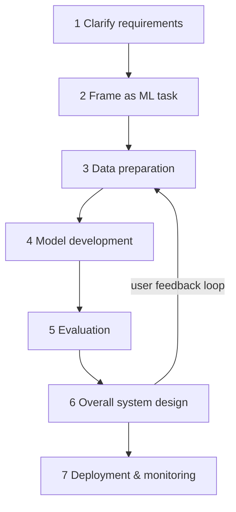
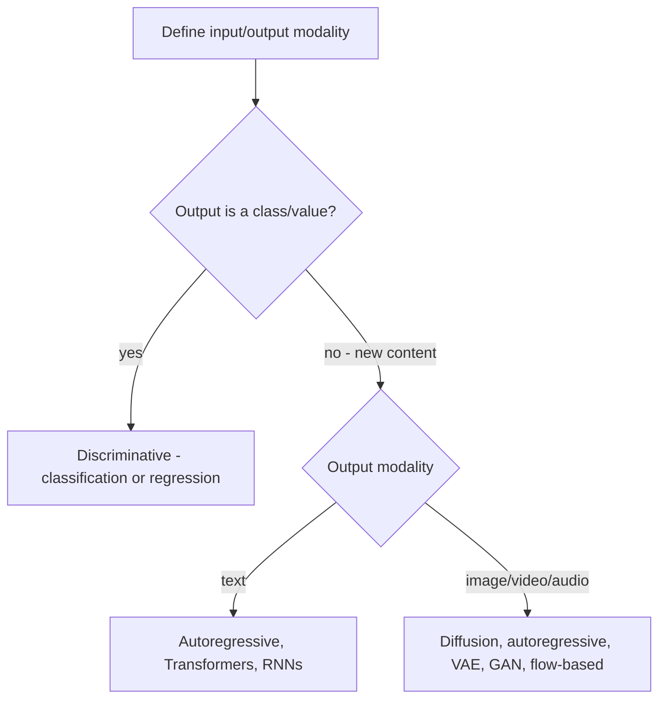

## GenAI Systems & the Design Interview Framework

GenAI system design rounds are open-ended — "design a chatbot" has no correct answer; the committee scores your framework, trade-offs, and numbers. Answer with the 7-step framework and its vocabulary (scaling laws, parallelism, evaluation metrics) — the spine every later design (chatbot, RAG, image, video) hangs from.

### Discriminative vs Generative Models

- **Discriminative:** learns P(Y|X) — classifies or predicts from input features (fraud detection, rating prediction).
- **Generative:** learns P(X) or P(X,Y) — samples new data from the learned distribution (new faces, text, speech).

| Dimension | Discriminative | Generative |
|---|---|---|
| Learns | Conditional P(Y\|X) | P(X) or joint P(X,Y) |
| Tasks | Classification, regression, object detection, NER, recommendations | Chatbots, summarization, text-to-image, TTS |
| Algorithms | Logistic regression, SVM, decision trees, KNN, neural nets | Classical: Naive Bayes, GMM, HMM, Boltzmann. Modern: VAE, GAN, diffusion, autoregressive |
| Trade-off | Cheap, ground-truth-comparable eval | Creates new content, but eval is subjective/human-in-the-loop (ch1 §What are AI and ML?) |

### Why GenAI Is Powerful Now: Data, Capacity, Compute

- **Data:** self-supervised learning unlocks internet-scale unlabeled data — no labeling bottleneck. Llama 3 trained on 15T tokens (~50 TB); Flamingo on 1.8B (image, text) pairs (ch1 §Data).
- **Model capacity** measured two ways — **parameters** (size) and **FLOP count** (compute per forward pass). Worked example: fully connected 4→3 layer = 3×(4+3) = 21 FLOPs (ch1 §FLOP count).

| Model | Parameters (ch1 Table 1) |
|---|---|
| Google PaLM | 540B |
| OpenAI GPT-3 | 175B |
| Meta Llama 3 | 405B |
| Google Flamingo | 80B |
| Google Imagen | 2B |

- **Compute:** PaLM-2 needed 10²² FLOPs; a single H100 (60 TFLOP/s ≈ 5.18 EFLOP/day) would take ~5.5 years — hence thousands of GPUs and GPT-4's >$100M training cost (ch1 §Compute).

| Scaling law | Finding | Design implication |
|---|---|---|
| OpenAI 2020 ([arXiv](https://arxiv.org/abs/2001.08361)) | Scaling beats architecture tweaks; power-law gains with model/data/compute | Spend budget on size+data, not arch search |
| DeepMind 2022 ([arXiv](https://arxiv.org/abs/2203.15556)) | Data should scale ~linearly with params; many existing LLMs were undertrained | Compute-optimal training pairs token count to model size |
| Inference-time (speculated post-o1, [arXiv](https://arxiv.org/abs/2407.21787)) | More inference compute may improve outputs | Budget test-time compute as a quality lever |

### Risks & Limitations

- **Ethics:** bias, IP, misinformation, misuse. **Environment:** energy/carbon from training. **Model limits:** no true understanding → inaccuracies, weak complex reasoning, hallucination. **Security:** deepfakes, automated phishing, adversarial inputs in critical systems (ch1 §GenAI risks and limitations).

### The 7-Step Framework

### Step 1-2: Clarify, Then Frame the ML Task

- **Functional requirements** (what): business objective, features, languages supported — they shape the architecture.
- **Non-functional requirements** (how): latency, throughput, fairness, security, scalability — rarely change the initial architecture, but drive later performance tuning; identify early (ch1 §Non-functional requirements).
- **Clarifying questions map to:** business objective, features, data sources/size/labels, compute constraints, cloud vs device, user scale, quality-vs-speed priority (ch1 §Clarifying Requirements).
- **Framing = define input/output modality, then pick the algorithm family** (ch1 §Framing the problem as an ML task):

### Step 3: Data Preparation — Traditional vs GenAI

| Dimension | Traditional ML (structured) | GenAI (unstructured) |
|---|---|---|
| Data | Categorical, numerical, ordinal tables | Text, image, audio, video |
| Core work | Data engineering (ETL) + feature engineering (feature stores: Tecton, SageMaker) | Collection at scale + cleaning + retrieval efficiency |
| Trade-off | Hand-crafted features need SME time; task-specific | Scale replaces labeling, but noise/bias/harm must be filtered (ch1 §Data Preparation) |

- **Synthetic training data** (model-generated, ch1 §Data collection): **pros** — diversity when real data is limited/imbalanced, scalable; **cons** — inherits the source model's bias/errors, may miss real-world distribution gaps.
- **Cleaning pipeline:** harm detection & removal, NSFW removal, low-quality filtering, deduplication — internet-scale data is noisy (ch1 Fig. 15).
- **Efficiency:** distributed storage (HDFS, S3), columnar formats (Parquet, ORC); retrieval via sharding, indexing (Lucene/Elasticsearch), caching (ch1 §Data efficiency).

### Step 4: Model Development — Architecture, Training, Sampling

- **Architecture:** multiple viable options per algorithm (diffusion → U-Net or DiT); be ready to justify layers and modify for new features (style vectors, motion control). Core primitive: scaled dot-product self-attention — project embeddings to Q/K/V, score with softmax(QKᵀ/√d_K)V; multi-head attention attends in parallel subspaces ([Attention Is All You Need](https://arxiv.org/abs/1706.03762)) (ch1 §Transformer's self-attention architecture).
- **Training:** name methodology, data per stage, ML objective + loss, task-specific challenges. LLMs train in three stages: pretraining (e.g., Common Crawl) → supervised finetuning → alignment on curated/expert-annotated data (ch1 §Model training).

| Technique | What it does | Reach for it when |
|---|---|---|
| Gradient checkpointing | Save subset of activations, recompute in backward | GPU memory bound |
| Mixed precision (AMP) | Most math in 16-bit, sensitive ops in 32-bit | Speed + memory without accuracy loss |
| Data parallelism | Full model copy per device, data split; **sync** = consistent but waits for slowest device, **async** = faster but devices hold stale versions | Dataset large, model fits one device |
| Pipeline parallelism | Layers split across devices (inter-layer) | Very deep models |
| Tensor parallelism | Single layer's ops split, column/row-wise (intra-layer) | One layer exceeds device memory |
| Hybrid + ZeRO/FSDP | Combine both; shard optimizer/state to cut redundancy | Largest models |

(ch1 §Training efficiency, Figures 20-23)

- **Sampling:** greedy, beam search (coherent but limits diversity), top-k/top-p — discuss pros/cons and speed-quality trade-offs (ch1 §Model sampling).

### Step 5-7: Evaluation, System Design, Deployment

- **Offline:** discriminative = metrics vs ground truth (classification: precision/recall/F1/accuracy; regression: MSE/MAE/RMSE; ranking: P@k, MRR, mAP, nDCG). Generative needs multi-angle assessment — quality *and* prompt alignment (ch1 §Offline Evaluation).

| Generative task | Metrics (ch1 Table 3) |
|---|---|
| Text generation | Perplexity, BLEU, METEOR, ROUGE, CIDEr |
| Image generation | FID, IS, KID, SWD, PPL, LPIPS |
| Text-to-video | FVD, CLIPScore, FID, LPIPS, KID |

- **Online:** business-aligned metrics — CTR, conversion, latency, engagement, revenue/user, churn, satisfaction, retention, completion rate; selection is subjective and involves stakeholders — voice your reasoning (ch1 §Online Evaluation).
- **System design beyond the model:** safety filters (NSFW), post-processing/upscaling models, user-feedback loops for retraining, scalability (load balancers, distributed inference, model parallelism), privacy, bias auditing, adversarial robustness (ch1 §Overall ML system design).
- **Deployment & monitoring:** out of scope for GenAI-specific rounds — point to the ML System Design Interview book ([1](https://www.aliaminian.com/books)) (ch1 §Deployment and monitoring).

### Failure modes & anti-patterns

- **Model = whole system:** skipping safety, eval, monitoring components — symptom: no answer when asked "how does this ship to millions safely?"
- **Synthetic data without scrutiny:** propagates source-model bias/errors and real-world distribution gaps — symptom: degraded output diversity (ch1 §Data collection).
- **Scaling params without data:** DeepMind 2022 showed many existing LLMs were undertrained — wasted compute, symptom: bigger model, no loss improvement.
- **Confusing parameters with FLOPs:** dense layers cost more compute than sparse at equal params — wrong optimization target when cost-constrained (ch1 §FLOP count).
- **Deferring non-functional requirements:** latency/quality trade-offs surface late; symptom: architecture rework during tuning (ch1 §Non-functional requirements).
- **Single-metric generative evaluation:** one score (e.g., FID) misses prompt alignment, safety, bias — assess multiple angles (ch1 §Offline Evaluation).
- **Sync data parallelism at scale:** every step waits for the slowest device; async fixes speed but introduces stale-parameter inconsistency (ch1 §Data parallelism).

### Key Takeaways

- The framework (clarify → frame → data → model → evaluate → system → deploy) is the answer skeleton for every GenAI design question; structure beats raw knowledge.
- GenAI's rise = self-supervised data at internet scale + billions of parameters + GPU fleets; quote Llama 3's 15T tokens and PaLM-2's 10²² FLOPs when justifying scale.
- Scaling laws are the justification tool: scaling beats architecture tweaks (OpenAI 2020); data must grow linearly with params (DeepMind 2022).
- GenAI data prep is collection + cleaning (harm/NSFW/dedup) + retrieval efficiency, not feature engineering.
- Generative evaluation has no single ground truth — combine offline task metrics with human judgment and business-aligned online metrics.

### Interview Lens

- When given "design X": open with 2-3 clarifying questions (business goal, scale, quality-vs-speed), then explicitly state input/output modality and the algorithm family — this maps you to the framework in the first 5 minutes.
- Any "why is this model good enough?" probe: answer with the scaling-law trade-off (params vs tokens vs compute), not "it's state of the art".
- For cost questions, run the FLOP math aloud (ops × params ÷ GPU TFLOP/s → GPU-years); it converts a hand-wave into a number.
- Expect follow-up "add a feature" probes (style control, motion direction) — answer at the architecture level: which components change, what new inputs they take (ch1 §Model architecture).
- Not every round weights all 7 steps equally — ask which area the interviewer cares about (infra, LLM, safety) and rebalance your time (ch1 §Summary).
