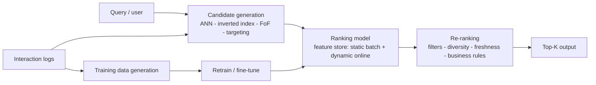

## Machine Learning System Design Interview (Aminian & Xu)

Your A3 defense is a system-design interview in committee form: the panel probes how you framed the ML objective, built the feature/data pipeline, and justified metrics — exactly this book's skeleton. All 11 chapters share one 7-step framework; the chapters mapping to data-engineering work (retrieval/ranking, feature stores, continual learning) get the most space below.

:::scenario Scenario — One Skeleton, Eleven Designs
@panel Committee: design a recommender :: Eleven chapters, one seven-step skeleton — seniority lives in data engineering; the models are the easy 20%.
-> open skeleton => @clarify
@clarify Step 1 — Clarify :: Business objective, features, data sources/labels, constraints, scale, accuracy-vs-latency — work the panel's menu.
-> frame objective => @frame
@frame Step 2 — Frame as ML task :: The load-bearing move: "increase engagement" → "maximize watch time" — name objectives with failure modes first.
? Maximize clicks raw => @clickbait |fail
-> prepare data => @data
@clickbait The clickbait trap :: Clicks reward clickbait, completions bias toward short videos — land on relevance-aware objectives.
-> reframe => @frame
@data Step 3 — Prepare data :: ETL + feature ops — imputation, scaling, encoding; labeling is a design decision: clicks free but noisy, humans scarce.
-> pick model => @model
@model Step 4 — Develop the model :: Ladder: popularity baseline → LR → DNN → ensemble only if needed; GBDT only where retraining from scratch is acceptable.
? Implicit-feedback matrix factorization => @loss |success
-> evaluate => @metrics
@loss Weight the unobserved pairs :: Observed-only loss hits zero with degenerate all-ones embeddings — WALS forces real separation; walk the loss aloud.
-> evaluate => @metrics
@metrics Step 5 — Evaluate :: Reproduce the elimination chain: MRR ignores post-first hits, recall@k drowns, precision@k is rank-blind → nDCG or mAP.
? Uncalibrated pCTR feeds bidding => @calibrate |fail
-> serve => @serve
@calibrate Calibrate before serving :: Ad pCTRs feed downstream auctions — NCE < 1 vs the background-CTR baseline; uncalibrated models break the auction.
-> serve => @serve
@serve Step 6 — Retrieve-then-rank :: Candidate generation → ranking → re-ranking; feature store = static batch + dynamic; business rules stay in re-rank.
-> monitor => @monitor
@monitor Step 7 — Monitor + retrain :: Position bias inflates winners, frequent users over-represent — continual learning where freshness matters.
:::
:::diagram ml-serving-pipeline.png
:::

### The Repeating Framework (ch1)

- Seven steps every chapter follows: clarifying requirements, framing as ML task, data preparation, model development, evaluation, deployment/serving, monitoring/infrastructure (ch1, p2).
- Clarifying-question menu: business objective, features to support, data sources/labels, constraints (compute, on-device), scale, performance (accuracy vs latency) (ch1 §Clarifying Requirements, p1-2).
- The load-bearing move is translating business goal → trainable ML objective (Table 1.1, p3): "increase engagement" → "maximize watch time"; "protect privacy" → "detect faces/plates accurately".
- Data engineering vocabulary expected: ETL, structured vs unstructured data (ch1, p7-9). Feature ops: missing values (deletion vs imputation), scaling (min-max, z-score, log for skew), discretization, encoding (integer for ordinal, one-hot for nominal, embeddings for high cardinality) (ch1 §Feature engineering, p10-14).
- Model ladder: popularity/simple baseline → simple model (LR) → complex (DNN) → ensemble only if needed (ch1 §Model selection, p14).

### The Chapter Map

| Ch | Prompt | ML objective | Model verdict | Offline metric |
|---|---|---|---|---|
| 2 Visual Search | rank similar images | representation learning | CNN/ViT + contrastive | nDCG |
| 3 Street Blur | detect faces/plates | object detection | two-stage detector | mAP |
| 4 Video Search | text → relevant videos | two retrievers fused | BERT text + ViT frames + inverted index | MRR |
| 5 Harmful Content | flag harmful posts | per-policy classification | multi-task multimodal NN | PR-AUC/ROC-AUC |
| 6 Video Rec | recommend relevant videos | implicit-feedback CF | MF/WALS + two-tower | diversity, recall |
| 7 Event Rec | rank events by attendance | pointwise LTR | GBDT→NN, continual learning | mAP |
| 8 Ad Click | predict click probability | pointwise LTR ⟨user,ad⟩ | DeepFM / DCN | CE, NCE |
| 9 Similar Listings | next-click from session | session-based rec | word2vec-style embeddings | avg rank of booked listing |
| 10 News Feed | engagement-ranked posts | weighted multi-reaction score | multi-task DNN | ROC-AUC per reaction |
| 11 PYMK | rank potential connections | edge prediction | GNN | ROC-AUC + mAP |

### Design Cards

#### ch2 — Visual Search: the ANN retrieval template
- Requirements: 100-200B images, images only, no personalization, click-only feedback (ch2 §Clarifying Requirements, p31).
- Task: ranking via representation learning — embeddings of similar images sit close in N-dimensional space (ch2, p33).
- Positive-pair labeling options: human judgment (accurate, expensive), clicks (free, noisy, sparse), self-supervision via augmentation (free, clean, but differs from real data) → chose self-supervision at billions scale (ch2 §Constructing the dataset, p38-39).
- Loss: similarities (dot product/cosine — Euclidean fails in high dimensions) → softmax → cross-entropy (ch2 §Model training, p41).
- Metric elimination chain: MRR ignores items after the first hit; recall@k drowns under millions of relevant items; precision@k is rank-blind → nDCG for continuous relevance scores (ch2 §Evaluation, p42-46).
- Serving: embedding generation → nearest-neighbor service → re-rank (privacy/duplicate/business filters) (ch2, p47). Indexing pipeline precomputes all embeddings, quantization for memory (ch2, p48). Exact NN is O(N×D) — infeasible at billions; ANN (tree-based, LSH, clustering) is sublinear; Faiss/ScaNN (ch2, p48-51).
- **Insight: every later chapter reuses this retrieve-then-rank shape — cite it as your own pipeline instinct.**

#### ch3 — Street View Blurring: precision-first object detection
- Privacy objective → detect + blur faces/plates; offline batch processing acceptable, latency not a concern (ch3 §Clarifying Requirements, p53-54).
- Task: object detection = bounding-box regression + class classification (ch3, p55).
- Two-stage (RPN + classifier, R-CNN family) over one-stage (YOLO/SSD): slower but more accurate; 1M training images doesn't punish the slower option — switch to one-stage when data or latency grows (ch3 §Model selection, p56).
- Loss: MSE (boxes) + cross-entropy (classes), balanced by λ (ch3, p61-62); a detection counts only above an IOU threshold (ch3, p63).
- Eval: precision varies with IOU threshold → AP averages over thresholds → mAP averages over classes (ch3 §Evaluation, p63-65). Online: user reports + human spot-checks (ch3, p65).
- Serving: batch prediction; preprocessing is CPU-bound, blurring GPU-bound → separate services, scale independently (ch3, p67); hard negative mining from user reports feeds retraining (ch3, p68).

#### ch4 — YouTube Video Search: two retrievers, one fuse
- 1B videos, 10M ⟨video, query⟩ pairs, English only, no personalization (ch4 §Clarifying Requirements, p71-72).
- Two parallel retrievers: visual search (two encoders — video + text — dot product in embedding space) and text search (inverted index via Elasticsearch, zero ML training cost) (ch4 §Framing the Problem, p73-75).
- Encoders: BoW/TF-IDF (fast, sparse, no semantics) < embedding layer/word2vec (static vectors) < Transformers (contextual) → BERT text encoder (ch4, p81-84). Video: video-level 3D-conv models capture time but are expensive; frame-level ViT samples frames and averages — chosen for speed (ch4, p84-85). Trained contrastively like ch2 (ch4, p85).
- Eval: with one relevant video per query, precision@10 caps at 0.1 — useless; recall@k becomes hit-rate but scores 0 whether the item is at rank 15 or 50 → MRR (ch4 §Evaluation, p86-87).
- Serving: ANN + Elasticsearch results merged by a fusing layer — weighted-sum re-rank chosen over a trained fusion model (extra training, serving latency) (ch4 §Serving, p88-89). Auto-tagger fills missing video tags (ch4, p89).

#### ch5 — Harmful Content Detection: multimodal, multi-task
- >500M posts/day; humans can label ~10K/day → natural labeling required (ch5 §Clarifying Requirements, p93).
- Memes: text and image benign separately, harmful combined — motivates fusion choice: early fusion (concatenate modalities early, captures interactions) vs late fusion (separate per-modality models, merged) (ch5, p95-97).
- Task: multi-task NN, one binary classifier per policy; DistilmBERT text encoder (ch5 §Model Development, p101-105). Labels: hand-labeled for evaluation (accuracy), naturally-reported for training (volume) (ch5 §Data, p109).
- Eval: PR-AUC/ROC-AUC per policy; distinguish prevalence (harmful content existing on platform) from harmful impressions (what users actually see); track valid appeals + proactive detection rate (ch5 §Evaluation, p110-111).

#### ch6 — Video Recommendation: the flagship chapter
- 10B videos, <200 ms serving (ch6 §Clarifying Requirements, p115).
- Objective options each carry a stated drawback: clicks → clickbait recommendations; completions → bias toward shorter videos; the elimination lands on maximizing relevant videos watched (ch6 §Frame the Problem, p116-117).
- Content-based (no cold start, poor discovery) vs collaborative filtering (discovers, cold-start pain) vs hybrid → CF-heavy hybrid like YouTube (ch6 Table 6.1, p120).
- Feedback matrix: explicit ratings scarce, implicit watches abundant but noisy → implicit (ch6, p128-129).
- MF loss walk: observed-pairs-only loss lets all-ones embeddings score zero loss (ch6, p131); adding unobserved pairs, weighted, optimized by WALS (ch6, p132).

| | Matrix factorization | Two-tower NN |
|---|---|---|
| Serving | Precomputed dot products, very fast | Encoder inference per request |
| Features | ID interactions only | Rich user/video features |
| New items | Retrain/recompute whole matrix | Handled via features |
| Reference | (ch6 Table 6.5, p137) | |

- Serving: two-stage — candidate generation (two-tower CF, no video features needed at this stage) → scoring (content-based, heavier model on the survivors) → re-ranking (clickbait suppression, freshness) (ch6 §Serving, p138-142); multiple candidate generators add diversity (ch6, p140).
- Cold start: new users via demographic features; new videos via heuristics → collect interactions → fine-tune (ch6, p143).
- **Insight: walk the loss function reasoning aloud — naive losses collapsing (all-ones labels → zero loss) is the show-your-reasoning set piece that signals depth.**

#### ch7 — Event Recommendation: pointwise LTR + feature freshness
- Ephemeral items — events happen once, then expire → intrinsic cold start (ch7 §Clarifying Requirements, p145-146).
- Task: pointwise LTR — binary classifier "will this user attend" (ch7, p148).
- Features: user, event, affinities; streaming features with a decay factor weighting recent interactions (ch7 §Feature engineering, p156).
- GBDT rejected: not fine-tunable, retraining from scratch is inefficient for continual learning at scale (ch7 §Model development, p162).
- Class imbalance: focal loss or class-balanced loss (ch7, p164). mAP over nDCG — relevance is binary here (ch7, p165).
- Serving: rule-based filtering cuts 1M events to hundreds (city/time), then the model ranks; static features precomputed in a feature store, dynamic fetched real-time (ch7 §Serving, p167-168).

#### ch8 — Ad Click Prediction: continual learning + the CTR model zoo
- Revenue objective; continual learning essential — a 5-minute model-update delay measurably damages performance (ch8 §Clarifying Requirements, p171-172).
- Labeling: impression visible for a duration without click = negative; click within t seconds (tuned hyperparameter) = positive (ch8, p172, p186).
- Core challenge: high-cardinality sparse features — millions of IDs, mostly zeros (ch8, p176-177).
- The model zoo is the CTR-evolution tour (ch8 §Model Development, p178-186): LR baseline (no interactions) → feature crossing + LR (manual, explodes sparsity) → GBDT (no fine-tuning, no embedding layers) → GBDT+LR (tree leaves as features) → plain NN (drowns in sparsity) → DCN (learns crosses automatically) → FM (LR + learned pairwise interactions via embeddings) → **DeepFM** (FM low-order + DNN high-order, shared embeddings). GBDT+DeepFM won competitions but slows continual learning (ch8, p186). Pick by experiment: LR baseline, then DCN/DeepFM.
- Eval: offline CE + NCE — CE normalized by the background-CTR baseline's CE; NCE < 1 means beating the naive baseline (ch8 §Evaluation, p188-189). Online: CTR, conversion rate, revenue lift, hide rate (ch8, p189-190).
- Serving: static features batch-computed into a feature store, dynamic features computed at query time; continual-learning pipeline fine-tunes → evaluates → deploys only if metrics improve (ch8 §Serving, p191-192). Two-stage: advertiser-targeting candidate generation → rank by pCTR → diversity re-rank (ch8, p192).

#### ch9 — Similar Listings: session-based embeddings
- 5M listings; new listings appear after 1 day; interactions only — no user or listing attributes (ch9 §Clarifying Requirements, p195-196).
- Session-based recommendation: recent interactions beat long-term interests (a user browsing SF doesn't care about generic history) (ch9, p197-198). Lineage: Airbnb listing embeddings, Instagram Explore, word2vec (ch9, p198).
- Training: shallow NN, word2vec-style sliding window, negative sampling — central vs context listings positive, central vs random negative (ch9 §Model training, p200-202).
- Two loss upgrades: eventually-booked listing as permanent global context (positive); same-region negatives as hard negatives — random negatives are trivially separable across regions users never compare (ch9, p203-204).
- Eval: average rank of the eventually-booked listing after re-ranking each session (ch9, p205). Online: CTR + session book rate (bookings = business objective) (ch9, p206).
- Serving: indexing pipeline precomputes embeddings and fully recomputes on each new model version (ch9, p207). Embedding fetcher: seen listing → index lookup; new listing → heuristic (nearest geographic embedding) until fine-tuned (ch9, p208). ANN mandatory at 5M comparisons; re-rank applies user price/city filters (ch9, p208).

#### ch10 — News Feed: weighted multi-task engagement
- 3B users, 2B DAU, <200 ms (ch10 §Clarifying Requirements, p211-212).
- Objective: implicit signals are data-rich but noisy (clickbait), explicit clean but scarce → weighted blend: click 1, like 5, comment 10, share 20, friend request 30, hide −20, block −50 (ch10 Table 10.1, p212-213).
- Per ⟨user, post⟩ pair: several binary classifiers predict each reaction; probabilities × weights = engagement score (ch10, p214-215).
- Features: BERT for text, ResNet/CLIP for images (ch10 §Feature engineering, p218); hashtags — Viterbi tokenization, feature hashing (handles unseen trending tags), TF-IDF/word2vec not Transformers (hashtags carry no context worth the cost) (ch10, p219); post-age buckets (ch10, p219). User-author affinities are among the most predictive features at Facebook scale (ch10, p221).
- Multi-task DNN (shared layers, per-reaction heads) over N independent DNNs — independent nets are expensive and starve rare reactions of data (ch10 §Model selection, p222-223). Passive users: add dwell-time regression + skip tasks (ch10, p224).
- Eval: ROC-AUC per reaction (ch10, p226); online CTR, reaction rates, total time spent (captures passive users), survey satisfaction (ch10, p227). Serving: retrieval → ranking → re-ranking (ch10, p227-228).

#### ch11 — People You May Know: graph edge prediction
- 1B users, 300M DAU, avg 1,000 connections; social graph evolves slowly (ch11 §Clarifying Requirements, p232).
- Pointwise LTR on ⟨user, user⟩ ignores social context — one-hop neighborhoods separate plausible from implausible pairs → frame as edge prediction on the social graph (ch11 §Choosing the right ML category, p233-235).
- Data: standardize free-text attributes ("computer science" vs "CS") via predefined lists, heuristics, or clustering (ch11 §Data engineering, p237). Mutual connections are among the most predictive features; time-discount them — recent network growth signals openness to connect (ch11 §Feature engineering, p239).
- Model: GNN produces node embeddings; dot product = edge probability (ch11 §Model selection, p240). Training: graph snapshot at time t, label = edge formed by t+1 (ch11 §Model training, p241-244).
- Eval: ROC-AUC for the model, mAP for ranking (binary connect-or-not) (ch11, p245). Online: requests sent can inflate (spam), requests accepted reflect real network growth (ch11, p245).
- Scale: ranking 1B embeddings per user is impractical → friends-of-friends narrows 1B → 1M (1000²); a Meta study found 92% of new friendships form within FoF (ch11 §Efficiency, p246). Batch prediction over online: 300M DAU can't be scored on the fly; ~20% DAU means 80% of batch compute wasted — accepted; recompute every 7 days (1 day for new users); over-generate and hide already-seen (ch11, p246-247). Serving: FoF service → GNN scoring → store → fetch per request (ch11, p248-249). Bias: frequent users get over-recommended, compounding their representation (ch11, p250).

### The Retrieval → Ranking Serving Skeleton (ch2, 4, 6, 8, 9, 10, 11)

- **Precompute-and-cache recurs**: all embeddings indexed offline (ch2, p48; ch9, p207); static features batch-computed into a feature store, dynamic computed at query time (ch8, p191); whole PYMK lists batch-predicted and stored (ch11, p247).
- ANN above ~millions of candidates (ch2, p48-51); exact search only for small pools (ch9, p208).
- Re-ranking is the dumping ground for non-ML logic — never bake business rules into the model (ch2, p47; ch9, p208).

### Failure modes & anti-patterns

- **All-ones embeddings**: loss over observed pairs only reaches zero with degenerate embeddings — always weight unobserved pairs (ch6, p131).
- **Uncalibrated probabilities**: ad pCTRs feed downstream bidding — an uncalibrated model breaks the auction (ch8, p192).
- **Clickbait optimization**: maximizing clicks or raw reactions rewards clickbait — weight negative signals, prefer relevance-aware objectives (ch6, p116; ch10, p212-213; hide rate ch8, p190).
- **Biased negatives**: unclicked ≠ uninterested when the user scrolled past (ch8, p172); random negatives pair items across regions users never compare (ch9, p203).
- **Positional bias**: higher-ranked items collect more clicks, inflating winners in a feedback loop (ch2, p51; ch9, p209; ch10, p228).
- **GBDT in continual-learning systems**: cannot be fine-tuned; retraining from scratch at scale (ch7, p162; ch8, p180).
- **Wrong computation mode**: blurring tolerates batch (ch3, p67) but ad models must refresh within minutes (ch8, p172); PYMK batch wastes 80% of compute on the 80% who never log in — an accepted, stated trade (ch11, p247).
- **Feedback-loop bias**: over-recommended frequent users grow even more represented in training data (ch11, p250).

### Worked Design: Gmail Smart Compose

The GenAI interview opener: a decoder-only LLM doing next-token prediction behind a keystroke-triggered service with a ~100 ms budget. Every concept here — tokenization, pretrain/finetune, beam search, online metrics — is reusable vocabulary for any "add LLM features to our pipeline" discussion.

#### Requirements Framing

- **Scope pinned by the interviewer dialogue:** no personalization, suggest only when confident, ~1 B training emails, email body as initial context, English-only, no biased suggestions, ~1.8 B Gmail users (up to 500 emails/day each), imperceptible latency ≈ 100 ms (ch2 §Clarifying Requirements).
- **Task framing:** input = sequence of typed words; output = continuation. Text generation task → sequential architecture needed (ch2 §Frame the Problem as an ML Task).
- **Transformer over RNN** (ch2 §Frame the Problem as an ML Task, Table 1):

| Feature | RNN (GRU/LSTM) | Transformer | Trade-off |
|---|---|---|---|
| Architecture | Simple | Complex | Complexity buys capability |
| Training efficiency | Inefficient — sequential time steps | Efficient — parallel via self-attention | Faster training at higher per-step cost |
| Long sequences | Weak (vanishing gradient) | Strong — attends to any distance | Self-attention is O(n²) in sequence length |
| Applications | Simple tasks (time series) | Language completion, translation | Match architecture to task complexity |

- The O(n²) attention cost motivates efficiency work — Group Attention, Flash Attention (ch2 §Frame the Problem as an ML Task).

#### Data Preparation

- **Two data sources:** general text (books, web, social — diverse vocabulary/syntax) + the 1 B email corpus (email style, common phrases) (ch2 §Data Preparation).
- **Text cleaning:** remove non-English (language ID, e.g. FastText), replace confidential content (names, URLs, emails, phones) with placeholders — `john@gmail.com` → `##@gmail.com` — strip irrelevant symbols/emojis, deduplicate to prevent skewed learning (ch2 §Data Preparation).
- **Normalization:** consistent formats, e.g. `(123) 456-7890` / `123-456-7890` → `1234567890` (ch2 §Data Preparation).
- **Tokenization levels** — the interview table (ch2 §Data Preparation, Table 3):

| Characteristic | Character-level | Word-level | Subword-level |
|---|---|---|---|
| Vocabulary size | ~100 | ~300,000+ (Transformer-XL: 267,735) | ~50,000–150,000 |
| Performance | Poor | High but impractical (huge embedding table, slow training) | High and practical |
| Unseen words | Decomposes to characters | Cannot handle easily | Decomposes into known subwords |

- **Choose subword** (BPE, SentencePiece — GPT-4 uses a BPE variant, Gemini uses SentencePiece); use existing libraries (Tiktoken, SentencePiece), don't hand-roll (ch2 §Data Preparation).
- **Token indexing:** build the vocabulary table, map tokens ↔ integer IDs (ch2 §Data Preparation).

#### Decoder-only Architecture

- **Pick by generation vs understanding** (ch2 §Architecture):

| Variation | Task type | Example models |
|---|---|---|
| Encoder-only | Understanding: classification, NER, sentiment | BERT, RoBERTa |
| Decoder-only | Generation, one token at a time | GPT, LLaMA, Gemini, Claude, Grok |
| Encoder-decoder | Output transforms input (translation) | T5, BART |

- Smart Compose completes partial text → **decoder-only** (ch2 §Architecture).
- **Pipeline:** text embedding → positional encoding → stacked Transformer blocks (multi-head self-attention + feed-forward) → prediction head producing a probability per vocabulary token (ch2 §Architecture, Fig. 22).
- **Embeddings fix two one-hot problems:** sparsity (tens of thousands of IDs → dense low-dim vectors) and missing semantics (learned vectors place "happy"/"joyful" close, "happy"/"sad" far) (ch2 §Architecture).
- **Positional encoding** is required because attention is permutation-invariant — without it "initialize then use" and "use then initialize" are indistinguishable (ch2 §Architecture):

| Method | Pros | Cons | Trade-off |
|---|---|---|---|
| Fixed (sine-cosine) | No extra parameters; maps any position → long-sequence generalization | Possible max-position caps; may underfit task-specific position patterns | Chosen for Smart Compose: efficiency + generalization |
| Learned (trainable N×d matrix) | Optimal position representation for the task | Extra parameters; overfits to training sequence lengths | Pay cost only when task benefits |

#### Two-stage Training

- **Never train from scratch on email data:** small task data → weak learning, overfitting risk, expensive full-language training (ch2 §Training).
- **Stage 1 — pretraining** on general data (e.g. Common Crawl, petabytes since 2008): objective = **next-token prediction**, loss = **cross-entropy** (ch2 §Training).
- **Stage 2 — finetuning** on the 1 B emails: same objective and loss, email-context predictions (ch2 §Training).
- Loss over all token positions is computed **in parallel** within a sequence — one pass, per-position losses (ch2 §Training, Fig. 27).
- **Context beyond the body:** body-only input cannot predict "Dear John" without knowing the recipient. Combine subject, recipient, sender, previous emails into one tagged sequence via a **prompt template**; GenAI decouples architecture from input structure (vs traditional per-type feature engineering) (ch2 §Training, Figs. 29–31).
- Transfer-learning benefits: one base model serves many tasks, faster finetuning, pretraining regularizes against overfitting, pretraining cost paid once (ch2 §Training).

#### Sampling: Deterministic by Design

| Strategy | Behavior | Pros | Cons |
|---|---|---|---|
| Deterministic (greedy, beam) | Same input → same output | Consistency, predictable, low inappropriate-suggestion risk | Low diversity; greedy causes repetition |
| Stochastic | Samples from the predicted distribution | Diversity, novelty | Inconsistent outputs, unexpected/inappropriate text |

- **Email completion wants consistency** → deterministic (ch2 §Sampling).
- **Greedy search** (always pick the argmax token) is rarely used: narrow path → repetitive loops, e.g. the GPT-2 "I'm not sure if I'll ever be able to..." example (ch2 §Sampling, Fig. 34).
- **Beam search** tracks top-k sequences (beam width k): init → expand each beam → prune by cumulative probability → stop at EOS or max length → return highest-scoring sequence. Drawbacks: similar outputs, expensive for long sequences — acceptable here because suggestions are short and diversity is unwanted (ch2 §Sampling, Figs. 36–37).

#### Evaluation

| Setting | Metric | Measures |
|---|---|---|
| Offline | **Perplexity** | exp of average negative log-likelihood; lower = better next-token prediction (ch2 §Evaluation) |
| Offline | **ExactMatch@N** | % of generations matching the first N ground-truth words; average across lengths (ch2 §Evaluation) |
| Online | Acceptance rate / usage rate | Suggestions accepted; % of emails using the feature (ch2 §Evaluation) |
| Online | Average completion time | Email writing speed with vs without the feature (ch2 §Evaluation) |
| Online | System response time | Suggestion latency — must stay under threshold (~100 ms requirement) (ch2 §Evaluation) |
| Online | Feedback rate, human evaluation | Continuous improvement; user studies for satisfaction (ch2 §Evaluation) |

- BLEU / ROUGE-N appear as newer helpful metrics (covered in ch3) (ch2 §Evaluation).

- **Triggering service:** activates only with enough context ("I hope" yes, "I" no) and throttles suggestion frequency (ch2 §Overall ML System Design).
- **Phrase generator:** beam-search top-k completions ending in EOS with scores; filters long and low-confidence candidates; forwards the top one (ch2 §Overall ML System Design).
- **Post-processing service:** rule-based bias control — pronoun neutralization ("he/she"→"they"), gender-neutral words ("chairman"→"chairperson"), flagged-term lexical analysis (age/race/disability), NSFW keyword filtering (ch2 §Overall ML System Design).

#### Failure Modes & Anti-patterns

- **From-scratch training on task data:** overfitting + prohibitive cost; symptom — great on training emails, poor generalization (ch2 §Training).
- **Body-only input:** model can't predict recipient-dependent tokens ("Dear" → never suggests "John"); symptom — useless greetings (ch2 §Training).
- **No positional encoding:** bag-of-words behavior, order-blind predictions (ch2 §Architecture).
- **Greedy search in production:** repetitive degenerate text (ch2 §Sampling, Fig. 34).
- **Learned positional encoding on varied lengths:** overfits training lengths, degrades on others (ch2 §Architecture).
- **Character- or word-level tokenization:** performance loss or a 300 K+ vocabulary making training slow and costly (ch2 §Data Preparation).
- **Skipping confidence/length filters:** users see long, specific, or half-confident guesses — trust collapses, acceptance rate drops (ch2 §Overall ML System Design).
- **No post-processing:** biased or NSFW suggestions reach users — an explicitly stated hard requirement (ch2 §Clarifying Requirements, §Overall ML System Design).

### Key Takeaways

- One skeleton, eleven designs — drill clarify → frame → data → model → eval → serve → monitor once, reuse on any prompt.
- Metric selection is a design decision with a written elimination chain (MRR vs recall@k vs nDCG vs mAP vs NCE) — every chapter discards candidates for stated reasons; reproduce that reasoning, don't just name a metric.
- Seniority lives in the data engineering: indexing pipelines, feature stores, negative sampling, labeling strategies, batch-vs-online choices — the models are the easy 20%.

### Interview Lens

- Map committee questions onto the skeleton: "how did you derive the ML objective from the business goal?" (Table 1.1 move, p3), "why this metric and not the alternatives?" (each card's eval chain), "batch or online?" (skeleton section), "what happens when data drifts?" (continual-learning pipelines, ch7/ch8).
- Rehearse the objective-options ritual — naming 2-3 candidate objectives with their failure modes before choosing (ch6, p116-117; ch10, p212-213) — it signals senior judgment more than any model name.
