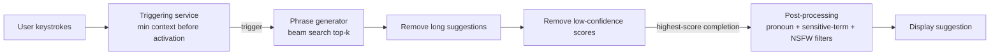

## Gmail Smart Compose

The GenAI interview opener: a decoder-only LLM doing next-token prediction behind a keystroke-triggered service with a ~100 ms budget. Every concept here — tokenization, pretrain/finetune, beam search, online metrics — is reusable vocabulary for any "add LLM features to our pipeline" discussion.

### Requirements Framing

- **Scope pinned by the interviewer dialogue:** no personalization, suggest only when confident, ~1 B training emails, email body as initial context, English-only, no biased suggestions, ~1.8 B Gmail users (up to 500 emails/day each), imperceptible latency ≈ 100 ms (ch2 §Clarifying Requirements).
- **Task framing:** input = sequence of typed words; output = continuation. Text generation task → sequential architecture needed (ch2 §Frame the Problem as an ML Task).
- **Transformer over RNN** (ch2 §Frame the Problem as an ML Task, Table 1):

| Feature | RNN (GRU/LSTM) | Transformer | Trade-off |
|---|---|---|---|
| Architecture | Simple | Complex | Complexity buys capability |
| Training efficiency | Inefficient — sequential time steps | Efficient — parallel via self-attention | Faster training at higher per-step cost |
| Long sequences | Weak (vanishing gradient) | Strong — attends to any distance | Self-attention is O(n²) in sequence length |
| Applications | Simple tasks (time series) | Language completion, translation | Match architecture to task complexity |

- The O(n²) attention cost motivates efficiency work — Group Attention, Flash Attention (ch2 §Frame the Problem as an ML Task).

### Data Preparation

- **Two data sources:** general text (books, web, social — diverse vocabulary/syntax) + the 1 B email corpus (email style, common phrases) (ch2 §Data Preparation).
- **Text cleaning:** remove non-English (language ID, e.g. FastText), replace confidential content (names, URLs, emails, phones) with placeholders — `john@gmail.com` → `##@gmail.com` — strip irrelevant symbols/emojis, deduplicate to prevent skewed learning (ch2 §Data Preparation).
- **Normalization:** consistent formats, e.g. `(123) 456-7890` / `123-456-7890` → `1234567890` (ch2 §Data Preparation).
- **Tokenization levels** — the interview table (ch2 §Data Preparation, Table 3):

| Characteristic | Character-level | Word-level | Subword-level |
|---|---|---|---|
| Vocabulary size | ~100 | ~300,000+ (Transformer-XL: 267,735) | ~50,000–150,000 |
| Performance | Poor | High but impractical (huge embedding table, slow training) | High and practical |
| Unseen words | Decomposes to characters | Cannot handle easily | Decomposes into known subwords |

- **Choose subword** (BPE, SentencePiece — GPT-4 uses a BPE variant, Gemini uses SentencePiece); use existing libraries (Tiktoken, SentencePiece), don't hand-roll (ch2 §Data Preparation).
- **Token indexing:** build the vocabulary table, map tokens ↔ integer IDs (ch2 §Data Preparation).

### Decoder-only Architecture

- **Pick by generation vs understanding** (ch2 §Architecture):

| Variation | Task type | Example models |
|---|---|---|
| Encoder-only | Understanding: classification, NER, sentiment | BERT, RoBERTa |
| Decoder-only | Generation, one token at a time | GPT, LLaMA, Gemini, Claude, Grok |
| Encoder-decoder | Output transforms input (translation) | T5, BART |

- Smart Compose completes partial text → **decoder-only** (ch2 §Architecture).
- **Pipeline:** text embedding → positional encoding → stacked Transformer blocks (multi-head self-attention + feed-forward) → prediction head producing a probability per vocabulary token (ch2 §Architecture, Fig. 22).
- **Embeddings fix two one-hot problems:** sparsity (tens of thousands of IDs → dense low-dim vectors) and missing semantics (learned vectors place "happy"/"joyful" close, "happy"/"sad" far) (ch2 §Architecture).
- **Positional encoding** is required because attention is permutation-invariant — without it "initialize then use" and "use then initialize" are indistinguishable (ch2 §Architecture):

| Method | Pros | Cons | Trade-off |
|---|---|---|---|
| Fixed (sine-cosine) | No extra parameters; maps any position → long-sequence generalization | Possible max-position caps; may underfit task-specific position patterns | Chosen for Smart Compose: efficiency + generalization |
| Learned (trainable N×d matrix) | Optimal position representation for the task | Extra parameters; overfits to training sequence lengths | Pay cost only when task benefits |

### Two-stage Training

- **Never train from scratch on email data:** small task data → weak learning, overfitting risk, expensive full-language training (ch2 §Training).
- **Stage 1 — pretraining** on general data (e.g. Common Crawl, petabytes since 2008): objective = **next-token prediction**, loss = **cross-entropy** (ch2 §Training).
- **Stage 2 — finetuning** on the 1 B emails: same objective and loss, email-context predictions (ch2 §Training).
- Loss over all token positions is computed **in parallel** within a sequence — one pass, per-position losses (ch2 §Training, Fig. 27).
- **Context beyond the body:** body-only input cannot predict "Dear John" without knowing the recipient. Combine subject, recipient, sender, previous emails into one tagged sequence via a **prompt template**; GenAI decouples architecture from input structure (vs traditional per-type feature engineering) (ch2 §Training, Figs. 29–31).
- Transfer-learning benefits: one base model serves many tasks, faster finetuning, pretraining regularizes against overfitting, pretraining cost paid once (ch2 §Training).

### Sampling: Deterministic by Design

| Strategy | Behavior | Pros | Cons |
|---|---|---|---|
| Deterministic (greedy, beam) | Same input → same output | Consistency, predictable, low inappropriate-suggestion risk | Low diversity; greedy causes repetition |
| Stochastic | Samples from the predicted distribution | Diversity, novelty | Inconsistent outputs, unexpected/inappropriate text |

- **Email completion wants consistency** → deterministic (ch2 §Sampling).
- **Greedy search** (always pick the argmax token) is rarely used: narrow path → repetitive loops, e.g. the GPT-2 "I'm not sure if I'll ever be able to..." example (ch2 §Sampling, Fig. 34).
- **Beam search** tracks top-k sequences (beam width k): init → expand each beam → prune by cumulative probability → stop at EOS or max length → return highest-scoring sequence. Drawbacks: similar outputs, expensive for long sequences — acceptable here because suggestions are short and diversity is unwanted (ch2 §Sampling, Figs. 36–37).

### Evaluation

| Setting | Metric | Measures |
|---|---|---|
| Offline | **Perplexity** | exp of average negative log-likelihood; lower = better next-token prediction (ch2 §Evaluation) |
| Offline | **ExactMatch@N** | % of generations matching the first N ground-truth words; average across lengths (ch2 §Evaluation) |
| Online | Acceptance rate / usage rate | Suggestions accepted; % of emails using the feature (ch2 §Evaluation) |
| Online | Average completion time | Email writing speed with vs without the feature (ch2 §Evaluation) |
| Online | System response time | Suggestion latency — must stay under threshold (~100 ms requirement) (ch2 §Evaluation) |
| Online | Feedback rate, human evaluation | Continuous improvement; user studies for satisfaction (ch2 §Evaluation) |

- BLEU / ROUGE-N appear as newer helpful metrics (covered in ch3) (ch2 §Evaluation).

- **Triggering service:** activates only with enough context ("I hope" yes, "I" no) and throttles suggestion frequency (ch2 §Overall ML System Design).
- **Phrase generator:** beam-search top-k completions ending in EOS with scores; filters long and low-confidence candidates; forwards the top one (ch2 §Overall ML System Design).
- **Post-processing service:** rule-based bias control — pronoun neutralization ("he/she"→"they"), gender-neutral words ("chairman"→"chairperson"), flagged-term lexical analysis (age/race/disability), NSFW keyword filtering (ch2 §Overall ML System Design).

### Failure Modes & Anti-patterns

- **From-scratch training on task data:** overfitting + prohibitive cost; symptom — great on training emails, poor generalization (ch2 §Training).
- **Body-only input:** model can't predict recipient-dependent tokens ("Dear" → never suggests "John"); symptom — useless greetings (ch2 §Training).
- **No positional encoding:** bag-of-words behavior, order-blind predictions (ch2 §Architecture).
- **Greedy search in production:** repetitive degenerate text (ch2 §Sampling, Fig. 34).
- **Learned positional encoding on varied lengths:** overfits training lengths, degrades on others (ch2 §Architecture).
- **Character- or word-level tokenization:** performance loss or a 300 K+ vocabulary making training slow and costly (ch2 §Data Preparation).
- **Skipping confidence/length filters:** users see long, specific, or half-confident guesses — trust collapses, acceptance rate drops (ch2 §Overall ML System Design).
- **No post-processing:** biased or NSFW suggestions reach users — an explicitly stated hard requirement (ch2 §Clarifying Requirements, §Overall ML System Design).

### Key Takeaways

- Decoder-only Transformer + subword tokenization + next-token prediction is the default GenAI stack; pick architecture by generation-vs-understanding, not fashion.
- Pretrain on general data, finetune on task data — one pretraining cost amortized across tasks, with regularization for free.
- Deterministic beam search suits email completion: short outputs, consistency wanted, diversity unwanted.
- Offline metrics (perplexity, ExactMatch@N) gate deployment; online metrics (acceptance rate, response time, completion time) prove product value.
- The LLM is one component: triggering, filtering, and bias post-processing wrap it into a shippable feature.

### Interview Lens

- When asked to "design an LLM feature," mirror the Smart Compose skeleton: requirements → ML task framing → data prep → architecture choice with justification → two-stage training → sampling choice → offline+online metrics → serving components.
- Volunteer the tokenization trade-off table unprompted — vocabulary size vs unseen-word handling is a classic probe.
- Justify beam search with the task: "suggestions are short, so beam search's long-sequence cost doesn't bite, and diversity is a bug here, not a feature."
- Name the 100 ms latency budget early and connect it to the triggering service and response-time metric — latency awareness reads senior (ch2 §Clarifying Requirements, §Evaluation).
- Follow-ups to have ready: multilingual support, personalization, BPE/SentencePiece/WordPiece mechanics, MLM vs next-token, multi-token prediction, quality-vs-latency balancing (ch2 §Other Talking Points; [Smart Compose paper](https://arxiv.org/abs/1906.00080)).
