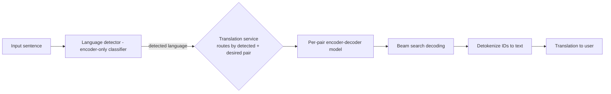

## Machine Translation (Google Translate)

A seq2seq translation service is the canonical encoder-decoder design — interviewers use it to test architecture selection, two-stage training, and evaluation metrics; the same skeleton covers summarization and speech recognition.

### Requirements & Problem Framing

- **Scope from clarifying questions:** 4 languages (EN/ES/KO/FR), auto language detection (users can't always name the language), inputs up to 1,000 words, cloud-deployed (no on-device), no real-time initially (ch3 §Clarifying Requirements).
- **Training data:** 300M sentence pairs + terabytes of general per-language text (ch3 §Clarifying Requirements).
- **Task shape:** sequence-to-sequence — input and output sequences of *different lengths*; encoder-decoder splits the job: encoder builds context vectors from the source, decoder emits target tokens one at a time (ch3 §Frame the Problem as an ML Task).
- **Why encoder-decoder over encoder-only/decoder-only:** (1) separation of input understanding (bidirectional) from output generation, (2) natural variable-length I/O, (3) cross-attention lets the decoder focus on relevant source parts while generating (ch3 §Choosing a suitable ML approach). Transformers beat GRU/LSTM on long-range dependencies; attention itself was introduced for translation ([arXiv 1409.0473](https://arxiv.org/abs/1409.0473)).

### Data Preparation

- **Keep:** remove missing/noisy pairs (HTML tags, wrong language pairing), dedup, replace named entities with `ENTITY_1`-style placeholders, restored after translation (ch3 §Text preprocessing).
- **Drop (legacy steps):** lowercasing, stop-word removal, stemming/lemmatization, punctuation removal — all lose grammatical/case information modern Transformers learn from context (ch3 §Text preprocessing).

| Tokenization | Vocabulary | OOV handling |
|---|---|---|
| Word-level | Hundreds of thousands across languages — huge, inefficient | Fails on unseen words |
| **Subword (BPE)** | Compact, built by iterative merges | Rare/unseen words decompose into known pieces ([BPE, HF course](https://huggingface.co/learn/nlp-course/en/chapter6/5)) (ch3 §Text tokenization) |

- **BPE mechanics:** start from characters + `</w>` boundary token; repeatedly merge the most frequent adjacent pair into a new token until vocab target size. `</w>` distinguishes "cat" as a full word from "cat" as a prefix of another word (ch3 §Byte-Pair Encoding).
- **Resulting training data:** one table per language pair; each row = two token-ID sequences (source, target) (ch3 §Data Preparation, Fig. 11).

### Model Development

```text
Encoder (per block): embed -> +positional (fixed sine-cosine) -> MHA self-attention -> FFN  [x N]
Decoder (per block): masked self-attention -> CROSS-attention over encoder output -> FFN -> linear+softmax head
Key differences: cross-attention layer | unidirectional (masked) self-attention | prediction head  (ch3 §Architecture)
```

- **Encoder:** bidirectional self-attention — every token sees all tokens; 1,000-word cap means standard attention suffices, no optimized attention needed (ch3 §Encoder).
- **Decoder:** masks future tokens (generation must only use already-generated prefixes) (ch3 §Decoder).

**Two-stage training** (ch3 §Training):

| Stage | Data | Objective | Loss |
|---|---|---|---|
| 1. Unsupervised pretraining | C4, Wikipedia, StackExchange — keep only target languages, drop the rest | **Masked LM** — mask input tokens, decoder predicts them (next-token would let the encoder "cheat" by leaking the answer) | Cross-entropy on masked positions only |
| 2. Supervised finetuning | 300M translation pairs, per language pair | Next-token prediction on target sentence | Cross-entropy over all positions |

- **Skip pretraining cost:** start from public encoder-decoder checkpoints (T5, [BART](https://arxiv.org/abs/1910.13461)) (ch3 §Training).

**Bilingual vs multilingual finetuning** (ch3 §Training):

| | Bilingual (one model per pair) | Multilingual (one model, many pairs) |
|---|---|---|
| Accuracy | Higher — captures pair-specific nuances | Often matches (mT5, [mBART](https://arxiv.org/abs/2001.08210)) and improving |
| Ops cost | N-pair models to train/deploy/maintain | One model — cheaper, simpler |
| Debuggability | Issues isolated per pair | Cross-pair interference |
| Pick | ✔ accuracy prioritized | — |



- **Language detector:** sequence classification with an encoder-only Transformer — either average-pool token outputs or use the last-token representation, then a prediction head over language classes (ch3 §Language detector, Fig. 27).
- **Sampling: beam search**, not stochastic — (1) higher accuracy via evaluating multiple candidate sequences, (2) deterministic: same input → same output; diversity is undesirable in translation (ch3 §Sampling).

| | Deterministic (greedy/beam) | Stochastic (top-k/top-p) |
|---|---|---|
| Quality | Coherent, predictable | Diverse, creative |
| Risk | Repetitive on long sequences | Inappropriate outputs |
| Use case | Translation, consistency-critical | Open-ended generation (ch3 Table 1) |

### Evaluation

| Metric | Mechanism | Pros | Cons |
|---|---|---|---|
| [BLEU](https://en.wikipedia.org/wiki/BLEU) | Precision: n-gram matches candidate→reference; brevity penalty for short outputs; weights over 1..N-grams | Simple, fast | Unfairly penalizes correct-but-different wording ("found a new method" vs "discovered a new algorithm") |
| [ROUGE](https://en.wikipedia.org/wiki/ROUGE_(metric)) | Recall: n-gram overlap reference→candidate | Easy, efficient | No contextual understanding; synonymous rewording scores low |
| [METEOR](https://www.cs.cmu.edu/~alavie/METEOR/pdf/Banerjee-Lavie-2005-METEOR.pdf) | Harmonic mean of precision+recall; matches synonyms/stems via [WordNet](https://wordnet.princeton.edu/) | Best human-judgment correlation; balanced | Slow, needs linguistic resources missing for many languages |

(ch3 §Offline evaluation metrics; BLEU formula: `BLEU = BP · exp(Σ wn log pn)`)

- **Online:** user feedback (thumbs/edit suggestions) + engagement (usage frequency, session length, return rate) (ch3 §Online evaluation metrics).

### Failure modes & anti-patterns

- **Encoder "cheating" in pretraining:** feeding the full sentence with a next-token objective leaks the answer — use MLM so masked tokens are never visible during encoding (ch3 §Training).
- **Named entities mistranslated or dropped:** models choke on uncommon proper nouns — placeholder-substitute them, reinsert after decoding (ch3 §Text preprocessing).
- **Word-level tokenization at scale:** vocabulary explosion + OOV failures on unseen words — use subword BPE (ch3 §Text tokenization).
- **Unmasked decoder self-attention:** letting decoder tokens attend to future positions breaks generation — causal masking is mandatory (ch3 §Decoder).
- **Trusting BLEU alone:** semantically correct translations get punished; pair BLEU with METEOR and human/user feedback (ch3 §BLEU, §METEOR).
- **Stochastic sampling in translation:** creative diversity produces inconsistent translations for identical input — beam search instead (ch3 §Sampling).
- **Wrong language detected → wrong model routed:** the detector is a load-bearing classifier, not an afterthought (ch3 §Overall ML System Design).
- **Bilingual fleet sprawl:** one model per pair multiplies training/deployment/maintenance cost — choose deliberately, per accuracy-vs-ops trade-off (ch3 §Training).

### Key Takeaways

- Translation = seq2seq → encoder-decoder Transformer: bidirectional encoder, causally-masked decoder with cross-attention into the encoder output.
- Two-stage training: MLM pretraining on multilingual general text, then supervised next-token finetuning on translation pairs; start from T5/BART to skip pretraining cost.
- Subword BPE + `</w>` boundary tokens solve vocabulary size and OOV across languages.
- Beam search over stochastic sampling: determinism is a feature for translation.
- Evaluate offline (BLEU/ROUGE/METEOR — precision/recall/both) *and* online (feedback, engagement); no single metric suffices.

### Interview Lens

- "Why not just GPT with a prompt?" → encoder-decoder gives bidirectional source understanding, variable-length I/O, and cross-attention alignment; all three variants *can* translate, this one is purpose-built (ch3 §Choosing a suitable ML approach).
- "Why MLM, not next-token prediction, in pretraining?" → unsupervised full-sentence input lets the encoder leak the answer; MLM forces genuine encoding (ch3 §Training).
- "One model or one per language pair?" → present the bilingual-vs-multilingual trade-off table, then state a pick with its justification (accuracy vs ops cost) — mT5/mBART show multilingual closing the gap (ch3 §Training).
- "How do you know it works?" → name all three offline metrics with their failure mode, then pivot to online metrics; metrics-only answers miss user reality (ch3 §Evaluation).
- Bonus points if time remains: low-resource languages via transfer learning, on-device inference optimization, continual improvement from user feedback (ch3 §Other Talking Points).
