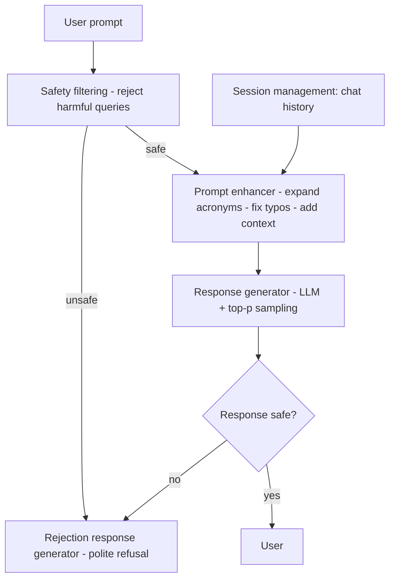

## Personal Assistant Chatbot

:::tldr
- Requirements before architecture: text-in/text-out, English-only, strict safety, ≥ 4096-token context, follow-ups in session, 80K (instruction, answer) pairs → decoder-only LLM.
- Three stages, three jobs: pretraining (trillions of tokens, 1000s GPUs, months) buys knowledge; SFT (10K–100K demos) turns continuer into responder; RLHF (100K–1M comparisons → reward model → PPO/DPO) aligns.
- Data quality inverts across stages: trillions of low-quality web tokens → small expert demonstrations → ranked comparisons; rank, never score — annotator numbers drift.
- The 4096-token requirement forces RoPE-style positional encoding — absolute encodings trained at 512 break at long context.
- Decoding default for open-ended chat: top-p/nucleus + tuned temperature (modern practice 0.1–1.5); greedy/beam loop in dialogue.
- Evaluation is four layers: perplexity baseline, task benchmarks (MMLU, GSM8K, HumanEval), safety benchmarks (RealToxicityPrompts, CrowS-Pairs, TruthfulQA), human + Arena-style online.
- Safety enforced at inference on both directions: input safety filter, prompt enhancer, output evaluator routing failures to the rejection generator; session management supplies follow-up context.
:::

The canonical "build an LLM product" round: sequence requirements → data → three-stage training → decoding → evaluation → safety rails, with a number at each stage (ch4 §Clarifying Requirements).

### Requirements & ML Framing

Elicit these before drawing anything — each changes the design (ch4 §Clarifying Requirements):

- **Language scope:** English-only initially.
- **Modality:** text-in, text-out; no image/audio/video.
- **Safety:** strict content moderation is a stated requirement, not a nice-to-have.
- **Context:** follow-ups within a session; context window ≥ 4096 tokens.
- **Out of scope:** web browsing, external API calls, personalization.
- **Training data:** 80,000 (instruction, answer) examples available.

ML task: language generation — a **decoder-only Transformer** with billions of parameters (**LLM**); same architecture family as GPT, Gemini, Llama (ch4 §Frame the Problem as an ML Task).

### Data Preparation (Web-Crawled Corpus)

| Step | What it does | Tools/techniques named |
|---|---|---|
| Content extraction | Strip HTML, ads, nav links; keep core body | Beautiful Soup, lxml, DOM analysis, boilerplate detection |
| URL/domain filtering | Drop content farms, spam; allowlist/blocklist trusted domains | Rules + ML classifiers |
| Language identification | Keep only target languages | fastText, langid.py |
| Quality filtering | Readability scoring, spam detection, length/structure heuristics, ML quality prediction | — |

Applied across all sources: remove NSFW content, **anonymize PII** (privacy-law compliance), drop low-quality text (coherence/grammar scoring), **deduplicate** (same article from many sites — prevents overexposure), remove irrelevant text (non-standard characters, unsupported languages), then **BPE tokenization** (ch4 §Data Preparation).

### Positional Encoding: Why 4096 Tokens Changes the Choice

Chat input far exceeds a sentence; the 4096-token requirement drives encoding choice (ch4 §Positional Encoding).

| Method | Idea | Trade-off |
|---|---|---|
| **Absolute** (sinusoidal/learnable) | Unique vector per position, added to embeddings; q/k depend only on absolute position | No relative-distance signal; trained at 512 → struggles at 4096; sinusoidal patterns go repetitive over long distances |
| **Relative** (T5, DeBERTa) | Encode position *differences*; each paper drops/replaces different attention terms | Better relative distances, but the attention score is no longer a plain q·k dot product → loses efficient linear-attention tricks |
| **RoPE** ([rotation matrix](https://arxiv.org/abs/2104.09864), used by Llama 3) | Rotates embeddings by an angle derived from position; the angle *between* two tokens encodes their relationship | Translational invariance, relative position captured geometrically, generalizes to unseen positions; extra math complexity (ch4 Fig. 4) |

### Training: Three Stages

Two stages are not enough; pretraining + SFT + RLHF each has its own data, objective, and compute budget (ch4 §Training, Fig. 6, Fig. 18):

```mermaid
flowchart LR
    ID[Internet data - trillions of tokens - low quality] --> PT[Pretraining - next-token prediction - 1000s GPUs, months]
    PT --> BM[Base model - continues text]
    BM --> SF[Demonstration data - 10-100K prompt-response pairs - human contractors]
    SF --> SFT[SFT - same objective - 1-100 GPUs, days]
    SFT --> CM[Comparisons data - 100K-1M rankings]
    CM --> RM[Reward model - margin ranking loss]
    RM --> P[PPO/DPO on 10-100K prompts]
    P --> CHAT[Chatbot model - helpful + safe]
```

:::scenario Build a personal assistant chatbot
@req Pin the requirements :: Text-in/text-out, English-only, strict safety, follow-up context, 4096-token window, 80K (instruction, answer) pairs
-> framed => @data
@data Clean the web corpus :: Strip boilerplate, filter domains, language-ID, dedup, anonymize PII
-> corpus ready => @pretrain
@pretrain Pretrain on trillions of tokens :: Next-token over Common Crawl/C4/GitHub/Wikipedia — 1000s of GPUs, months; the only expensive stage
-> base model just continues text => @sft
@sft SFT on demonstrations :: 10K-100K prompt-response pairs — same objective, turns the continuer into a responder
-> plausible but unaligned => @rlhf | fail
@rlhf Reward model + PPO :: 100K-1M ranked comparisons; generate → score → update toward high-reward responses
-> @pos
@pos RoPE for the 4096-token window :: Absolute encodings trained at 512 break at long context — rotate relative position in
-> @decode
@decode Sample with top-p + temperature :: Nucleus sampling adapts to sharp/flat distributions; greedy/beam loops in open-ended dialogue
-> output unsafe => @gates | fail
-> output safe => @gates | success
@gates Two-sided safety :: Input filter rejects harmful prompts; output evaluator routes failures to the rejection generator
-> @session
@session Session management :: Chat history joins the enhanced prompt — the follow-up coherence mechanism
:::

| Stage | Data | Objective | Compute | Output |
|---|---|---|---|---|
| Pretraining | Named corpora: Common Crawl, C4, GitHub, Wikipedia, Books, ArXiv, Stack Exchange (Llama-1 uses all seven, ~1.4T tokens) | Next-token prediction, cross-entropy | 1000s GPUs, months, millions of $ | **Base model** |
| SFT | 10K–100K (prompt, response) pairs; domain experts for healthcare/finance (OpenAI labelers: >⅓ hold master's) | Same objective, same loss | 1–100 GPUs, days | **SFT model** — answers instead of continuing |
| Reward modeling | 100K–1M comparisons from contractors | Regression: scores consistent with rankings | 1–100 GPUs, days | **Reward model** |
| RL optimization | 10K–100K prompts | RL ([PPO](https://arxiv.org/abs/1707.06347)/[DPO](https://arxiv.org/abs/2305.18290)) — maximize reward | 1–100 GPUs, days | **Chatbot model** |

- **Reward model:** any Transformer + scalar head; typically a copy of the SFT model. Size has no consistent pattern: OpenAI 6B RM for a 175B LM; Anthropic 10B–52B (ch4 §3.1).
- **Rank, don't score:** annotators compare and rank responses because absolute numeric scores vary between annotators; rankings become (prompt, winning, losing) preference pairs (ch4 §Training data).
- **Margin ranking loss:** penalize when `score(win) − score(lose) < margin m`; the optimizer pushes the gap open (ch4 Fig. 15).
- **PPO loop:** generate multiple responses → reward model scores them → update toward high-scoring responses (ch4 Fig. 17). PPO/DPO internals are beyond most interview scopes — say so and move on.

### Sampling: How the Next Token Is Chosen

Deterministic search fails on open-ended dialogue; stochastic sampling is the default (ch4 §Sampling, Fig. 20):

| Method | How it picks | Fails when |
|---|---|---|
| **Greedy** | Argmax each step | Repetition loops; misses high-probability paths hidden behind a low-prob token |
| **Beam** (width k) | Tracks top-k sequences | Computationally heavy (k sequences at once); repetitive, generic output |
| **Multinomial** | Samples the full distribution | Flat distributions → incoherent text; rarely used |
| **Top-k** | Normalized sample from k highest | Fixed width misfits the distribution: sharp → drops the obvious token (89%-confident "lot" still competes with "much"/"high"); flat → caps diversity (ch4 Fig. 28) |
| **Top-p / nucleus** ([2019](https://arxiv.org/abs/1904.09751)) | Smallest set whose cumulative probability exceeds p — adaptive | The practical default in advanced LLMs (ch4 Fig. 29) |

- **Temperature T** scales logits before softmax: T=1 normal; T>1 → flatter, more random (too high → off-topic); T<1 → sharper (too low → repetition); T=0 → identical output (ch4 §Temperature).
- Typical ranges: providers allow 0–2 ([OpenAI API](https://platform.openai.com/docs/api-reference/chat/create)); modern practice 0.1–1.5, tuned per task.
- **Repetition penalty** knobs: `no_repeat_ngram_size` (Hugging Face) stops after repeated n-grams; `frequency_penalty` (ChatGPT API) down-weights already-sampled tokens ([method survey](https://huggingface.co/blog/how-to-generate)).

### Evaluation: Four Layers

Perplexity is only a baseline — low perplexity ≠ can solve math or code (ch4 §Traditional evaluation).

| Layer | What it measures | Benchmarks |
|---|---|---|
| Task: reasoning | Everyday inference | PIQA, SIQA, HellaSwag, WinoGrande, OpenBookQA, CommonsenseQA |
| Task: world knowledge | Facts | TriviaQA, Natural Questions, SQuAD |
| Task: reading comprehension | Passage QA | SQuAD, QuAC, BoolQ |
| Task: math | Problem solving | MATH, GSM8K |
| Task: code | Functional code from NL prompts | HumanEval, MBPP |
| Task: composite | Broad multitask | MMLU, MMMU, AGIEval; Llama 3 human eval — 1,800 prompts, 12 use cases |
| Safety: toxicity | Hate/abuse/harm | RealToxicityPrompts (~100K prompts + PerspectiveAPI), ToxiGen, HateCheck |
| Safety: bias | Demographic fairness | CrowS-Pairs (9 categories), BBQ, BOLD (23,679 prompts, 5 domains) |
| Safety: truthfulness/privacy/robustness | Misinformation, PII leakage, adversarial inputs | TruthfulQA; PrivacyQA; AdvGLUE, TextFooler, AdvBench |

Human evaluation remains the most reliable for nuanced helpfulness/safety (ch4 §Human evaluation). Online: user ratings, engagement (queries, session duration), conversion, leaderboards — [LMSYS Chatbot Arena](https://lmarena.ai/leaderboard) ranks on 800K+ crowdsourced pairwise comparisons (ch4 §Online evaluation metrics).

### Inference Pipeline

Safety gates on both directions; session state makes follow-ups work (ch4 Fig. 42):

- **Prompt enhancer** expands "Tell me about NYC" into a contextualized prompt — cheap quality win before the LLM (ch4 Fig. 43).
- **Response generator** may sample multiple candidates and pick the best by predefined criteria.
- **Session management** feeds chat history with the enhanced prompt — the whole mechanism for follow-up coherence (ch4 §Inference).

### Failure modes & anti-patterns

- **Deploying the base model:** it continues your prompt instead of answering it — symptom: the chatbot completes sentences, never responds (ch4 Fig. 7).
- **Stopping at SFT:** plausible but unhelpful or unsafe responses — the alignment stage exists for this (ch4 Fig. 11).
- **Deterministic decoding for dialogue:** greedy/beam → repetition loops and generic text (ch4 Fig. 22).
- **Raw multinomial sampling:** flat distributions → incoherent output — rarely used (ch4 Fig. 25).
- **Top-k with fixed k:** sharp distributions can lose the 89%-obvious token; flat ones get artificially capped variety (ch4 §Top-k sampling).
- **Temperature mis-set:** too high → erratic/off-topic; too low → repetition — both are tuning signals, not model bugs (ch4 §Temperature).
- **Absolute positional encoding at long context:** trained at 512, breaks at 4096 — the reason modern LLMs use RoPE (ch4 §Absolute positional encoding).
- **Scoring instead of ranking annotations:** numeric scores drift between annotators; rankings are the reliable protocol (ch4 §Training data).
- **Skipping dedup:** duplicate articles overexpose the model to certain data (ch4 §Data Preparation).

:::cards
Q: Name the three training stages. :: Pretraining, supervised finetuning, RLHF — knowledge, response behavior, human alignment respectively.
Q: Why rank instead of score responses? :: Absolute numeric scores drift between annotators; rankings become (prompt, winning, losing) preference pairs.
Q: Why RoPE over absolute positional encoding? :: Absolute encodings trained at 512 break at 4096; RoPE captures relative position geometrically.
Q: Default decoding for open-ended chat? :: Top-p (nucleus) sampling with tuned temperature — deterministic search loops in dialogue.
Q: Why does top-k fail? :: Fixed k misfits the distribution — sharp loses the obvious token, flat caps diversity.
Q: Name the evaluation layers. :: Perplexity, task benchmarks, safety benchmarks, human plus online signals (LMSYS Arena).
Q: How do follow-ups work? :: Session management feeds chat history into the prompt enhancer's context.
:::

### Key Takeaways

- Three stages, three jobs: pretraining buys knowledge; SFT turns a text-continuer into a responder; RLHF aligns to human preferences (helpfulness + safety).
- Data quality inverts across stages: trillions of low-quality tokens → 10K–100K demonstrations → 100K–1M comparisons.
- The 4096-token context requirement, not fashion, forces RoPE-style positional encoding.
- Decoding default for open-ended chat: top-p + tuned temperature; deterministic search belongs to short, predictable outputs.
- Evaluation is four layers — perplexity, task benchmarks, safety benchmarks, human + online signals (Arena-style).
- Safety is enforced at inference on both input (filtering) and output (response evaluator + rejection generator); session management supplies follow-up context.

### Interview Lens

- Pin requirements aloud first — modality, language, context window, follow-ups, safety, 80K-example dataset — before any architecture.
- "How would you train it?": trillions of tokens / 1000s GPUs / months, then 10–100K demos, then 100K–1M comparisons — pretraining is the only expensive stage (ch4 Fig. 18).
- "Why top-p over top-k?": the sharp-vs-flat distribution argument, not "it's newer".
- "How do you keep it safe?": two-sided pipeline — input filter, output evaluator, rejection generator — plus safety benchmarks and red-teaming.
- "How does it remember turns?": session management feeds chat history; beyond scope, name the extras: KV cache, GQA, RAG, chain-of-thought, distillation, multi-token prediction (ch4 §Other Talking Points).
- Honest scope cuts read senior: "PPO/DPO internals are beyond this round; the loop is generate → score → update" (ch4 §ML objective and loss function).
