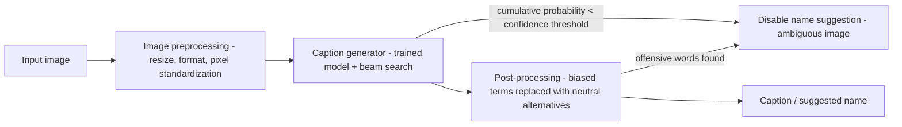

## Image Captioning

A multi-modal encoder–decoder design: the image is treated as a foreign "language" that one encoder speaks and one decoder translates. The reusable muscles — cleaning 400M noisy pairs, picking encoder output granularity, consensus-based evaluation, and confidence-gated serving — mirror the data-quality and evaluation discipline a DE design round probes.

### Requirements Snapshot

Clarify before designing; each answer removes a design branch (ch5 §Clarifying Requirements):

| Question | Answer | Design consequence |
|---|---|---|
| Image domain | General everyday images | No domain-specific finetuning |
| Use case | Asset name suggestions for uploaded files | Short, descriptive captions — summarize long ones |
| Language | English only | Filter non-English pairs |
| Data | 400M pairs, unpreprocessed: mixed languages, noisy/inaccurate, some missing | Heavy cleaning pipeline (below) |
| Latency | 1–2 s acceptable, not real-time | Beam search affordable at serving |
| Ambiguous images | Skip the suggestion | Confidence threshold gates the output |
| Fairness/safety | No biased or offensive captions | Post-processing filter required |
| Min resolution | 256×256 | Drop smaller images in prep |

Applications beyond user-facing: NSFW moderation via text-based interpretation, and fixing the **cold-start problem** in recommenders — captions give textual features for new items (ch5 §Introduction).

### Data Preparation (400M Noisy Pairs)

**Caption preparation** (ch5 §Caption preparation):

- **Remove non-English** captions — model scope is English.
- **Deduplicate**: duplicate images via **perceptual hashing** or a CLIP image encoder; duplicate captions via exact match or CLIP text-encoder semantic similarity. Duplicates cause overfitting to redundant pairs.
- **Remove irrelevant pairs**: pretrained vision–language model (CLIP) scores image–caption relevance; drop pairs below a threshold (e.g., **0.25**). CLIP scoring details: ch9.
- **Summarize long captions** with an LLM (e.g., Llama) — training on long captions teaches the model to emit long captions, wrong for the use case.
- **Normalize** (lowercase, trim whitespace), then **tokenize** with subword **BPE** (details: ch2–3).

**Image preparation** (ch5 §Image preparation): drop <256×256; normalize pixels to 0–1; drop blurry/over-/underexposed images scored by quality models like the **LAION Aesthetics Predictor**; then make dimensions uniform without breaking aspect ratio:

```text
Resize + center-crop (target 256x256), original 512x768:
  1. resize so the SMALLER side matches target: 512x768 -> 256x384
  2. center-crop the long side:                256x384 -> 256x256
```

### Architecture: Encoder–Decoder, Two Modalities

Like translation, but the source "language" is pixels (ch5 §Frame the Problem as an ML Task): an **image encoder** compresses the image, a **text decoder** generates the caption from those embeddings.

Encoder output granularity is the pivotal trade-off (ch5 §Image encoder):

| Dimension | Single token (one vector) | Sequence of tokens (per patch) |
|---|---|---|
| Representation | Global summary of whole image | Global + local features per region |
| Cost | Simple, low compute/resources | Higher compute |
| Caption quality | Concise, high-level, but generic; loses local detail | Descriptive, attends per region |
| Fit to decoder | Weak — attention wants sequences | Aligns with Transformer attention |

Encoder backbone choice (ch5 §Image encoder):

| Dimension | CNN-based | Transformer-based (ViT) |
|---|---|---|
| Mechanism | Convolutional filters; spatial hierarchies | Self-attention over patch embeddings |
| Coverage | Local patterns strong; **struggles with long-range dependencies** | Local + global relationships |
| Output shape | Grid of feature vectors, e.g. 3×3×c → flatten to 9×c | Sequence of c-dim embeddings |

**Patchify** converts an image to a sequence in three steps: divide into fixed-size patches → flatten → linearly project. Example: 256×256 image, 64×64 patches → 16 patches, each flattened to 4096-dim then projected to c (ch5 §Patchify, Fig. 9). **Positional encoding** options: **1D** (sequence position; may miss 2D spatial structure) vs **2D** (row+col → vector; preserves spatial layout); **learnable** vs **fixed** (e.g., sine–cosine). ViT uses learnable 1D; there is no universal best — test combinations (ch5 §Positional encoding).

**Text decoder**: decoder-only Transformer — the standard text-generation choice — consuming the image-embedding sequence and emitting the caption one token at a time (ch5 §Text decoder).

### Training & Sampling

Two-stage strategy, the same pattern as earlier designs (ch5 §Training):

1. **Unsupervised pretraining** — decoder-only Transformer on general text for language structure. Too expensive to redo: start from pretrained **GPT-2 or Llama**; likewise initialize the encoder from pretrained **CLIP or ViT**.
2. **Supervised finetuning** — train encoder + decoder jointly on the 400M pairs; encoder learns to encode images, decoder to read image embeddings and emit captions.

Objective: **next-token prediction** with **cross-entropy loss** (ch5 §ML objective and loss function).

Sampling: use **beam search**, not stochastic sampling (ch5 §Sampling):

| Reason | Why it matters here |
|---|---|
| Quality | Higher-quality captions for accurate image description |
| Consistency | Deterministic — same image always yields the same caption |
| Coherence | Avoids contradictions like "A person is walking house" |

### Evaluation

Validation data: held-out images with **multiple reference captions** from several annotators — multiple references make training robust to phrasing variety and evaluation fairer (ch5 §Offline evaluation metrics, Fig. 14).

Metrics: BLEU, ROUGE, METEOR (ch3) plus **CIDEr**, built specifically for captioning (ch5 §CIDEr). CIDEr steps:

```text
1. TF-IDF: caption + each reference -> numerical vectors
2. Cosine similarity: generated vs each reference   (1 = close, 0 = far)
3. Aggregate: average similarities; final CIDEr = mean over validation set

Worked example: scores 0.688, 0.257, 0.766 vs 3 refs
  CIDEr = (0.688 + 0.257 + 0.766) / 3 = 0.570
```

| CIDEr pros | CIDEr cons |
|---|---|
| Consensus-based — rewards captions matching multiple references | Computationally complex at scale (TF-IDF over large sets) |
| TF-IDF weights rare/important words appropriately | Sensitive to reference quality — poor refs mislead |
| Robust across caption variations via multiple refs | Penalizes novel-but-accurate phrasing absent from refs |
| | No semantic understanding: "Coffee on top of the table" vs "Table on top of the coffee" score similarly |

**Online evaluation** is secondary (ch5 §Online evaluation metrics): captioning is usually embedded in a bigger system (hard to isolate interaction data) and caption quality is subjective. Use engagement metrics and user feedback only where captioning directly touches UX.

### Overall ML System Design



- **Image preprocessing**: resize to standard size, consistent format, standardized pixels — match training-time expectations (ch5 §Image preprocessing).
- **Caption generator**: runs the trained model with beam search; if the caption's cumulative probability falls below the **confidence threshold**, the suggestion is disabled — this is how ambiguous images get skipped (ch5 §Caption generator).
- **Post-processing**: replaces biased terms with neutral alternatives; disables the service entirely if offensive words appear (ch5 §Post-processing).

### Other Talking Points

If time remains (ch5 §Other Talking Points): extend to **VQA**; adapt to other domains; multilingual captions via multilingual data + cross-lingual transfer; edge-device optimization for caption generation; generate-and-rank multiple candidate captions; BLIP-2/BLIP-3 architectures and auxiliary losses. Alternative model families: [BLIP-2](https://arxiv.org/abs/2301.12597), [BLIP-3](https://www.arxiv.org/abs/2408.08872), [InternVL](https://arxiv.org/abs/2312.14238); key papers: [ViT](https://arxiv.org/abs/2010.11929), [CLIP](https://arxiv.org/abs/2103.00020), [CIDEr](https://arxiv.org/abs/1411.5726), [LAION-5B](https://arxiv.org/abs/2210.08402).

### Failure modes & anti-patterns

- **Training on raw noisy pairs**: mixed-language, inaccurate, or missing captions poison the model — symptom: off-language or wrong captions at inference; fix with the filter pipeline above (ch5 §Data Preparation).
- **Skipping long-caption summarization**: the model imitates caption length — symptom: verbose outputs unusable as name suggestions (ch5 §Caption preparation).
- **Single-token encoder for detail-rich images**: global vector loses local nuance — symptom: generic captions that miss objects/actions (ch5 §Image encoder).
- **CNN encoder despite long-range needs**: convolutional receptive fields miss distant-region relationships — symptom: captions describing parts in isolation (ch5 §Which architecture...).
- **Stochastic sampling at serving**: nondeterministic captions and incoherent phrases like "A dog is reading a person" (ch5 §Sampling).
- **Trusting CIDEr alone**: it penalizes novel-but-correct captions and can't tell "coffee on table" from "table on coffee" — pair with human review (ch5 §CIDEr).
- **Serving without confidence gating**: ambiguous images get confidently wrong suggestions — symptom: user-visible garbage names (ch5 §Caption generator).
- **Serving without bias/offense post-processing**: biased terms or offensive words reach users; contract requires neutralization + full disable on offense (ch5 §Post-processing).

### Key Takeaways

- Frame captioning as translation where the image is the source language: image encoder → embedding sequence → decoder-only Transformer → caption, one token at a time.
- Prefer a Transformer (ViT-style) encoder emitting a token sequence — it feeds attention and preserves local detail that a single global vector discards.
- Data quality dominates at 400M-pair scale: dedup (perceptual hash / CLIP), relevance filtering (CLIP threshold ~0.25), LLM summarization, and aspect-ratio-preserving resize+crop.
- Reuse pretrained weights for both stages (GPT-2/Llama decoder, CLIP/ViT encoder); finetune jointly with next-token cross-entropy.
- Serve with beam search for determinism, gate on cumulative probability for ambiguous images, and post-process for bias/offense.
- Evaluate with CIDEr over multi-reference validation data; know its blind spots (novel phrasing, word-order semantics).

### Interview Lens

- Asked "why not just CLIP?" — answer with the pipeline split: CLIP is the *filter* (relevance/dedup), the captioner is the *generator* (encoder–decoder finetuned on pairs); they solve different problems.
- When the interviewer says "ambiguous images", volunteer the confidence-threshold gate on beam-search cumulative probability — it shows you design for the skip path, not just the happy path.
- Any evaluation question: name all four metrics (BLEU/ROUGE/METEOR/CIDEr), then go deep on CIDEr's three steps and its failure modes — depth on one metric beats listing four.
- Defend beam search over sampling with the trio quality/consistency/coherence and the "same image, same caption" argument — determinism is the requirement interviewers listen for.
