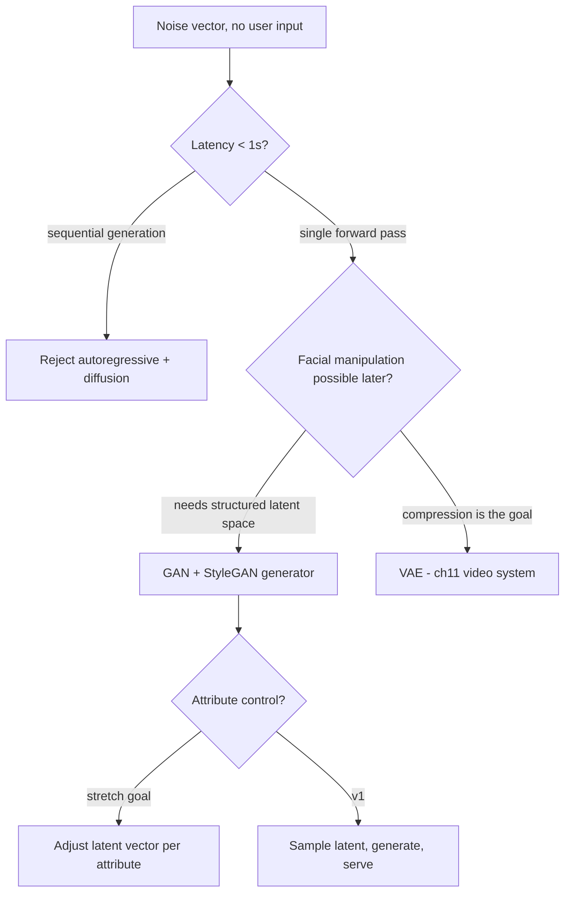
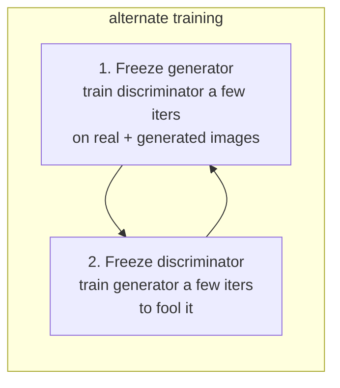
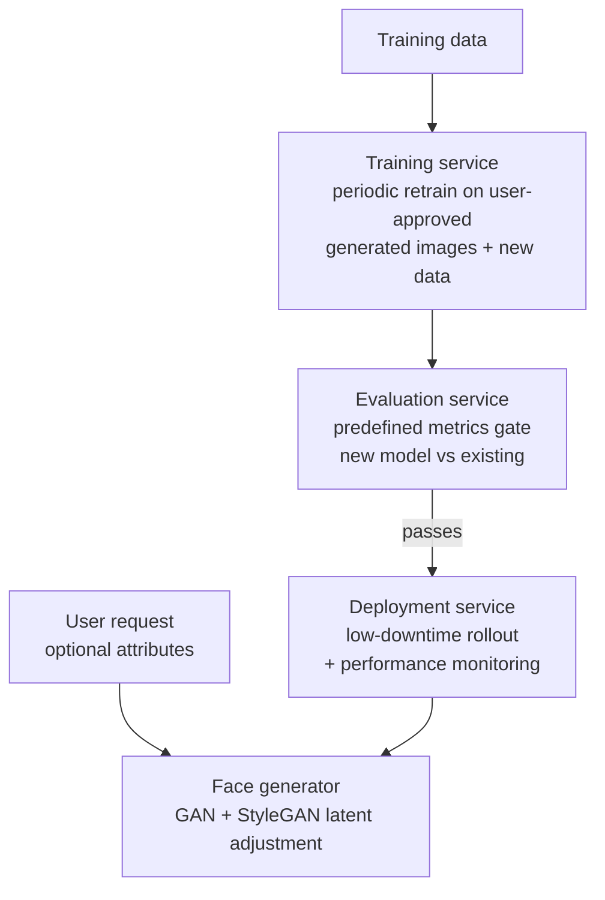

## Realistic Face Generation

The classic GAN interview: near-real-time (<1s) unconditioned synthesis at 1024×1024 over 70k licensed images — the one design where "pick GAN over diffusion" is defensible: facial attribute manipulation needs a structured latent space (ch7 §Clarifying Requirements, §Choosing a suitable ML approach).

### Requirements Snapshot

| Question | Locked answer | Design consequence |
|---|---|---|
| Scope | Faces only, entertainment/content-creation first, data collection later | Domain-specific model, not general text-to-image |
| Diversity | Ethnicities, ages, genders balanced | Dataset rebalancing becomes a first-class pipeline step |
| Attribute control | Not now; stretch goal | Keeps GAN in play; latent manipulation is the stretch |
| Data | 70,000 licensed public images | Augmentation + quality filtering mandatory |
| Resolution / latency | 1024×1024, <1s | Kills autoregressive + diffusion; favors one-pass GAN (ch7 §Clarifying Requirements) |

### Choosing the Generative Approach

Users provide no input; all four approaches map a random noise vector → image (ch7 §Specifying the system's input and output).

| Characteristic | VAE | GAN | Autoregressive | Diffusion |
|---|---|---|---|---|
| Quality | Low | Moderate | High | Exceptional |
| Speed | Fast | Fast | Slow | Slow |
| Training stability | Stable | Unstable | Stable | Stable |
| Control over generation | Limited | Limited | Flexible | Moderate |
| Facial manipulation | No | **Yes** | No | No |
| Novelty | Limited | Limited | High | High |
| Resource intensity | Moderate | Moderate | High | High |

(ch7 Table 1)

- **VAE**: encoder→latent→decoder; reparameterization trick makes the latent a multivariate Gaussian — great compression (ch11 video system), blurry output. Rejected: low realism (ch7 §Variational autoencoder).
- **Autoregressive** (DALL-E, Muse): image as token sequence through a Transformer; detailed and controllable, but token-by-token is too slow for <1s and there's no manipulable latent space (ch7 §Autoregressive model).
- **Diffusion** (DALL·E 3): iterative denoising over fixed steps; best quality but multiple steps → slow, no structured latent space (ch7 §Diffusion model).
- **GAN, selected**: single forward pass hits the latency target; structured latent space enables attribute control via StyleGAN ([StyleGAN](https://arxiv.org/abs/1812.04948), [StyleGAN2](https://arxiv.org/abs/1912.04958)) — at the cost of unstable training (ch7 §Choosing a suitable ML approach).



### Data Preparation

Four steps on the 70k images (ch7 §Data Preparation):

- **Quality filter**: drop low-resolution images; ML models filter low-quality/blurry ones.
- **Augmentation**: flips, rotation, color adjustment — more variation, better generalization.
- **Normalize + resize**: standard dimension 1024×1024; pixel range normalized to **-1 to 1** (this drives the Tanh output choice below).
- **Diversity balancing**: classifiers tag gender/age/attributes; rebalance — dataset bias becomes output bias.

### Architecture

**Generator** — noise → image via stacked upsampling blocks (ch7 §Architecture, Fig. 8):

```text
100-dim noise -> reshape 1x1x100 -> ConvT 4x4x1024 -> 8x8x512 -> 16x16x256
             -> 32x32x128 -> 64x64x3 RGB
each block: ConvTranspose2d + BatchNorm2D + ReLU; final block swaps ReLU -> Tanh
            (Tanh matches the -1..1 pixel normalization from data prep)
```

- **Transposed convolution** ("deconvolution"): inserts zeros between pixels, then convolves — the inverse of standard convolution; `ConvTranspose2d` in PyTorch (ch7 §Transposed convolution, Fig. 9).
- **Normalization layer**: keeps activation distributions consistent amid two competing networks, enabling higher learning rates ([GAN training](https://developers.google.com/machine-learning/gan/training)):

| Layer | Normalizes across | Where it wins |
|---|---|---|
| Batch (BN) | Batch dimension, per feature | Deep CNNs, GAN generators; also regularizes |
| Layer (LN) | Features of each sample | Small/variable batches: RNNs, Transformers |
| Instance (IN) | Each feature map per sample | Style transfer, image generation |
| Group (GN) | Feature groups | Very small batches where BN fails |

(ch7 §Normalization layer, Fig. 10)

- **Non-linear activation**: ReLU per block; without it the stack collapses to a linear map regardless of depth (ch7 §Non-linear activation).

**Discriminator** — binary classifier: real vs generated (ch7 §Architecture, Fig. 12-13):

- Downsampling blocks: Conv2D with **stride 2** to halve spatial dims, BatchNorm2D + ReLU between layers.
- Classification head: 1-2 fully connected layers → **sigmoid** → probability the image is real.



Alternating freeze-train keeps both improving; imbalance either way is empirically fatal (ch7 §Training, Fig. 14).

- **Losses**: discriminator minimizes binary cross-entropy; generator minimizes `-log D(G(z))`; unified as the **minimax loss** — D maximizes, G minimizes ([GAN paper](https://arxiv.org/abs/1406.2661), ch7 §ML objective and loss function).

### GAN Training Challenges

The three interview-mandatory failures (ch7 §Common training challenges in GANs):

| Challenge | Mechanism | Mitigations |
|---|---|---|
| Vanishing gradients | Discriminator gets too good → near-zero gradients reach the generator → learning stalls | Modified minimax (generator maximizes `log D(G(z))`); **Wasserstein loss** (WGAN): critic outputs a "realness" score, loss = `D(x) − D(G(z))` |
| Mode collapse | Generator finds one plausible image that fools D and keeps emitting it → limited variety | Wasserstein loss; **Unrolled GAN** ([paper](https://arxiv.org/abs/1611.02163)) |
| Failure to converge | Generator improves → D accuracy falls toward 50% (coin-flip) → feedback becomes noise → quality collapses | Normalization; **different learning rates** for G/D; weight decay; **noise into discriminator inputs** |

(ch7 §Vanishing gradients, §Mode collapse, §Failure to converge)

### Sampling

- **Latent space**: learned during training; each point maps to a distinct face (ch7 §Sampling, Fig. 15).
- **Random sampling**: draw latent vectors from a standard Gaussian over the full space → diverse outputs.
- **Truncated sampling**: restrict to the high-probability region → fewer outliers, higher realism at the cost of diversity.
- **Choice**: random sampling — diversity matters for faces and "usually works well in practice" (ch7 §Sampling, Fig. 16).

### Evaluation

| Metric | What it measures | Mechanism |
|---|---|---|
| **Inception score** | Quality + diversity of generated set alone | Inception v3 class probabilities: per-image distribution peaked (quality), marginal near-uniform (diversity); score = exponentiated average KL divergence ([Inception score](https://en.wikipedia.org/wiki/Inception_score)) |
| **FID** | Similarity of generated vs real feature distributions | Inception v3 deep-layer features from both sets → mean + covariance each → Fréchet distance; **lower = better** ([FID](https://en.wikipedia.org/wiki/Fr%C3%A9chet_inception_distance)) |
| **KID** | Kernel-based distance between generated and real distributions | Named alongside IS/FID, which remain most used (ch7 §Offline evaluation metrics) |
| **Human evaluation** | Photorealism, aesthetics — what metrics miss | Pairwise: users pick the more photorealistic of two faces ([protocol](https://arxiv.org/abs/2204.06125)) |

(ch7 §Offline evaluation metrics, Figs. 17-19)

- IS/FID rely on Inception v3's ImageNet classes and can misalign with human judgment; CLIP-based metrics align better, but **human evaluation remains the most reliable** (ch7 §Evaluation).
- **Online**: user feedback (surveys, ratings, comments) and request→image latency — latency monitoring doubles as bottleneck detection (ch7 §Online evaluation metrics).

### Overall ML System Design



(ch7 §Overall ML System Design, Fig. 20)

- Attribute control lives in the face generator: adjust the latent vector per age/gender/hairstyle/expression; architecture details are out of interview scope ([StyleGAN3](https://nvlabs.github.io/stylegan3/)) (ch7 §Face generator).

### Other Talking Points (extra-time menu)

- GAN variants (DCGAN, WGAN, StyleGAN) and stabilization (Wasserstein loss, gradient penalty) ([DCGAN](https://arxiv.org/abs/1511.06434), [WGAN](https://arxiv.org/abs/1701.07875), [survey](https://arxiv.org/abs/1910.00927)); **conditional GANs** (cGAN) for condition-driven generation ([cGAN](https://arxiv.org/abs/1411.1784)) + condition-consistency metrics ([CLIPScore](https://arxiv.org/abs/2104.08718)); **style-mixing** (ch7 §Other Talking Points).

### Failure modes & anti-patterns

- **Discriminator dominates**: vanishing gradients; generator loss flatlines early. Fix: modified minimax or WGAN critic (ch7 §Vanishing gradients).
- **Mode collapse**: near-identical faces despite diverse latent samples. Fix: Wasserstein loss, unrolled GAN (ch7 §Mode collapse).
- **Training past the usefulness point**: D at ~50% accuracy feeds useless feedback; quality degrades late in training. Fix: monitor D accuracy, stop at balance (ch7 §Failure to converge).
- **Skewed dataset**: demographic skew in outputs. Fix: classifier-tagged rebalancing before training (ch7 §Data Preparation).
- **Pixel-range mismatch**: -1..1 normalization needs a Tanh final activation, not ReLU (ch7 §Non-linear activation).
- **Trusting automated metrics alone**: good FID, unhappy users — ImageNet artifacts. Fix: pairwise human evaluation (ch7 §Evaluation).

### Key Takeaways

- <1s latency + future attribute control select GAN over diffusion/autoregressive — quality traded for speed and a structured latent space (ch7 Table 1).
- Alternating freeze-train of G and D is the core discipline; imbalance is the root of all three classic failures, each with named fixes (ch7 §Training).
- Sampling is the diversity-vs-realism dial; random is the default for faces (ch7 §Sampling).
- FID lower-is-better vs IS higher-is-better; neither replaces human pairwise evaluation. Production loop: train → auto-eval gate → deploy → monitor → retrain on user-approved images (ch7 §Overall ML System Design).

### Interview Lens

- "Why not diffusion, it's state of the art?": requirement math — multiple denoising steps vs the <1s SLA; GAN is one forward pass and the only approach with facial manipulation via latent space.
- Volunteer the three training failures unprompted, one mitigation each — the rubric expects them (ch7 §Common training challenges in GANs).
- "How do we add expression control later?" → StyleGAN latent adjustment; a deferred stretch requirement, not ignored (ch7 §Clarifying Requirements, §Face generator).
