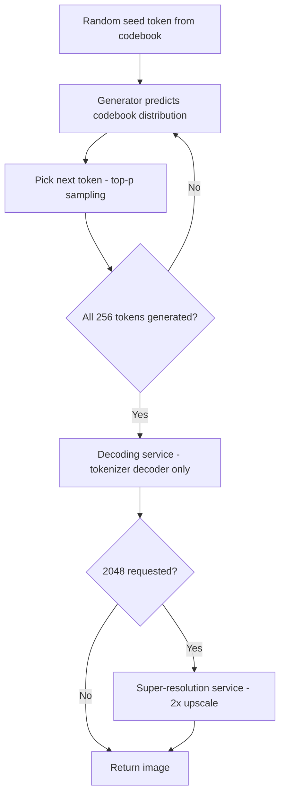

## High-Resolution Image Synthesis

Design an image generator that produces 1024²–2048² natural-scene images in ~5 seconds from a 5M-image dataset. The interview-grade decision is two-layered: pick autoregressive token generation over diffusion for latency, then split the system into an independently trained tokenizer + generator pair served as separate, separately scalable services (ch8 §Choosing a suitable ML approach, §Overall ML System Design).

### Requirements & Model Selection

- **Requirements** (ch8 §Clarifying Requirements): 5M high-res images of natural scenes/landscapes; unconditional generation (architecture stays prompt-ready); output 1024×1024 or 2048×2048 per request; ~5 s per image — reasonable latency, not real-time.

| Approach | High-res behavior | Verdict for 1024²+ @ 5 s |
|---|---|---|
| **VAE / GAN** | Posterior collapse at ≥512px: the higher-capacity decoder models output independently and ignores the latent space → latents contribute little, diversity drops (ch8 §Choosing a suitable ML approach) | Reject |
| **Autoregressive** | Pixel-by-pixel is O(N²) for N×N and hard to parallelize; generating chunk tokens (64×64 px per token → 256 tokens for 1024²) cuts the step count and runs in seconds (ch8 §Choosing a suitable ML approach) | **Chosen**; diffusion deferred to ch9 |
| **Diffusion** | O(T·N²): super-linear in pixel count, more denoising steps T needed at higher res; standard diffusion takes minutes (ch8 §Choosing a suitable ML approach; footnote 1 — latent diffusion speeds this up, ch10–11) | Reject for this latency |

### Image Tokenizer (VQ-VAE)

- **VQ-VAE** ([paper](https://arxiv.org/abs/1711.00937)) is a VAE variant purpose-built for tokenization: encode an image into discrete tokens, decode tokens back to an image (ch8 §Image tokenizer). Three parts:
- **Encoder**: deep CNN (Conv2D + ReLU stacks) mapping the image to a lower-dimensional continuous latent representation (ch8 §Encoder).
- **Quantizer**: an embedding table whose sole parameter is a learnable **codebook** of k embeddings; each continuous vector is replaced by the nearest codebook entry (Euclidean distance), producing integer token IDs (ch8 §Quantizer). Discretization earns its place twice: (1) **avoids posterior collapse** — discrete latents force the decoder to use them; (2) **shrinks the learning space** — the generator predicts among k tokens instead of endless, nearly-identical continuous vectors (ch8 §Avoiding posterior collapse, §Reducing the learning space).
- **Decoder**: transposed convolutions (`ConvTranspose2d`) upscale token embeddings back to image size (ch8 §Decoder).

### Image Generator (Decoder-Only Transformer)

| Dimension | Image tokenizer | Image generator |
|---|---|---|
| Role | image ↔ discrete tokens | token sequence → next token |
| Training stage | I — reconstruction losses | II — next-token + cross-entropy |
| Deployed at inference | decoder only | full model |
| Data it consumes | raw images | cached token sequences from Stage I |

- Component pipeline: codebook **embedding lookup** → projection to model dimension → **positional encoding** (spatial information) → N× blocks (multi-head attention, normalization, feed-forward) → **prediction head** emitting next-token probabilities (ch8 §Image generator, Fig. 11).
- Decoder-only chosen because (1) the architecture flexes across modalities — text→text chat, image→text captioning, and image-token generation; (2) attention captures **long-range dependencies**, which is what keeps generated images coherent (ch8 §Image generator, Fig. 5).

### Training, Sampling & Serving

- **Stage I losses** (ch8 §Stage I: Training the image tokenizer): overall loss is the weighted sum `λrec·rec + λquant·quant + λperc·perc + λadv·adv`, weights tuned per performance goals (ch8 §Overall loss).

| Loss | Form | Why |
|---|---|---|
| Reconstruction | MSE over pixels (ch8 §Reconstruction loss) | Pixel fidelity; sufficient at low res |
| Quantization | distance between encoder output E(x) and nearest codebook vector; **stop-gradient** blocks flow through the term so the codebook isn't updated while optimizing the encoder (ch8 §Quantization loss) | Pulls encoder outputs toward codebook entries |
| Perceptual | distance between pretrained-VGG layer-l feature maps of original vs reconstruction (ch8 §Perceptual loss) | High-res images still show artifacts with MSE alone; preserves content/style features |
| Adversarial | −log D(x̂) with a discriminator; **patch-based** variant per VQGAN ([paper](https://arxiv.org/abs/2012.09841)) reduces unnatural artifacts (ch8 §Adversarial loss) | Realism |

- **Straight-through gradient**: the nearest-neighbor lookup has no well-defined gradient; VQ-VAE copies the decoder-input gradient directly to the encoder output, so only selected tokens receive gradients from the decoder (ch8 §Stage I).
- **Image cleaning & normalization** (ch8 §Data preparation, step 1 of 2): remove low-quality images — low resolution, excessive noise, irrelevant content — while keeping a wide range of styles, subjects, and compositions; normalize pixel values to 0–1 to stabilize training; resize all images to a uniform 1024×1024 for consistent inputs. Step 2 (tokenization) below.
- **Tokenizer data**: training is self-supervised (no labels), so augment the 5M in-house images with [LAION-400M](https://laion.ai/blog/laion-400-open-dataset/) for a richer codebook; after training, tokenize all 5M images and cache the token sequences for Stage II (ch8 §Training data).
- **Stage II**: next-token prediction with cross-entropy over the cached token sequences (ch8 §Stage II: Training the image generator).
- **Sampling**: randomly pick the first token from the codebook as seed → generator predicts the distribution over the codebook → select next token (e.g., top-p) → append → repeat until all 256 tokens exist (1024² at 64×64 px/token) → tokenizer decoder reshapes tokens into the image (ch8 §Sampling).

:::scenario Serve 1024-2048px images in five seconds
@pick Diffusion or autoregressive? :: Diffusion is O(T-N^2) — minutes at high res; AR over 64x64-px chunk tokens is 256 steps — seconds
-> chunked AR chosen => @tokenizer | success
@tokenizer Tokenize with VQ-VAE :: CNN encoder -> codebook nearest-neighbor -> transposed-conv decoder; discrete latents avoid posterior collapse
-> MSE-only losses at high res => @tokenizer | fail
-> reconstruction + quantization + perceptual + adversarial => @cache | success
@cache Tokenize the corpus once :: Add LAION-400M for a richer codebook; straight-through gradients keep the encoder trainable; cache all 5M token sequences
-> @generate
@generate Train the generator :: Decoder-only Transformer, next-token + cross-entropy over the cached sequences
-> @sample
@sample Seed, predict, repeat :: Random first codebook token, top-p per step, until 256 tokens exist
-> @decode
@decode Decoding service, decoder only :: The tokenizer encoder exists for training and never ships; decoding scales on its own compute profile
-> 2048 requested => @sr
-> 1024 sufficient => @ship | success
@sr Super-resolution service :: Pretrained 2x upscaler (RCAN/ESRGAN) restores 2048 from the 1024 generation
-> @ship
@ship Gate on quality and unit economics :: IS/FID + human votes + time and cost per image before any new model serves
-> artifacts or cost regress => @tokenizer | fail
-> hold => @ship | success
:::

- **System**: three services (ch8 §Overall ML System Design, Fig. 16) — **generation service** (transformer → tokens), **decoding service** (tokenizer's decoder; the encoder exists only for training and is never deployed), **super-resolution service** (pretrained 2× upscaler — CNN-based [RCAN](https://arxiv.org/abs/1807.02758) or [ESRGAN](https://arxiv.org/abs/1809.00219) — when 2048² is requested but the generator emits 1024²).
- **Why split generation and decoding**: different models with distinct computational needs and latencies → each service scales independently (ch8 §Decoding service).
- **Extension talking points** (ch8 §Other Talking Points): text-conditioned generation ([Muse](https://arxiv.org/abs/2301.00704), [VQGAN-CLIP](https://arxiv.org/abs/2204.08583)); image completion / AR super-resolution ([LAR-SR](https://openaccess.thecvf.com/content/CVPR2022/papers/Guo_LARSR_A_Local_Autoregressive_Model_for_Image_Super-Resolution_CVPR_2022_paper.pdf)); diversity-vs-fidelity via temperature scaling; stability via adversarial training, gradient clipping, LR scheduling; progressive growing / multi-scale architectures; interactive refinement ([CogView2](https://arxiv.org/abs/2204.14217)).

### Evaluation

| Type | Metric | Measures |
|---|---|---|
| Offline | Inception score ([ref](https://en.wikipedia.org/wiki/Inception_score)) | Similarity of generated images to real-world objects, via pretrained Inception v3 |
| Offline | FID ([ref](https://en.wikipedia.org/wiki/Fr%C3%A9chet_inception_distance)) | Distribution match between generated and real image statistics |
| Offline | Human evaluation | Pairwise photorealism/aesthetics votes over time |
| Offline (ops) | Time per image, cost per generation | The 5 s latency budget; unit economics — model complexity, resolution, infrastructure (ch8 §Offline evaluation metrics) |
| Online | User feedback, periodic surveys, subscription rate, churn rate | Live quality signal tied to business outcomes (ch8 §Online evaluation metrics) |

### Failure Modes & Anti-Patterns

- **Posterior collapse** (VAE/GAN at high res): decoder gets powerful enough to model output without latents → low-diversity generations. Symptom: outputs converge to near-identical images. Fix: discretize latents with a quantizer (ch8 §Avoiding posterior collapse).
- **Pixel-level autoregression**: O(N²) sequential steps, unparallelizable → blows the 5 s budget (≈1M pixel steps at 1024²). Fix: chunk tokens, 256 steps (ch8 §Choosing a suitable ML approach).
- **MSE-only tokenizer at high resolution**: pixel error looks fine but images show artifacts. Fix: add perceptual + adversarial losses (ch8 §In practice…).
- **Assuming the quantizer backpropagates**: nearest-neighbor lookup has no gradient → training silently stalls for encoder. Fix: straight-through gradient copy (ch8 §Stage I).
- **Deploying the tokenizer encoder**: it is training-only; shipping it wastes inference compute (ch8 §Decoding service).
- **Monolithic generation+decoding service**: distinct latency/resource profiles make independent scaling impossible (ch8 §Decoding service).
- **Ignoring cost per generation**: latency-only monitoring misses revenue impact; track cost alongside time-per-image (ch8 §Offline evaluation metrics).

### Key Takeaways

- Autoregressive-over-tokens wins the latency bound: 256 chunk-token steps instead of ~1M pixel-by-pixel steps.
- Two independently trained models — tokenizer (reconstruction objective) and generator (next-token objective) — composed at inference time.
- The discrete codebook is the load-bearing trick: it kills posterior collapse and shrinks the sequential prediction space.
- High-res tokenizer quality needs perceptual and adversarial losses beyond MSE.
- Serving mirrors the model split: generation service, decoding service (decoder only), optional 2× super-resolution for 2048².

### Interview Lens

- Asked "why not diffusion?": quote the complexity contrast — O(T·N²) with growing T at high res (minutes) vs 256 chunk steps (seconds); concede latent diffusion (ch10–11) changes the calculus, bridging to text-to-image.
- Do the token math aloud when resolution comes up: 1024² ÷ 64² px/token = 256 sequential steps — it shows you size the bottleneck before picking the model.
- On losses, order by purpose, not by list: reconstruction = pixel fidelity, quantization = codebook commitment (stop-gradients decide what moves), perceptual = high-level features, adversarial = realism.
- Map any "how do you serve two models?" question to the split-service pattern and its scaling rationale — and note the encoder never ships.
