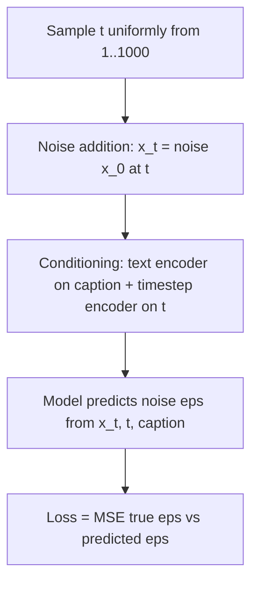
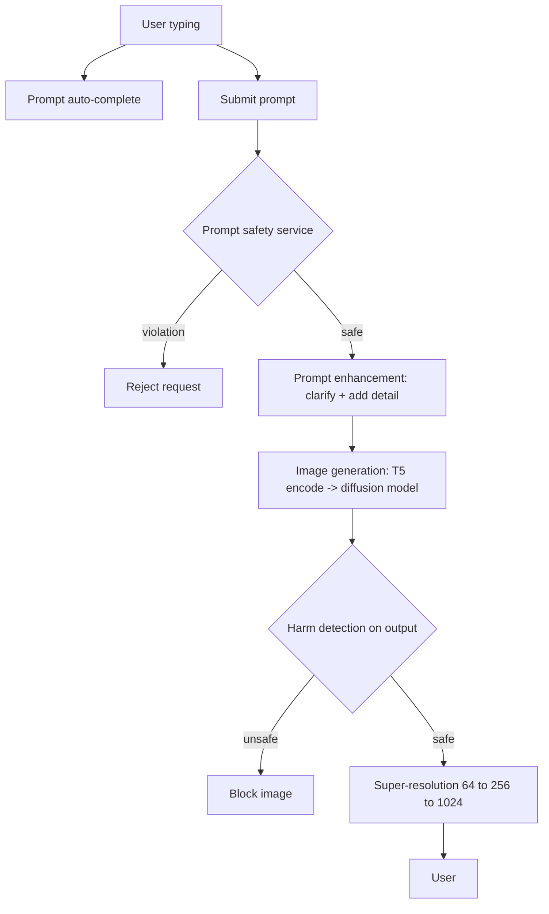

## Text-to-Image Generation


:::tldr
- Requirements drive decisions: 1024×1024, ~500M pairs, ≤128-word prompts, ~10 s SLA, broad scope, fairness and safety.
- Diffusion over autoregressive: AR simpler to train, diffusion wins fine detail plus a sampling-steps dial — pay implementation complexity for quality.
- Training is four steps: sample t from 1..1000, closed-form noise to x_t, condition on text + timestep, predict the noise ε (not x₀) with MSE loss.
- U-Net vs DiT: cross-attention is the steering layer — queries from image features, keys/values from text-encoder (CLIP/T5) embeddings.
- Sampling's two fixes: classifier-free guidance buys prompt adherence; DDIM cuts 1,000 steps to ~20 for the latency budget.
- Data curation is where quality comes from: dedup, NSFW/aesthetic filters, CLIP-gated captions with BLIP-3 recaptioning.
- Serve gated twice — prompt safety before compute, harm detection after generation — with a 64→256→1024 super-resolution cascade; watch average cost per user per month (re-rolling seeds burns GPU money).
:::

The multimodal sibling of the LLM designs — and a favorite interviewer pivot because every design decision (diffusion vs autoregressive, U-Net vs DiT, pixel vs latent space) is a defensible trade-off, and the serving path is a safety-gated pipeline any senior engineer can reason about (ch9 §Introduction).

### Clarify Requirements First

Requirements the interviewer hands you — map every later decision back to one of them (ch9 §Clarifying Requirements):

| Requirement | Value | What it drives downstream |
|---|---|---|
| Resolution | 1024×1024 | Forces super-resolution cascade — diffusion can't hit this directly |
| Language | English first, adaptable | Caption filtering + recaptioning rules |
| Training data | ~500M image–caption pairs | Dedup, NSFW/aesthetic filtering at scale |
| Prompt length | Max 128 words | Text encoder choice, caching embeddings |
| Latency | ~10 s per image | Sampling steps, DDIM, distillation, quantization |
| Scope | Landscapes → portraits → abstract art | Model must be broad, not domain-tuned |
| Fairness | Bias on age/race/gender | Filters + checks scoped to those attributes |
| Safety | Filters offensive/inappropriate output | Two gates: prompt safety + harm detection |

### Diffusion vs Autoregressive — Pick One and Defend It

- **Autoregressive:** decoder-only Transformer treats the image as a sequence — text tokens in, visual tokens out, an image tokenizer decodes them. Ships as DALL-E and Muse (ch9 §Autoregressive models).
- **Diffusion:** starts from random noise, iteratively denoises toward the prompt; a text encoder (CLIP or T5) produces the embedding that guides each step. Ships as Imagen 3, DALL-E 2, Stable Diffusion (ch9 §Diffusion models).

| Dimension | Autoregressive | Diffusion | Trade-off |
|---|---|---|---|
| Implementation | Simpler train + inference; gradient signal from every step in one pass | Must sample noise levels per example; multi-step iterative inference | AR wins on engineering simplicity |
| Image quality | Realistic but coarser detail | Iterative refinement → superior fine detail and realism | Diffusion wins where quality is the product |
| Sampling flexibility | Fixed once trained | Dial sampling steps: more steps = better image, slower | Diffusion wins for latency SLAs |

The call: **diffusion**, prioritizing exceptional image quality — say "we pay implementation complexity for detail quality" out loud (ch9 §Diffusion versus autoregressive models).

### One Denoising Step: U-Net vs DiT

Each step the model consumes a noisy image + conditioning and predicts the **noise to remove** (ch9 §Architecture):

- **U-Net:** downsampling blocks (Conv2D → BatchNorm → ReLU → MaxPool, spatial↓ channels↑) mirrored by upsampling blocks (TransposedConv → BatchNorm → ReLU). Both insert **cross-attention**: queries from image features, keys/values from text-encoder embeddings — this is where the prompt steers the prediction (ch9 §U-Net).
- **DiT:** ViT-style — patchify → positional encoding → Transformer (conditions folded in) → unpatchify (ch9 §DiT).

```text
noisy image ─[U-Net or DiT]─> predicted noise      output size = input size
                     ^
text prompt ─> Text Encoder (CLIP / T5) ─> embeddings (cross-attention K,V)
timestep t  ─> Timestep Encoder ─────────> conditioning signal
```

Both perform well; U-Net backed Imagen and Stable Diffusion, DiT is the newer bet (details deferred to ch11). For interviews, know the block inventory, not every variant (ch9 §DiT).

### Training = Four Steps on One Image

- **Forward process** adds Gaussian noise over t ∈ 1..1000 timesteps via a **noise schedule** β_t that grows with t — early steps preserve the image, later ones accelerate destruction. No ML involved. The closed-form reparameterization jumps from x₀ straight to any x_t without iterating (ch9 §Forward process, §Noise addition).
- **Backward process** trains the model to reverse it — **predict the noise ε, not the clean image x₀**; predicting x₀ directly underperforms (ch9 §Backward process, §Noise prediction).



:::scenario Ship a text-to-image product at a 10-second SLA
@pick Diffusion or autoregressive? :: AR is simpler to train; diffusion wins fine detail and the steps dial — pay implementation complexity for quality
-> diffusion committed => @arch
@arch U-Net or DiT backbone :: Cross-attention is the steering layer — queries from image features, keys/values from text-encoder embeddings
-> CLIP or T5 conditioning at every block => @train
@train Predict the noise, not the image :: Sample t, closed-form noise to x_t, model predicts eps, MSE(eps, eps-hat) — four steps per training image
-> @fixes
@fixes Fix sampling's two failures :: Classifier-free guidance for prompt adherence; DDIM cuts 1,000 steps to ~20 for the latency budget
-> @data
@data Curate the 500M pairs :: Drop <64px, dedup perceptually, NSFW + aesthetic filters, CLIP-gated captions with BLIP-3 recaptioning
-> raw web captions trusted => @data | fail
-> aligned pairs => @serve | success
@serve Gate twice, cascade resolution :: Prompt safety classifier before compute, harm detection after generation, SR 64->256->1024
-> output unsafe => @serve | fail
-> safe => @metrics | success
@metrics Watch the trap metric :: CTR, conversion, latency — and average cost per user per month, because re-rolling seeds burns GPU money
-> CLIPScore alignment or cost regresses => @data | fail
-> hold => @ship | success
@ship Feed the flywheel :: Cached text-encoder embeddings, user prompts + feedback folded back into training data, eval pipeline gating new models
:::

Interview depth stops at the loss — MSE between true and predicted noise; the math derivation is explicitly non-load-bearing for design (ch9 §ML objective and loss calculation).

### Sampling: Two Fixes for Two Failures

Naive sampling (Gaussian noise → iterative refinement) fails on alignment and speed. Production fixes (ch9 §Sampling):

- **Classifier-free guidance (CFG):** during training, generate with and without the prompt; at sampling, amplify the conditioned mode and shrink the unconditioned one → images match prompts far better.
- **DDIM:** cuts diffusion steps from 1,000 to as few as 20 → major speedup at minimal quality cost.

Both map to the ~10 s SLA: CFG buys alignment, DDIM/distillation buys latency.

### Data Preparation at 500M Scale

| Stage | Action | Why it matters |
|---|---|---|
| Image filtering | Drop <64×64; deduplicate perceptually similar; NSFW/harm detection; low-aesthetic removal | Small/ugly data poisons quality; duplicates bias the model toward over-represented images (ch9 §Filtering inappropriate images) |
| Image standardization | Resize shorter side to target (e.g. 128), center-crop, normalize to [0,1] or [-1,1] | Model needs uniform input dims and stable pixel ranges (ch9 §Standardizing images) |
| Caption prep | Missing/non-English → BLIP-3 auto-caption; CLIP scores each pair, weak captions replaced with auto-generated; still-below-threshold pairs dropped | Model is exposed only to pairs whose captions match the image (ch9 §Caption preparation) |

### Evaluation: Offline + Online

- **Benchmark:** DrawBench — curated prompts probing composition, interaction, context (ch9 §Offline evaluation metrics).
- **Offline metrics:** IS and FID for quality/diversity; **CLIPScore** (cosine similarity of CLIP text/image embeddings) for image–text alignment (ch9 §CLIPScore).
- **Human eval:** photorealism win-rate vs a reference image; text alignment scored yes/somewhat/no = 100/50/0 (ch9 §Human evaluation).
- **Online:** CTR, time-on-page, feedback, conversion, latency, throughput, resource utilization, **average cost per user per month** — the trap metric: unhappy users re-roll the same prompt with different seeds, so dissatisfaction compounds into compute spend (ch9 §Online evaluation metrics).

### Production Pipelines



- **Inference gates work in pairs** — text classifier rejects bad prompts *before* compute; harm detector blocks bad images *after* generation, catching what slipped through (ch9 §Inference pipeline).
- **Super-resolution cascade:** diffusion models can't generate high resolution directly; train the base at low res, then 64→256→1024 through specialized SR models (Imagen Video's approach, ref [31]) (ch9 §Super-resolution service).
- **Data pipeline** precomputes and caches T5 caption embeddings (train-time savings) and folds user prompts/generated images/feedback back into the training set — the flywheel (ch9 §Data pipeline).
- **Evaluation pipeline** gates newly trained models on predefined automated metrics before they qualify for deployment (ch9 §Evaluation pipeline).

### Training-Cost Anti-Patterns

Diffusion models are huge — DALL-E 2 is 3.5B parameters (ch9 §Challenges in text-to-image diffusion models):

| Symptom | Root cause | Fix |
|---|---|---|
| GPU OOM during training | Params + activations + gradients exceed memory | Mixed precision (16/32-bit); FSDP / DeepSpeed parallelism |
| Training/inference too slow | Operating in pixel space is high-dimensional | **Latent diffusion** — denoise in a lower-dimensional space (ch11 deep-dive) |
| 10 s SLA blown | Sequential multi-step sampling × billions of params | Parallel sampling, distillation, quantization |

### Failure Modes & Anti-Patterns

- **Skipping dedup:** model biased toward images that appear more frequently. Symptom: same compositions across prompts.
- **Trusting raw web captions:** poorly matched pairs dilute prompt–image alignment. Symptom: good images, wrong content. Fix: CLIP-score gating + BLIP-3 recaptioning.
- **Naive sampling in an interview:** both prompt fidelity and latency fail. Always volunteer CFG + DDIM.
- **Generating at 1024 directly:** diffusion doesn't do high-res natively; you'll blow the SLA. Cascade super-resolution instead.
- **One safety gate only:** prompt filtering alone misses model-generated harm (the model can produce unsafe images from a benign-ish prompt); output-side harm detection is the second gate.
- **Ignoring cost-per-user:** re-rolling seeds on bad images silently multiplies inference spend — watch it as a satisfaction proxy.
- **Predicting x₀ instead of ε:** harder task, worse convergence — the one non-negotiable training detail.

:::cards
Q: Why diffusion over autoregressive for text-to-image? :: Superior fine detail plus a tunable sampling-steps dial — complexity traded for quality.
Q: What does the model predict during training? :: The noise ε, not the clean image x₀ — predicting x₀ underperforms.
Q: How does the prompt steer denoising? :: Cross-attention — queries from image features, keys/values from text-encoder embeddings.
Q: Name the two sampling fixes. :: Classifier-free guidance for prompt adherence; DDIM cuts steps from 1,000 to ~20.
Q: Why cascade super-resolution? :: Diffusion can't generate high resolution directly — train low, upscale 64→256→1024.
Q: Why two safety gates? :: Prompt filtering before compute misses model-generated harm — output harm detection catches it after generation.
Q: Which online metric reveals hidden dissatisfaction? :: Average cost per user per month — unhappy users re-roll seeds, compounding compute spend.
:::

### Key Takeaways

- Diffusion over autoregressive is a quality-vs-simplicity trade; defend it with the three axes: implementation, detail quality, sampling flexibility.
- Training is four mechanical steps — noise, condition, predict ε, MSE — and sampling speed/alignment are product decisions (steps dial, CFG).
- Data curation (dedup, NSFW, aesthetic, CLIP-gated captions) is where quality actually comes from at 500M-pair scale.
- The serving path is safety-gated twice and resolution-cascaded; the diffusion model is one component, not the system.
- Latency and cost are first-class metrics — DDIM, distillation, latent diffusion, and cost-per-user monitoring exist because billion-parameter denoisers are slow and expensive.

### Interview Lens

- "Why not just train a big autoregressive model?" → answer with the trade-off table, then commit: diffusion for detail quality + tunable sampling; cite DALL-E/Muse as the AR counter-examples.
- Asked about the 10 s latency target: decompose it — DDIM (steps), distillation/quantization (per-step cost), parallel sampling, latent diffusion (dimensionality) — before touching infrastructure.
- Every safety question gets two answers: input gate (prompt classifier) and output gate (harm detection) + super-resolution as a quality component, not an afterthought.
- If the interviewer wants more: consistency models, RLHF (DDPO), ControlNet, inpainting/outpainting, Patch n' Pack for aspect ratios, and personalization (ch10's setup) are the named extensions (ch9 §Other Talking Points). Reference anchors: [DALL-E 3](https://openai.com/index/dall-e-3/), [Imagen 3](https://arxiv.org/abs/2408.07009), [DDPM](https://arxiv.org/abs/2006.11239), [CFG](https://arxiv.org/abs/2207.12598), [DDIM](https://arxiv.org/abs/2010.02502), [U-Net](https://arxiv.org/abs/1505.04597), [DiT](https://arxiv.org/abs/2212.09748).
