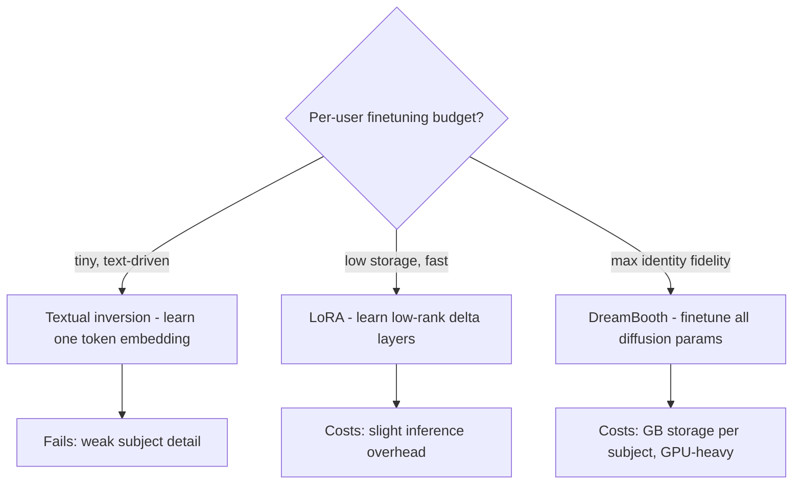
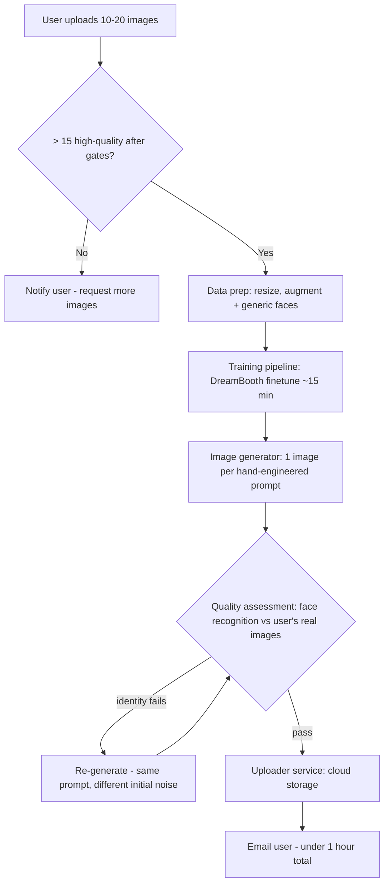

## Personalized Headshot Generation

:::tldr
- Requirements: 10–20 uploads, 1024×1024, 50 headshots per user, async <1 hour, no user prompts, identity fidelity critical.
- Tuning-based over tuning-free: identity preservation is the product; per-user models with richer detail from 10–20 images vs one reference image.
- Method scorecard: textual inversion low effectiveness (one token embedding), LoRA low-rank delta at MB storage, DreamBooth full-parameter finetune — highest identity, GB storage, ~15 min.
- DreamBooth fits here: 15-min finetune inside the SLA; models discarded after delivery, so the GB-per-subject cost never accrues.
- Rare-token identifier `[V]`: common words carry meanings to overwrite, random strings fragment — rare tokens are distinct yet cohesive.
- Loss = α × reconstruction + β × class-specific prior preservation, plus generic "a person" faces in training — learn the instance without destroying the class.
- Quality gate is a face-recognition model: CLIP scores text alignment, DINO fine visual detail, but neither measures identity; failed generations retry with a new seed.
:::

The ML-system-design round sometimes leaves data territory: this is the "adapt, don't retrain" template — pick the smallest finetuning surface that preserves identity, then design evaluation and pipelines around it. The reasoning pattern (method comparison table, offline + online metrics, regenerate-on-quality-failure loop) transfers to any "personalize a foundation model" prompt.

### Requirements Snapshot

Pin these before designing — each one constrains the ML choice (ch10 §Clarifying Requirements):

| Question | Answer | Design consequence |
|---|---|---|
| Use case | Business profiles (LinkedIn) | Professional look, identity fidelity critical |
| User input | 10–20 face images, varied pose/angle | Enough data to finetune, not enough to train from scratch |
| Bad uploads | Detect + ask user for better images | Needs a data-quality gate before training |
| Attribute control (hairstyle etc.) | Not required | Drop editor complexity |
| Resolution | 1024x1024 | Pretrained base already outputs this |
| User text prompts | None | Hand-engineered prompt set instead |
| Output count | 50 images per user | Batch generation, one per prompt template |
| Latency | Async email delivery, < 1 hour end-to-end | ~15 min finetune fits; no real-time constraint |

### Personalization: Tuning-Based vs Tuning-Free

- **Personalization**: adapting a pretrained T2I model to learn a new subject (the user's face) so prompts like "John reading a book" actually depict John (ch10 §Introduction).
- **Tuning-based**: finetune the T2I model per identity — one personalized model per user (ch10 Fig. 3).
- **Tuning-free**: finetune the base model plus a visual encoder **once**; the encoder injects features from a new reference image without touching T2I weights per user — e.g. Meta's Imagine Yourself (ch10 §Choosing a suitable ML approach, [1](https://ai.meta.com/research/publications/imagineyourself-tuning-free-personalized-image-generation/); also [InstantID](https://arxiv.org/abs/2401.07519), [MoA](https://arxiv.org/abs/2404.11565)).

| Dimension | Tuning-free | Tuning-based |
|---|---|---|
| Training | Once, fewer parameters | Per user |
| Deployment | Single shared model | Model (or adapter) per user |
| Input images | One reference image | 10–20 |
| Identity detail | May miss angles/expressions from a single image | Richer, more versatile (any subject type) |
| Subject-specific engineering | Required (special encoders, synthetic paired data) | Not required |

Trade-off call: **tuning-based** wins because identity preservation is the product (ch10 §Choosing a suitable ML approach).

### The Three Tuning-Based Methods

:::scenario Deliver 50 headshots per user in under an hour
@uploads Gate the 10-20 uploads :: Face detection + blur/expression heuristics reject bad images and ask the user — never train on dark, face-less shots
-> fewer than 15 usable => @uploads | fail
-> enough => @method | success
@method Pick the personalization method :: Textual inversion too weak, LoRA lighter on identity; DreamBooth finetunes everything — identity is the product
-> 15-min finetune fits the async SLA => @data | success
@data Prep + generic data :: Resize, mirror/rotate augmentations, mix in pretrained-model "a person" faces to protect the class
-> @token
@token Choose the rare-token identifier :: Common words carry meanings the model must overwrite; random strings fragment — rare tokens are distinct yet cohesive
-> @train
@train DreamBooth with two losses :: alpha x reconstruction on "[V] person" + beta x class-specific prior preservation keeps "a person" renderable
-> identity overfits, class forgotten => @data | fail
-> both losses balanced => @generate | success
@generate One image per hand-engineered prompt :: 50 professional templates, classifier-free guidance, 1024x1024
-> @qa
@qa Face-recognition quality gate :: CLIP/DINO score semantics and detail but not identity — a face model compares against the user's real photos
-> identity fails => @generate | fail
-> pass => @deliver | success
@deliver Retry with a new seed, then ship :: Regenerate failed identities with different initial noise; upload to cloud storage, email the user
-> models discarded after delivery — GB-per-subject storage never accrues => @uploads | success
:::

- **Textual inversion**: add a special token `S*`, train **only its embedding**; diffusion model, text encoder, and other embeddings stay frozen. Generation: prompt "A photo of S* ..." (ch10 §Textual inversion, [4](https://textual-inversion.github.io/)). Lightweight, preserves model capabilities, minimal storage — but a single token embedding lacks capacity for subject detail.
- **DreamBooth**: finetune **all diffusion model parameters** on the subject's images (ch10 §DreamBooth, [5](https://arxiv.org/abs/2208.12242)). Two enabling techniques:
  - **Rare-token identifier**: represent the subject as `[V]`, built from rare vocabulary tokens. A common word ("special") carries an established meaning the model must overwrite; random strings ("xxy5syt00") get tokenized into fragments, each with prior associations. Rare tokens are distinct yet cohesive — the tokenizer treats them as one unit. Recipe: find rare tokens via token frequency distribution → generate a sequence → decode to text ("XyZ", "SKS", "[V]") (ch10 §Rare-token identifier).
  - **Class-specific prior preservation loss**: keeps generic class ability (any human face, not just this one) so full-parameter finetuning doesn't overfit (ch10 §Class-specific prior preservation loss).
- **LoRA**: freeze `W`, learn a low-rank delta `ΔW = AB` with `A ∈ R^(d_out×r)`, `B ∈ R^(r×d_in)`; trainable params drop from `d_in × d_out` to `r × (d_in + d_out)` (ch10 §The mathematics of LoRA, [6](https://arxiv.org/abs/2106.09685)). Megabytes per adapter instead of gigabytes; original model untouched; small inference-time overhead (ch10 §LoRA for T2I personalization).

The scorecard (ch10 Table 1):

| Dimension | Textual Inversion | LoRA | DreamBooth |
|---|---|---|---|
| Learning effectiveness | Low | Moderate | High |
| Required storage | Low | Moderate | High |
| Required training resources | Low | Moderate | High |
| Maintains original model capabilities | Yes | Yes | No |

### Why DreamBooth for Headshots

Requirements decide, not leaderboard rank (ch10 §Which method is more suitable for headshot generation?):

1. **Better identity preservation** — the product promise.
2. **~15 min finetune** fits the < 1 hour delivery SLA.
3. **Storage concern void** — personalized models are discarded after generating the 50 headshots, so the GB-per-subject cost never accrues.

### Data Preparation

Three steps turn heterogeneous uploads into training data (ch10 §Data Preparation):

- **Image resizing**: diffusion models need fixed input dimensions; uploads vary.
- **Image augmentation**: mirroring, slight rotations, scaling — artificial expansion is essential when only 10–20 real images exist.
- **Generic face data addition**: mix in a larger generic face set generated by the pretrained model ("an image of a person") to prevent overfitting to one identity and forgetting prior knowledge.

### Training, Loss & Sampling

- Architecture unchanged: U-Net, downsampling then upsampling blocks, pretrained for 1024x1024 (ch10 §Architecture).
- Training loop = standard diffusion: random-timestep noise addition → encode caption + timestep → predict noise (ch10 §Training).
- Labels: subject images "An image of a [V] person"; generic images "An image of a person" (ch10 §Training data).
- **Overall loss = α × reconstruction loss + β × class-specific prior preservation loss** — reconstruction preserves the identity, prior preservation keeps the human class intact; α, β trade the two (ch10 Fig. 12).
- **Sampling**: users give no prompts, so a hand-engineered prompt set covers professional settings ("A professional headshot of [V] smiling in front of a plain white background", profile shots, formal attire...); one image per prompt, iterative denoising with **classifier-free guidance (CFG)** ([8](https://arxiv.org/abs/2207.12598)) (ch10 §Sampling).

### Evaluation

| Aspect | What it measures | Metrics |
|---|---|---|
| Text alignment | Image matches prompt | CLIPScore |
| Image quality | Realism/quality | FID, Inception score |
| Image alignment (identity) | Generated image resembles the subject | CLIP score (image-encoder cosine sim), DINO/DINOv2 score, facial similarity score |

- **DINO vs CLIP**: DINO (self-supervised, contrastive) captures fine visual detail — yellow vs red jacket scores low DINO but high CLIP, since both show "a person wearing a jacket". Use DINO for image-to-image, CLIP for image-to-text ([13](https://arxiv.org/abs/2104.14294), [15](https://arxiv.org/abs/2304.07193)) (ch10 §DINO versus CLIP).
- **Facial similarity score**: CLIP/DINO can score different faces as similar — neither measures identity. A pretrained face recognition model closes that gap; combining all three gives full coverage (ch10 §Facial similarity score).
- **Online metrics**: user satisfaction rating 1–5 after delivery; conversion rate to paid (new paying customers ÷ engaged users) — satisfaction drives revenue in a paid service (ch10 §Online evaluation metrics).

### Overall ML System Design

- **Data pipeline gates**: face detection, quality assessors (blur detection, facial expression, heuristics) reject unclear/non-diverse/not-single-subject images before training (ch10 §Data pipeline, Fig. 16).
- **Inference loop**: generate → verify identity → regenerate with new seed on failure — quality assessment is a feedback gate, not a post-hoc report (ch10 §Inference pipeline).

### Failure modes & anti-patterns

- **Common-word identifier** ("special"): established meaning fights the new one — model can't cleanly bind the token to the subject (ch10 §Rare-token identifier).
- **Random-string identifier** ("xxy5syt00"): tokenizer fragments it into characters with prior associations — outputs contaminated by fragment meanings (ch10 §Rare-token identifier).
- **Finetuning on user images alone**: overfits the identity, forgets the generic face class — can't render "a person" anymore; fix with generic data + prior preservation loss (ch10 §Generic face data addition, §Overall loss).
- **Trusting CLIP/DINO for identity**: two different faces can score high — identity checks need a face recognition model (ch10 §Facial similarity score).
- **Ignoring bad uploads**: dark or face-less images poison finetuning; gate at ingestion and ask the user, don't train anyway (ch10 §Clarifying Requirements, §Data pipeline).
- **Skipping the regeneration loop**: a failed identity check shipped anyway is a deepfake-quality bug the user sees; re-sample with different initial noise instead (ch10 §Quality assessment service).

:::cards
Q: Why tuning-based over tuning-free? :: Identity preservation is the product — 10–20 images give richer identity than one reference image.
Q: Rank the three methods by identity fidelity. :: DreamBooth (full finetune) > LoRA (low-rank delta) > textual inversion (one token embedding).
Q: Why DreamBooth despite GB-per-subject storage? :: 15-min finetune fits the <1h async SLA and models are discarded after the 50 headshots.
Q: Why a rare token instead of a common word? :: Common words carry meanings the model must overwrite; rare tokens are distinct yet tokenizer-cohesive.
Q: Name the two DreamBooth losses. :: Reconstruction on "[V] person" plus class-specific prior preservation on "a person".
Q: Why add generic face images to training? :: Prevents overfitting to one identity and forgetting the generic face class.
Q: Why isn't CLIP enough for identity? :: CLIP/DINO score semantics and detail, not identity — a face recognition model closes the gap.
:::

### Key Takeaways

- Personalization = adapting a pretrained T2I model to a subject; choose tuning-based vs tuning-free by identity-fidelity needs and per-user cost, not novelty.
- Method choice is requirement-driven: DreamBooth wins here because identity quality is the product, 15 min fits the SLA, and discarding models erases its storage weakness.
- The identifier token is a real design decision — rare tokens balance distinctness against tokenizer cohesion.
- Two-loss training (reconstruction + class-specific prior preservation) is the general pattern for "learn the instance without destroying the class".
- Evaluate on three axes — text alignment, image quality, image/identity alignment — and gate inference with a face-recognition regenerate loop.

### Interview Lens

- When asked to "pick a personalization method", answer with the SLA math: DreamBooth's 15-min finetune + 50-image generation inside a 1-hour async budget; mention you'd switch to LoRA if models had to persist.
- Volunteer the DINO-vs-CLIP jacket example when evaluation comes up — it shows you know why one metric is never enough, then add face recognition as the identity-specific gate.
- Map "what if generation quality is bad?" to the seed-retry loop and the 1–5 satisfaction metric — operational answer, not model-retraining answer.
- Deepfake risk and PII handling in finetuning data are the expected bonus-round topics (ch10 §Other Talking Points, [18](https://arxiv.org/abs/2311.17394), [20](https://arxiv.org/abs/2307.16382)).
