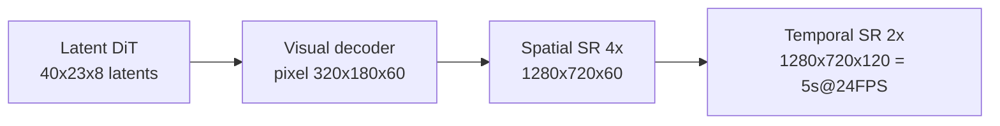
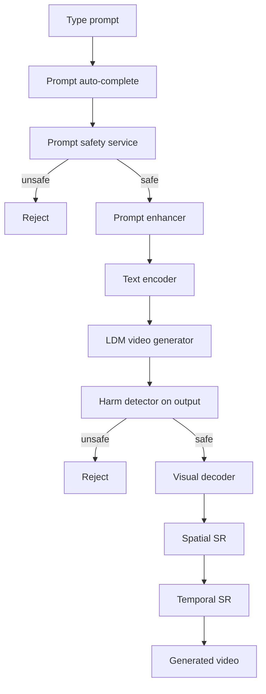

## Text-to-Video Generation

Text-to-video is text-to-image with a time axis: 5 s at 24 FPS = 120 frames, and every design choice (latent compression, temporal layers, super-resolution) exists to keep that multiplier affordable. One system, built end-to-end: requirements → LDM → DiT → evaluation → inference pipeline (ch11 §Introduction, §Model Development).

### Clarifying Requirements (the interview script)

- **Output spec:** 5-second, 720p (1280×720), 24 FPS silent videos; a few minutes of generation latency acceptable initially (ch11 §Clarifying Requirements).
- **Data & compute:** ~100M video–caption pairs (some noisy/non-English captions); >6000 H100 GPUs; pretrained text-to-image model available to extend (ch11 §Clarifying Requirements).
- **Scope guards:** all genres, English-only prompts, audio deferred, safety safeguards mandatory (ch11 §Clarifying Requirements).

### Why Latent Diffusion (LDM), Not Pixel Diffusion

- **Cost of naive scaling:** a 512×512 image ≈ 1 s on an H100; a 720p frame has ~3.6× more pixels, so a 5 s 720p video in pixel space ≈ **7 minutes** (ch11 §Choosing a suitable ML approach).
- **LDM idea:** train the diffusion model to denoise compressed **latent representations** instead of pixels; compression network is a separately trained **VAE** (visual encoder → latents, visual decoder → pixels) ([Stable Diffusion](https://arxiv.org/abs/2112.10752), ch11 §Compression network).
- **Compression math:** factor 8 in both spatial and temporal dims: 1280×720×120 frames (110,592,000 px) → 160×90×15 (216,000 px) = **512× smaller**, so training is 512× cheaper (ch11 §LDM, Fig. 6).
- **Generation loop:** random latent noise → iteratively denoise conditioned on text-encoder embeddings → visual decoder maps latents back to pixels (ch11 §Sampling, Fig. 22).

### Data Preparation

- **Video filtering:** drop low-resolution/short/slow-motion/compression-artifact clips (Movie Gen practice), deduplicate ([LAION dedup](https://arxiv.org/abs/2303.12733)), remove harmful videos with harm-detection models (ch11 §Filter inappropriate videos).
- **Standardization:** split into 5 s clips, re-encode to 24 FPS, resize/crop to 1280×720 (ch11 §Standardize videos).
- **Precompute latents:** running frames through the VAE every training step is too slow — cache latents for all videos. Back-of-envelope: 1000-frame video ≈ 1000 MB → 2 MB latent; 100M videos → **~200 TB**, manageable vs training time saved (ch11 §Precompute video representations).
- **Caption prep:** generate captions for missing/non-English ones and **re-caption** existing ones with video captioners (LLaMa3-Video, LLaVA) — Sora showed re-captioning is essential for text alignment; precompute caption embeddings with the text encoder (ch11 §Caption preparation).

### Architecture: U-Net vs DiT

- **Image U-Net is spatial-only:** Conv2D + cross-attention blocks model within-frame relations; extending to video means interleaving **temporal attention** (attend across frames) and **temporal convolution** (3D conv) into every down/up block (ch11 §U-Net for videos, Fig. 11-13).
- **DiT pipeline:** patchify (3D patches for video) → positional encoding → Transformer with cross-attention on text conditioning → unpatchify (LayerNorm → linear → reshape) (ch11 §DiT for videos, Fig. 14-19).

| Dimension | U-Net | DiT |
|---|---|---|
| Backbone | Convolutions + temporal attn/conv layers | Pure Transformer (patchify/unpatchify) |
| Maturity | Longer-tested; Stable Video Diffusion, Emu Video | Newer, superior results; Sora, Movie Gen |
| Scaling | Around longer, extensively tested — no scaling claim made | Scales with data + compute (Transformer property) |
| Modality flexibility | Needs temporal modules interleaved | Easy — sequences accept any patch type |
| Pick | — | **DiT** (follows Sora) |

(ch11 §U-Net vs. DiT)

- **Positional encoding:** no single best scheme — 1D vs 3D coordinates must be validated empirically; follow OpenSora's **RoPE** choice ([RoPE](https://arxiv.org/abs/2104.09864), ch11 §Positional encoding).

### Training

- **One iteration:** sample timestep → add noise to latents → DiT predicts the noise (conditioned on text + timestep) → **MSE reconstruction loss** against the actual noise (ch11 §Training).
- **Video–text data scarcity:** two remedies — (1) treat every image as a single-frame video and train jointly on image+video data, or (2) pretrain on image–text, finetune on video–text. Pick (1): one training stage (ch11 §Lack of large-scale video–text training data, Fig. 20).

| Cost lever | Mechanism | Source |
|---|---|---|
| LDM | Denoise 512× smaller latents, not pixels | ch11 §Computational cost |
| Precomputed latents | Skip per-iteration VAE encoding | ch11 §Computational cost |
| Spatial SR | Generate 720p, upscale to 1080p/4K separately | [Imagen Video](https://arxiv.org/abs/2210.02303) |
| Temporal SR | Generate 60 frames @12 FPS, interpolate to 120 @24 FPS | [Imagen Video](https://arxiv.org/abs/2210.02303) |
| Efficient attention + MoE | Near-linear attention ([HyperAttention](https://arxiv.org/abs/2310.05869)); sparse expert compute | ch11 §Computational cost |
| Distributed training | Tensor parallelism across devices | ch11 §Computational cost |

:::scenario Generate 5-second 720p video from a prompt
@frame Count the frames :: 5 s at 24 FPS = 120 frames — pixel-space diffusion is ~7 minutes per video; that multiplier drives every choice
-> compress => @ldm
@ldm Denoise latents, not pixels :: VAE compresses 8x spatial and 8x temporal — 512x smaller, diffusion runs entirely in latent space
-> @arch
@arch Pick DiT over U-Net :: 3D patchify + Transformer scales with data and compute; Sora and Movie Gen both chose it
? Paired video-text data scarce => @cache | fail
-> images folded in as single-frame videos => @cache | success
@cache Precompute all latents :: 100M videos -> ~200 TB cached — per-step VAE encoding would stall every training iteration
-> @sample
@sample Denoise conditioned on text :: Random latent noise, text-encoder cross-attention, MSE against the true noise
-> frame metrics only => @eval | fail
-> FVD tracked => @eval | success
@eval Judge motion, not just frames :: FID/IS miss flicker — FVD over I3D features catches temporal consistency; CLIP similarity checks alignment
-> @safety
@safety Gate both ends :: Prompt safety service before generation, harm detector on output — a single gate trusts the model to be safe
-> safe => @sr | success
@sr Restore resolution and frame rate :: Spatial SR to 720p and temporal SR 12 -> 24 FPS — the base model generates low-res, low-FPS
-> @ship
@ship Serve and monitor :: CTR, time on page, conversion — plus pairwise human votes for subjective quality
:::

(ch11 Fig. 21)

### Evaluation

- **Benchmarks:** VBench and Movie Gen Bench — curated prompts probing motion coherence, temporal consistency, scene complexity ([VBench](https://vchitect.github.io/VBench-project/), ch11 §Offline evaluation metrics).

| Axis | Metric | How it works | Blind spot |
|---|---|---|---|
| Frame quality | FID, IS (avg over frames; also LPIPS, KID) | Per-frame image metrics | Ignores motion — sharp frames, jerky video |
| Temporal consistency | FVD (lower = better) | I3D features → Fréchet distance between generated vs real video distributions | — |
| Video–text alignment | CLIP similarity | Per-frame CLIP image features vs text features, cosine sim, averaged/maxed | — |

(ch11 §Offline evaluation metrics)

- **Human evaluation:** pairwise preference between two models on alignment, quality, consistency — automated metrics alone don't capture subjective quality (ch11 §Human evaluation).
- **Online:** CTR, time on page, user feedback, conversion rate (ch11 §Online evaluation metrics).

### Inference Pipeline

(ch11 §Inference pipeline, Fig. 24)

- **Safety is double-gated:** prompt safety *before* generation, harm detector *after* — filtering only at the prompt trusts the model to be safe (ch11 Fig. 24).
- **Unique components vs text-to-image (ch9):** visual decoder (latents → pixels) and temporal super-resolution (frame interpolation for smooth motion) (ch11 §Inference pipeline).

### Failure modes & anti-patterns

- **Pixel-space diffusion at 720p/120 frames:** ~7 min per video on an H100 — training and inference intractable; symptom: compute budget blown before scale-up. Fix: LDM (ch11 §Choosing a suitable ML approach).
- **Encoding latents on the fly during training:** per-step frame extraction + VAE passes stall every iteration; symptom: diffusion training dominated by data preprocessing. Fix: precompute + cache all latents (~200 TB) (ch11 §Precompute video representations).
- **Judging videos by FID/IS alone:** high frame quality with no temporal coherence passes frame metrics; symptom: flickery videos score well. Fix: FVD for temporal consistency (ch11 §Frame quality).
- **Reusing image U-Net unchanged:** layers are within-frame only; symptom: inconsistent motion across frames. Fix: interleave temporal attention + temporal convolution (ch11 §U-Net for videos).
- **Training only on video–text pairs:** paired video data is scarce; symptom: undertrained visual foundation. Fix: fold in image–text data as single-frame videos (ch11 §Lack of large-scale video–text training data).
- **Training DiT at target resolution:** 1080p/4K multiplies cost; fix: generate low-res/low-FPS, restore with spatial + temporal SR (ch11 §Computational cost).
- **Trusting noisy/short source captions:** misaligned conditioning degrades text alignment; fix: re-caption with LLaVA/LLaMa3-Video (ch11 §Caption preparation).
- **Single safety gate:** harmful generations slip past prompt filtering; fix: prompt safety service + output harm detector (ch11 §Inference pipeline).

### Key Takeaways

- Video = 120 frames of image cost; the whole design (LDM, SR, precomputed latents) is about collapsing that multiplier — quote the 512× latent compression and 7-min pixel-space figure.
- DiT over U-Net for new builds: Transformer scaling and modality flexibility — Sora and Movie Gen both chose it; U-Net remains valid (SVD, Emu Video).
- Data prep is a systems problem: filter → standardize → cache latents → re-caption; 200 TB of cached latents buys training speed.
- Evaluate on three axes — frame quality (FID/IS), temporal consistency (FVD), alignment (CLIP) — plus pairwise human eval; none of the three metrics covers the others.
- Safety gates exist on both ends of the inference pipeline, not just the input.

### Interview Lens

- When asked "why not just run text-to-image 120 times?": answer with temporal consistency (flicker) plus compute — then land on LDM's 512× compression as the enabling trick.
- Volunteer the arithmetic unprompted: 24 FPS × 5 s = 120 frames; 8×8×8 compression → 15 latent frames; it signals you reason about cost, not just architecture.
- If challenged on training data: name both image-data strategies and the trade-off (joint training = one stage; pretrain+finetune = stronger visual foundation first).
- Pre-compute the "make it faster" answer: spatial SR, temporal SR, efficient attention, MoE, distributed training — order them by which you'd do first and why.
